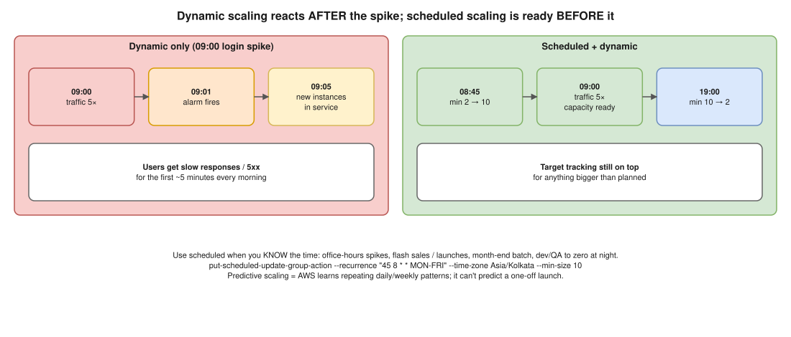

# AWS 05 · When Is Scheduled Scaling Better Than Dynamic Scaling?



> **Say this first:** "Dynamic scaling **reacts**: the load arrives, a metric crosses a threshold, and only then do instances start booting, so for a few minutes users get slow responses. When I **know** when the load comes, scheduled scaling is better because the capacity is already warm when it arrives. Classic example: a payroll or stock-trading app where everyone logs in at **9:00 on weekdays**, or a sale that starts at **midnight on a fixed date**. I schedule the minimum up at 8:45 and back down at 19:00, and keep target tracking running on top for anything unexpected. The other use is cost: scale dev/test environments **to zero at night and weekends**."

## Scenarios where scheduled wins

| Scenario | Why dynamic isn't enough | Scheduled action |
|---|---|---|
| Office hours app: logins spike at 09:00 Mon–Fri | Spike is steep; 3–5 min boot = slow first minutes every morning | `min=10` at 08:45, `min=2` at 19:00 (time zone set!) |
| Flash sale / ticket release / product launch at a known time | Traffic goes 0 → 50× in seconds; reactive scaling can't catch it | Raise min the hour before, lower after |
| Month-end / payroll batch jobs | Known date, heavy compute | Scale the batch ASG on the 30th |
| Dev / QA environments | Nobody uses them at night | `min=max=desired=0` at 20:00, back at 08:00 → ~65% saving |
| Known marketing push (TV ad, newsletter at 10:00) | Very sharp spike | Pre-warm before it goes out |

**Also pre-warm what's in front:** for a truly huge, sudden event, think about the database (scale up the instance or add read replicas before), caches, and ask AWS support about load balancer pre-warming if the jump is extreme.

## Use both together

- Scheduled actions change **min / max / desired**; dynamic policies keep working inside those limits.
- So: scheduled sets the floor for the known peak, **target tracking** handles surprises above it, and **predictive scaling** is the middle ground (it learns daily/weekly cycles from history and scales ahead automatically).
- A scheduled action can be **one-time** (`--start-time`) or **recurring** (`--recurrence` cron, in UTC unless you set `--time-zone`).

```bash
# Weekday morning scale-up (IST)
aws autoscaling put-scheduled-update-group-action \
  --auto-scaling-group-name web-prod \
  --scheduled-action-name weekday-morning \
  --recurrence "45 8 * * MON-FRI" --time-zone "Asia/Kolkata" \
  --min-size 10 --desired-capacity 10

# Evening scale-down
aws autoscaling put-scheduled-update-group-action \
  --auto-scaling-group-name web-prod \
  --scheduled-action-name weekday-evening \
  --recurrence "0 19 * * MON-FRI" --time-zone "Asia/Kolkata" \
  --min-size 2

aws autoscaling describe-scheduled-actions --auto-scaling-group-name web-prod
```

```hcl
# (illustrative)
resource "aws_autoscaling_schedule" "dev_off" {
  scheduled_action_name  = "dev-off-at-night"
  autoscaling_group_name = aws_autoscaling_group.dev.name
  recurrence             = "0 20 * * *"
  time_zone              = "Asia/Kolkata"
  min_size               = 0
  max_size               = 0
  desired_capacity       = 0
}
```

**Kubernetes version of the same idea:** KEDA's `cron` scaler or a CronJob that patches HPA `minReplicas` before the peak; for nodes, a scheduled ASG action or over-provisioning pods. See [K8s 04](../kubernetes/04-hpa-too-slow.md).

## Resume check

Fine for your AWS background. KEDA is not on your resume; mention it as an option only.

## Real-world example (suggested story, adapt it to what you really did)

"Our dev and staging EKS node groups ran 24/7. I added scheduled ASG actions to scale them to zero at 21:00 and back at 08:00 on weekdays, and kept them off on weekends. That cut that part of the bill by more than half." Only say it if you did it or something close.

## Follow-up questions

**Q: What's the risk of scheduled scaling alone?**
The event moves or is bigger than planned, and you're under capacity; or you scale down while traffic is still high. Keep dynamic scaling on top.

**Q: Scheduled vs predictive?**
Scheduled = you know the calendar (a launch date). Predictive = the pattern repeats and AWS learns it; it can't predict a one-off launch.

**Q: Which time zone do schedules use?**
UTC by default; set `--time-zone` (IANA name like `Asia/Kolkata`), which also handles daylight saving where it applies.

## 🎯 Drill: type this from memory

1. `aws autoscaling put-scheduled-update-group-action --auto-scaling-group-name <asg> --scheduled-action-name <n> --recurrence "45 8 * * MON-FRI" --time-zone Asia/Kolkata --min-size 10`
2. The `aws_autoscaling_schedule` block for dev-off-at-night.
3. Three scenarios: office-hours spike, flash sale, dev environments at night.

## 🗣️ 30-second spoken answer

1. Dynamic reacts after the spike, so the first minutes are slow.
2. Known time → schedule capacity before it (09:00 logins, midnight sale).
3. Also for cost: dev to zero at night.
4. Keep target tracking on top for surprises; predictive for repeating patterns.
