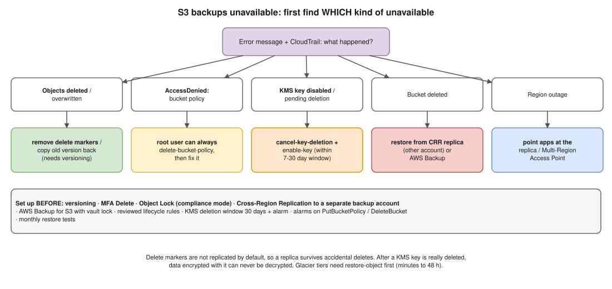

# AWS 06 · S3 Bucket With Critical Backups Becomes Unavailable



> **Say this first:** "'Unavailable' can mean four different things, and the recovery depends on which: **objects deleted or overwritten** (restore old versions if **versioning** is on), **access denied** (someone changed the bucket policy, or the **KMS key** was disabled or scheduled for deletion), the **bucket itself deleted**, or a **regional S3 problem**. So first I check the error and CloudTrail. Recovery comes from what we set up **before**: versioning, **Cross-Region Replication** to a bucket in another region and ideally **another account**, **Object Lock** so backups can't be deleted, and **AWS Backup** for S3. If none of that existed, the honest answer is the data may be gone, and the lesson is to set it up now."

## Step 1: what kind of unavailable?

| Symptom / error | Likely cause | Check |
|---|---|---|
| `NoSuchKey`, files missing, listing empty | Objects deleted (delete markers) or lifecycle rule expired them | `list-object-versions`, CloudTrail `DeleteObject`, lifecycle config |
| `AccessDenied` for everyone | Bucket policy changed (explicit Deny), Block Public Access/ACL change, SCP | `get-bucket-policy`, CloudTrail `PutBucketPolicy` |
| `AccessDenied` / `KMS.DisabledException` / `KMS.KMSInvalidStateException` | SSE-KMS key disabled or **pending deletion** | `aws kms describe-key` → `KeyState` |
| `NoSuchBucket` | Bucket deleted | CloudTrail `DeleteBucket` |
| 5xx / timeouts, AWS Health event | Regional S3 issue | AWS Health Dashboard, try another region |
| Ransomware-style: objects replaced with encrypted copies | Compromised credentials | CloudTrail, GuardDuty S3 protection |

## Step 2: recover, by cause

**Deleted objects (versioning on):** a delete only adds a **delete marker**. Remove the marker or copy the previous version back.

```bash
aws s3api list-object-versions --bucket acme-backups --prefix db/2026-11-11/
# Remove the delete marker → the previous version becomes current again
aws s3api delete-object --bucket acme-backups --key db/2026-11-11/dump.sql.gz \
  --version-id <DELETE_MARKER_VERSION_ID>
# Or copy an older version back on top
aws s3api copy-object --bucket acme-backups --key db/dump.sql.gz \
  --copy-source "acme-backups/db/dump.sql.gz?versionId=<OLD_VERSION_ID>"
```

**Locked out by a bucket policy:** the account **root user** can always delete a bucket policy (`aws s3api delete-bucket-policy`), even one that denies everyone. Then put the correct policy back.

**KMS key disabled / pending deletion:** `aws kms enable-key` or `aws kms cancel-key-deletion` (possible during the 7–30 day waiting period) then `enable-key`. After the key is actually deleted, the data encrypted with it **cannot be decrypted**.

**Bucket deleted:** a bucket must be empty to delete, so with versioning that means every version was deleted. Recover from the **replica** (CRR bucket) or **AWS Backup** recovery point. Recreate the bucket (names are global; someone else could take the name).

**Regional outage:** point the restore jobs / apps at the **CRR replica** in the other region, or use an **S3 Multi-Region Access Point** with failover controls.

**Archived data:** objects in Glacier Flexible Retrieval / Deep Archive need `restore-object` first (minutes to 48 hours depending on tier).

## Step 3: what should have been there (and what I'd set up now)

| Control | Protects against |
|---|---|
| **Versioning** | Accidental delete/overwrite |
| **MFA Delete** (root only, CLI) | Deleting versions without MFA |
| **Object Lock** (compliance mode, retention e.g. 35 days) | Anyone, even root, deleting/overwriting during retention → ransomware protection |
| **Cross-Region Replication** to a bucket **in a separate backup account** | Region outage, compromised production account |
| **AWS Backup for S3** (with vault lock) | Point-in-time restore, central policy |
| **Lifecycle rules** reviewed | Rules expiring the data you need |
| **KMS key policy** + deletion window 30 days + alarm on `ScheduleKeyDeletion` | Key loss |
| **Bucket policy guard** + alarms on `PutBucketPolicy`, `DeleteBucket` (EventBridge/CloudTrail) | Lockouts, malicious changes |
| **Restore tests** (monthly) | Backups that don't actually restore |

## Resume check

S3, KMS, CloudTrail are core AWS. Don't claim you've used **Object Lock / AWS Backup for S3 / Multi-Region Access Points** unless you have; present them as the design.

## Real-world example (suggested story, adapt it to what you really did)

"A cleanup script ran with the wrong prefix and deleted a week of database dumps from our backup bucket. Versioning was on, so I listed the object versions, removed the delete markers with a short script and everything came back in 20 minutes. Afterwards we restricted the script's IAM role to its own prefix and turned on Object Lock for the backup bucket." Only use if it fits your experience.

## Follow-up questions

**Q: Does S3 replication copy deletes?**
Delete markers are **not** replicated by default (you can enable delete marker replication for V2 rules); deletes of a specific version are never replicated. That's why a replica protects against accidental deletes.

**Q: Versioning vs Object Lock?**
Versioning keeps old versions but anyone with permission can delete them. Object Lock (compliance mode) prevents deletion for the retention period, even by root.

**Q: How do you know your backups work?**
Restore them on a schedule into a test environment and check the data, with an alert if the restore job fails.

## 🎯 Drill: type this from memory

1. `aws s3api list-object-versions --bucket <b> --prefix <p>`
2. `aws s3api delete-object --bucket <b> --key <k> --version-id <marker-id>`
3. `aws kms cancel-key-deletion --key-id <id>` then `aws kms enable-key --key-id <id>`
4. `aws s3api delete-bucket-policy --bucket <b>` (as root)
5. The controls table: versioning, Object Lock, CRR to another account, AWS Backup, restore tests.

## 🗣️ 30-second spoken answer

1. Find out why: deleted, access denied, KMS key, bucket gone, region down (CloudTrail).
2. Deleted → remove delete markers / restore versions.
3. Policy lockout → root deletes the policy. KMS → cancel deletion, enable key.
4. Bucket/region gone → restore from CRR replica or AWS Backup.
5. Prevent: versioning, Object Lock, cross-account replication, restore tests.
