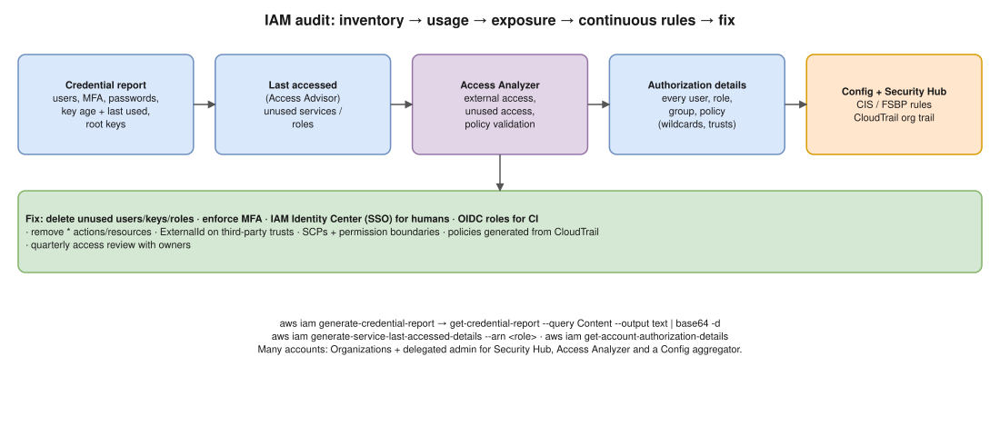

# AWS 07 · Audit All IAM Users and Roles for Compliance ⭐



> **Say this first:** "I split it into a one-time audit and continuous compliance. One-time: the **IAM credential report** shows every user, whether they have MFA, console passwords and access key age and last use. **Last accessed information** (Access Advisor) shows which permissions and roles aren't used. **IAM Access Analyzer** finds resources shared outside the account or organization, **unused** roles, keys and permissions, and validates policies. `get-account-authorization-details` dumps every user, role, group and policy for review. Continuous: **AWS Config** rules and **Security Hub** (CIS benchmark, Foundational Security Best Practices) flag violations every day, and **CloudTrail** records who did what. Then I fix: remove unused users and keys, enforce MFA, replace IAM users with **IAM Identity Center** SSO and roles, and tighten wildcards."

## The tools and what each answers

| Question the auditor asks | Tool | Command / where |
|---|---|---|
| Which users exist, MFA on? password age? access keys age and last used? root key? | **IAM credential report** (CSV) | `aws iam generate-credential-report` then `get-credential-report` |
| Which services/actions did this role/user actually use, and when? | **Last accessed information** (Access Advisor) | `generate-service-last-accessed-details` / console "Access Advisor" tab |
| What is shared outside my account/org (S3, KMS, roles, Lambda…)? | **IAM Access Analyzer – external access** | Analyzer with zone of trust = account or organization |
| Which roles, users, keys, passwords and permissions are unused? | **IAM Access Analyzer – unused access** (paid) | Findings per principal |
| Is this policy valid / too broad? | Access Analyzer **policy validation**, custom policy checks | `aws accessanalyzer validate-policy` |
| Full inventory of every policy attachment | **Account authorization details** | `aws iam get-account-authorization-details` |
| Are rules followed every day? | **AWS Config** managed rules + conformance packs | e.g. `iam-user-mfa-enabled`, `access-keys-rotated`, `iam-root-access-key-check`, `iam-password-policy`, `iam-user-unused-credentials-check`, `iam-policy-no-statements-with-admin-access` |
| Overall score vs CIS | **Security Hub** CIS AWS Foundations Benchmark / AWS FSBP | Dashboard, findings |
| Who did what, when? | **CloudTrail** (org trail to a locked S3 bucket) + Athena / CloudTrail Lake | Event history |
| Across all accounts | **Organizations** + delegated admin for Access Analyzer, Config aggregator, Security Hub | One view |

```bash
aws iam generate-credential-report
aws iam get-credential-report --query Content --output text | base64 -d > cred-report.csv
# Users without MFA
awk -F, 'NR>1 && $8=="false" {print $1}' cred-report.csv   # column 8 = mfa_active

# Access keys and when they were last used
aws iam list-access-keys --user-name alice
aws iam get-access-key-last-used --access-key-id AKIA...

# What a role actually uses
JOB=$(aws iam generate-service-last-accessed-details \
  --arn arn:aws:iam::111122223333:role/app-role --query JobId --output text)
aws iam get-service-last-accessed-details --job-id "$JOB"

# Everything in one JSON for review
aws iam get-account-authorization-details > iam-dump.json

# External / unused access findings
aws accessanalyzer list-analyzers
aws accessanalyzer list-findings-v2 --analyzer-arn <arn>
```

## What I look for (the findings list)

1. **Root user**: access keys exist? MFA on? Used recently? (Should be no keys, hardware MFA, almost never used.)
2. **IAM users without MFA**, especially with console access.
3. **Access keys older than 90 days** or **never used / unused for 90 days** → rotate or delete.
4. **Inactive users** (no login, no key use for 90 days) → disable, then delete.
5. **Wildcards**: `"Action": "*"`, `"Resource": "*"` on non-admin roles, `iam:PassRole` on `*`, `AdministratorAccess` attached to people.
6. **Trust policies**: roles trusting external accounts **without an `ExternalId`**, or trusting `"AWS": "*"`.
7. **Inline policies** (hard to see) vs managed.
8. **Unused roles** (last used > 90 days).
9. **Password policy** (length, reuse).
10. **Humans with long-term keys** → move to Identity Center + temporary credentials; CI → OIDC roles (GitLab/GitHub), not keys.

## Fix and prevent

- **IAM Identity Center** (SSO) with permission sets per team; no IAM users for humans.
- **SCPs** in Organizations: deny leaving the org, deny disabling CloudTrail/Config/GuardDuty, deny creating IAM users/keys except a break-glass path, region restrictions.
- **Permission boundaries** for roles teams create themselves.
- Generate least-privilege policies from CloudTrail activity (**Access Analyzer policy generation**).
- **Quarterly access review** with owners signing off; evidence = credential report + Security Hub export.
- IaC: IAM in Terraform, reviewed in MRs, checked by checkov/tfsec rules.

## Resume check

IAM, CloudTrail, Terraform are part of your AWS work. **Security Hub / Access Analyzer unused access / Config conformance packs** may not be; say "I'd enable" unless you used them. Don't overclaim SOC2/PCI audit ownership.

## Real-world example (suggested story, adapt it to what you really did)

"Before a security review at Koko I pulled the credential report and found eight IAM users with keys older than a year, two never used, and CI using a static access key. We deleted the unused ones, moved CI to GitLab OIDC with a role, enforced MFA with a deny-unless-MFA policy, and turned on Config rules so new violations show up the next day." Only say what you really did.

## Follow-up questions

**Q: How do you find permissions a role has but doesn't use?**
Last accessed information (service and, for some services, action level) or Access Analyzer unused access findings, then remove them; or generate a policy from CloudTrail activity.

**Q: How do you enforce MFA?**
For humans: Identity Center with MFA required. For legacy IAM users: a policy that denies everything except managing their own MFA when `aws:MultiFactorAuthPresent` is false. Config rule to detect.

**Q: How do you audit 50 accounts?**
Organizations + delegated administrator for Security Hub, Access Analyzer (org zone of trust) and a Config aggregator; an organization CloudTrail.

## 🎯 Drill: type this from memory

1. `aws iam generate-credential-report` → `aws iam get-credential-report --query Content --output text | base64 -d`
2. `aws iam get-access-key-last-used --access-key-id <id>`
3. `aws iam generate-service-last-accessed-details --arn <role-arn>` → `get-service-last-accessed-details --job-id <id>`
4. `aws iam get-account-authorization-details`
5. The 10-item findings list, from root user to humans with keys.

## 🗣️ 30-second spoken answer

1. Credential report: users, MFA, key age and last use, root.
2. Last accessed + Access Analyzer: unused permissions, external sharing.
3. Authorization details dump to review wildcards and trust policies.
4. Continuous: Config rules + Security Hub CIS, CloudTrail, org-wide.
5. Fix: Identity Center, OIDC for CI, delete unused, SCPs, quarterly review.
