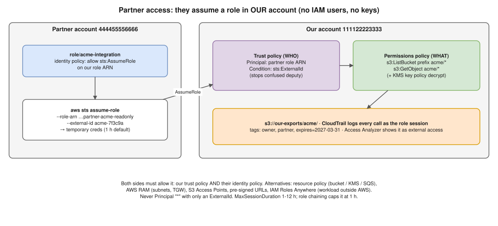

# AWS 08 · Grant Cross-Account Access to a Partner ⭐



> **Say this first:** "Never create an IAM user and hand over access keys. I create an **IAM role in our account** whose **trust policy** allows only the **partner's AWS account** (or a specific role in it) to assume it, with an **`sts:ExternalId` condition** to prevent the confused-deputy problem. The role's **permissions policy** is least privilege, for example read-only on one S3 prefix. The partner calls **`sts:AssumeRole`** and gets **temporary credentials** (1 hour by default). Everything they do is in **CloudTrail** under that role. For some services I can instead use a **resource-based policy** (S3 bucket policy, KMS key policy) or **AWS RAM** sharing. And I set an expiry/review date and monitor it with Access Analyzer."

## How it works

1. **Partner** gives us their **account ID** (and ideally the role ARN that will assume ours).
2. **We** create role `partner-acme-readonly` with:
   - **Trust policy** (who can assume): the partner's account/role + `sts:ExternalId` condition.
   - **Permissions policy** (what they can do): only what's needed.
   - `MaxSessionDuration` (1–12 h).
3. **Partner** grants their own user/role permission to call `sts:AssumeRole` on our role ARN (both sides must allow it).
4. Partner assumes the role → temporary `AccessKeyId`, `SecretAccessKey`, `SessionToken`.

```json
{
  "Version": "2012-10-17",
  "Statement": [{
    "Effect": "Allow",
    "Principal": { "AWS": "arn:aws:iam::444455556666:role/acme-integration" },
    "Action": "sts:AssumeRole",
    "Condition": { "StringEquals": { "sts:ExternalId": "acme-7f3c9a" } }
  }]
}
```

```json
{
  "Version": "2012-10-17",
  "Statement": [
    { "Effect": "Allow", "Action": "s3:ListBucket",
      "Resource": "arn:aws:s3:::our-exports",
      "Condition": { "StringLike": { "s3:prefix": "acme/*" } } },
    { "Effect": "Allow", "Action": "s3:GetObject",
      "Resource": "arn:aws:s3:::our-exports/acme/*" }
  ]
}
```

```bash
# Partner side
aws sts assume-role \
  --role-arn arn:aws:iam::111122223333:role/partner-acme-readonly \
  --role-session-name acme-sync --external-id acme-7f3c9a

# Or in ~/.aws/config
# [profile ourco]
# role_arn = arn:aws:iam::111122223333:role/partner-acme-readonly
# source_profile = default
# external_id = acme-7f3c9a
aws s3 ls s3://our-exports/acme/ --profile ourco
```

## Why the ExternalId (confused deputy)

If the partner is a **SaaS vendor** serving many customers, someone else could tell the vendor "my role ARN is (your role ARN)" and the vendor would assume **your** role on their behalf. The ExternalId is a unique value per customer that the vendor generates and sends with every AssumeRole; without it the call fails. It is not a password, but it stops this mix-up. AWS recommends it for every third-party role.

## Other options and when to use them

| Option | Use when |
|---|---|
| **IAM role + AssumeRole** (above) | Default; works for any service |
| **Resource-based policy** (S3 bucket policy, SQS, SNS, KMS key policy, ECR repo policy, Lambda) | Partner only needs one resource; they use their own credentials, no role switch. Remember KMS: if the S3 objects use SSE-KMS, the **key policy** must allow them too |
| **AWS RAM** | Sharing subnets, Transit Gateway, Route 53 Resolver rules, License Manager etc. |
| **S3 Access Points** | Many partners on one bucket, each with its own access point policy |
| **Pre-signed URLs** | One-off file exchange without any AWS access |
| **IAM Roles Anywhere** | Partner workload runs outside AWS and has X.509 certificates |

## Guardrails

- Least privilege, scoped to a prefix / resource; no `iam:*`, no `*` resources.
- **Permission boundary** on the role, and an SCP that denies dangerous actions anyway.
- Tag the role (`owner`, `partner`, `expires=2027-03-31`); review quarterly; delete when the contract ends.
- **CloudTrail** + an EventBridge rule/alert on `AssumeRole` of that role from unexpected source IPs; optional `aws:SourceIp` condition if the partner has fixed IPs.
- **Access Analyzer** lists the role as external access (expected finding → archive with a note).
- Never use `"Principal": {"AWS": "*"}` with only an ExternalId.

## Resume check

IAM roles and AssumeRole are everyday AWS (you used them for EKS/CI). RAM, Roles Anywhere and Access Points may not be on your resume: list them as alternatives only.

## Real-world example (suggested story, adapt it to what you really did)

"A data analytics vendor needed daily read access to our export files. Instead of an IAM user with keys, I created a role trusting their account with an ExternalId they generated, read-only on the `vendor/` prefix, and allowed decrypt on the KMS key in the key policy. We tagged it with the contract end date and added it to the quarterly access review." Use only if true or close.

## Follow-up questions

**Q: What does the partner need on their side?**
Their user/role needs an identity policy allowing `sts:AssumeRole` on our role ARN. Cross-account access needs both sides to allow it.

**Q: How long do the credentials last?**
Default 1 hour; up to the role's `MaxSessionDuration` (max 12 h). Role chaining limits it to 1 hour.

**Q: Role vs bucket policy for S3?**
Bucket policy: simplest for one bucket, partner keeps using their own identity, objects they write may be owned by them unless Object Ownership = bucket owner enforced. Role: works across services and is easier to revoke in one place.

## 🎯 Drill: type this from memory

1. The trust policy JSON with `Principal.AWS` = partner role ARN and the `sts:ExternalId` condition.
2. The S3 read-only permissions policy for one prefix (`ListBucket` with `s3:prefix`, `GetObject` on `bucket/prefix/*`).
3. `aws sts assume-role --role-arn <arn> --role-session-name <n> --external-id <id>`
4. The `~/.aws/config` profile with `role_arn`, `source_profile`, `external_id`.

## 🗣️ 30-second spoken answer

1. No IAM users or keys; a role in our account.
2. Trust policy: partner account/role + ExternalId (confused deputy).
3. Least-privilege permissions; partner calls AssumeRole → temporary creds.
4. Alternatives: bucket/KMS policy, RAM, pre-signed URLs.
5. Tag with expiry, CloudTrail alerts, Access Analyzer, quarterly review.
