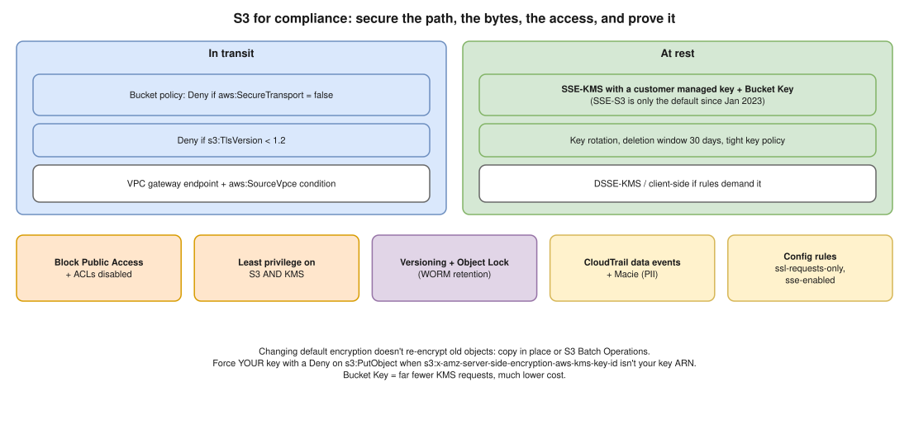

# AWS 09 · Secure S3 Data in Transit and at Rest for Compliance ⭐



> **Say this first:** "**In transit:** a bucket policy that **denies any request where `aws:SecureTransport` is false**, and optionally denies TLS older than 1.2 with `s3:TlsVersion`; traffic from the VPC goes through an **S3 gateway endpoint** so it never touches the internet. **At rest:** S3 encrypts every new object with **SSE-S3** by default since January 2023, but compliance usually wants **SSE-KMS with a customer-managed key** so we control the key policy, rotation and get a CloudTrail record of every decrypt; turn on **S3 Bucket Keys** to cut KMS cost. Around that: **Block Public Access**, Object Ownership = bucket owner enforced (ACLs off), least-privilege IAM, **versioning + Object Lock** for retention, **CloudTrail data events** and **Macie** to find sensitive data, and Config / Security Hub rules to prove it continuously."

## In transit

```json
{
  "Version": "2012-10-17",
  "Statement": [
    {
      "Sid": "DenyInsecureTransport",
      "Effect": "Deny",
      "Principal": "*",
      "Action": "s3:*",
      "Resource": ["arn:aws:s3:::acme-records", "arn:aws:s3:::acme-records/*"],
      "Condition": { "Bool": { "aws:SecureTransport": "false" } }
    },
    {
      "Sid": "DenyOldTLS",
      "Effect": "Deny",
      "Principal": "*",
      "Action": "s3:*",
      "Resource": ["arn:aws:s3:::acme-records", "arn:aws:s3:::acme-records/*"],
      "Condition": { "NumericLessThan": { "s3:TlsVersion": "1.2" } }
    }
  ]
}
```

- **VPC gateway endpoint** for S3 (free): traffic from private subnets stays on the AWS network; add a bucket policy condition `aws:SourceVpce` to allow access **only** through that endpoint for sensitive buckets.
- **Client-side encryption** (AWS Encryption SDK / S3 Encryption Client) if the requirement is that AWS never sees plaintext.
- Clients use HTTPS by default (AWS CLI/SDKs); the policy makes it mandatory.

## At rest: the encryption options

| Option | Key managed by | Audit of key use | When |
|---|---|---|---|
| **SSE-S3** (AES-256) | AWS, fully | No per-request key audit | Default on all buckets since Jan 2023; fine for non-regulated data |
| **SSE-KMS** with AWS managed key `aws/s3` | AWS, in KMS | CloudTrail KMS events | Little control over the key policy |
| **SSE-KMS with customer managed key (CMK)** | You (key policy, rotation, disable) | Yes, every Decrypt / GenerateDataKey | **Compliance default** (PCI, HIPAA, SOC2 evidence); access needs S3 **and** KMS permission |
| **DSSE-KMS** | You, two layers of encryption | Yes | Rules that require dual-layer encryption |
| **SSE-C** | You supply the key with each request | You | Rare; you must store keys yourself |
| **Client-side** | You | You | AWS must never see plaintext |

```hcl
# (illustrative) default encryption with a CMK + Bucket Key
resource "aws_s3_bucket_server_side_encryption_configuration" "records" {
  bucket = aws_s3_bucket.records.id
  rule {
    apply_server_side_encryption_by_default {
      sse_algorithm     = "aws:kms"
      kms_master_key_id = aws_kms_key.s3.arn
    }
    bucket_key_enabled = true # far fewer KMS calls → much lower KMS cost
  }
}

resource "aws_kms_key" "s3" {
  description             = "S3 records"
  enable_key_rotation     = true
  deletion_window_in_days = 30
}
```

- To **force** your CMK (not just any KMS key), add a Deny on `s3:PutObject` when `s3:x-amz-server-side-encryption-aws-kms-key-id` isn't your key ARN.
- Changing default encryption does **not** re-encrypt existing objects: copy them in place or use **S3 Batch Operations**.

## Access control and the rest of the compliance list

| Control | Why |
|---|---|
| **Block Public Access** (account + bucket level) | No accidental public bucket |
| **Object Ownership: bucket owner enforced** | Disables ACLs; only policies control access |
| Least-privilege IAM + bucket policy; KMS key policy limited to the roles that need decrypt | Two locks: S3 and KMS |
| **Versioning**, **Object Lock** (compliance mode) for retention, **MFA Delete** | Records can't be altered or deleted (WORM, e.g., SEC 17a-4 style rules) |
| **CloudTrail data events** for the bucket, **S3 server access logs** | Who read/wrote which object |
| **Amazon Macie** | Finds PII/card numbers in buckets |
| **AWS Config rules**: `s3-bucket-ssl-requests-only`, `s3-bucket-server-side-encryption-enabled`, `s3-bucket-public-read-prohibited`, `s3-default-encryption-kms` | Continuous evidence |
| **GuardDuty S3 Protection** | Unusual access patterns |
| Lifecycle rules matching the retention policy | Keep as long as required, no longer |

## Resume check

S3, KMS, IAM, Terraform fit your AWS work. **Macie, DSSE-KMS, Object Lock** are likely new to you; present them as "what compliance needs", not as things you ran.

## Real-world example (suggested story, adapt it to what you really did)

"For a fintech audit at Perfios we had to show customer documents were encrypted with keys we controlled. I moved the bucket from SSE-S3 to SSE-KMS with a customer-managed key and Bucket Keys, re-encrypted existing objects with a copy-in-place job, added the deny-non-TLS policy, a VPC endpoint condition and Config rules, and gave the auditors the Config compliance report as evidence." Only use if it matches what you did.

## Follow-up questions

**Q: S3 now encrypts everything by default, so why bother with KMS?**
SSE-S3 keys are fully AWS-managed: you can't restrict who can decrypt separately from S3 permissions, can't disable the key, and have no per-request key audit. Compliance frameworks usually want customer-controlled keys.

**Q: What's an S3 Bucket Key?**
A bucket-level data key derived from your KMS key, so S3 doesn't call KMS for every object. Up to 99% fewer KMS requests and lower cost.

**Q: How do you prove data in transit is encrypted?**
The `aws:SecureTransport` deny policy, the Config rule `s3-bucket-ssl-requests-only` showing compliant, and access only through the VPC endpoint.

## 🎯 Drill: type this from memory

1. The `DenyInsecureTransport` statement with `"Bool": {"aws:SecureTransport": "false"}`, both resource ARNs (bucket and `bucket/*`).
2. The `s3:TlsVersion` `NumericLessThan 1.2` deny.
3. The Terraform SSE-KMS block with `bucket_key_enabled = true` and the KMS key with rotation.
4. The encryption options table (SSE-S3, SSE-KMS CMK, DSSE-KMS, SSE-C, client-side).

## 🗣️ 30-second spoken answer

1. Transit: deny `aws:SecureTransport = false`, TLS 1.2 minimum, VPC endpoint.
2. Rest: SSE-KMS with a customer key + Bucket Key (SSE-S3 is only the default).
3. Block Public Access, ACLs off, least privilege on S3 and KMS.
4. Versioning + Object Lock for retention.
5. Prove it: CloudTrail data events, Macie, Config rules.
