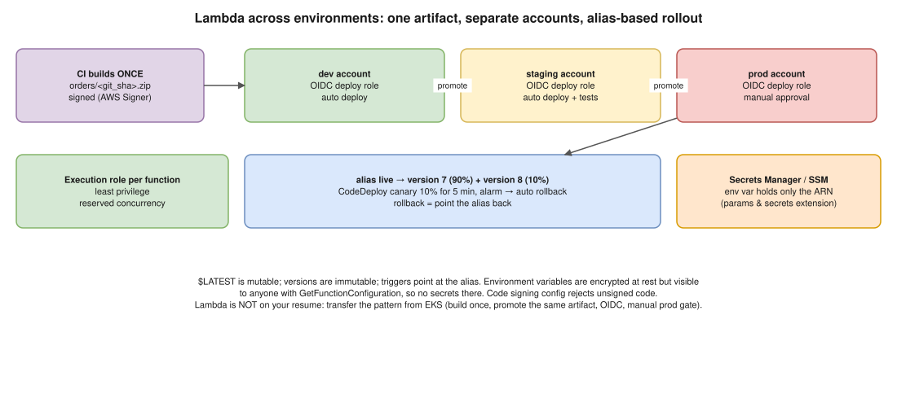

# AWS 10 · Deploy Lambda Functions Across Multiple Environments Securely



> **Say this first:** "**One account per environment** (dev, staging, prod in AWS Organizations), so a mistake in dev can't touch prod. The function is defined in **IaC** (Terraform, SAM or CDK) and the **same build artifact** is promoted through the environments; only the configuration changes. CI deploys with **OIDC**, assuming a deploy role in each account, no stored keys, with manual approval before prod. Every deploy publishes a **version**, and a **`live` alias** points at it, so rollback is moving the alias. In prod I shift traffic gradually with **CodeDeploy canary** (10% for 5 minutes) and automatic rollback on CloudWatch alarms. Each function has its **own least-privilege execution role**; secrets come from **Secrets Manager / SSM Parameter Store** at runtime, not from plain environment variables; and **code signing** makes sure only artifacts built by our pipeline run."

## The pieces

| Concern | How |
|---|---|
| Isolation | Separate AWS accounts per env (Organizations, SCPs); at minimum separate stacks with env prefix |
| Definition | Terraform / AWS SAM / CDK; one module, env-specific variables |
| Build once | CI builds the zip or container image once, stores it (S3 / ECR) with a commit SHA; staging and prod deploy that same artifact |
| Deploy identity | GitLab/GitHub **OIDC** → `AssumeRoleWithWebIdentity` into a deploy role per account; prod role only from the `main` branch / protected environment |
| Versions & aliases | `publish = true` → immutable version; alias `live` → version N; API Gateway / event source points at the **alias** |
| Safe rollout | CodeDeploy `LambdaCanary10Percent5Minutes` / `LambdaLinear10PercentEvery1Minute` with alarms → auto rollback; or a weighted alias by hand |
| Config | Environment variables for non-secret settings (encrypted at rest with KMS by default; use a CMK if required) |
| Secrets | Secrets Manager / SSM SecureString, read at runtime (cache it; the **AWS Parameters and Secrets Lambda Extension** does this) |
| Permissions | One execution role per function, only the actions/resources it needs; resource-based policy limits who can invoke it |
| Integrity | **Code signing** (AWS Signer signing profile + code signing config: reject unsigned) |
| Network | VPC config only if it needs private resources; VPC endpoints instead of NAT where possible |
| Limits | Reserved concurrency so one function can't starve others or hammer a database |
| Observability | CloudWatch Logs with retention, X-Ray tracing, alarms on Errors, Throttles, Duration p99 |

```hcl
# (illustrative) Terraform: version + alias per environment
resource "aws_lambda_function" "orders" {
  function_name = "orders-${var.env}"
  role          = aws_iam_role.orders.arn
  runtime       = "python3.12"
  handler       = "app.handler"
  s3_bucket     = var.artifact_bucket
  s3_key        = "orders/${var.git_sha}.zip"   # same artifact in every env
  publish       = true                           # new immutable version each change
  timeout       = 10
  reserved_concurrent_executions = 50

  environment {
    variables = {
      ENV             = var.env
      DB_SECRET_ARN   = aws_secretsmanager_secret.db.arn   # the ARN, not the password
    }
  }
  code_signing_config_arn = aws_lambda_code_signing_config.this.arn
}

resource "aws_lambda_alias" "live" {
  name             = "live"
  function_name    = aws_lambda_function.orders.function_name
  function_version = aws_lambda_function.orders.version
}
```

```bash
# Manual canary with a weighted alias: 10% to version 8, 90% stays on 7
aws lambda update-alias --function-name orders-prod --name live \
  --function-version 7 --routing-config 'AdditionalVersionWeights={"8"=0.1}'
# Promote fully / roll back = point the alias at one version
aws lambda update-alias --function-name orders-prod --name live --function-version 8 --routing-config '{}'
```

```yaml
# (illustrative) GitLab CI: OIDC into the prod account, manual gate
deploy_prod:
  stage: deploy
  environment: production          # protected environment = approvers
  when: manual
  rules: [{ if: '$CI_COMMIT_BRANCH == "main"' }]
  id_tokens:
    AWS_TOKEN: { aud: sts.amazonaws.com }
  script:
    - >
      export $(printf "AWS_ACCESS_KEY_ID=%s AWS_SECRET_ACCESS_KEY=%s AWS_SESSION_TOKEN=%s"
      $(aws sts assume-role-with-web-identity --role-arn "$PROD_DEPLOY_ROLE"
      --role-session-name "gl-$CI_PIPELINE_ID" --web-identity-token "$AWS_TOKEN"
      --query 'Credentials.[AccessKeyId,SecretAccessKey,SessionToken]' --output text))
    - terraform -chdir=envs/prod apply -auto-approve -var git_sha=$CI_COMMIT_SHA
```

## Resume check

**Lambda is not on your resume.** Be upfront: "My production work was EC2/EKS, but this is how I'd do Lambda", and lean on what transfers: multi-account, Terraform, GitLab CI with OIDC, Secrets Manager, least privilege. SAM/CDK/CodeDeploy are also not on your resume.

## Real-world example (suggested story, adapt it to what you really did)

Don't invent a Lambda story. Transfer one you have: "For our EKS services we built the image once, tagged it with the commit SHA and promoted the same tag from dev to prod through GitLab CI with OIDC and a manual prod approval. For Lambda I'd use the same pattern with versions and aliases."

## Follow-up questions

**Q: How do you roll back a bad Lambda deploy?**
Point the `live` alias back to the previous version (seconds). With CodeDeploy, a CloudWatch alarm during the canary rolls back automatically.

**Q: Are environment variables safe for secrets?**
They're encrypted at rest, but anyone with `lambda:GetFunctionConfiguration` sees them in plain text, and they leak into IaC state and logs. Store the secret in Secrets Manager, put only its ARN in the variable.

**Q: `$LATEST` vs a version?**
`$LATEST` is mutable (changes on every update). Versions are immutable snapshots. Production triggers should point at an alias that points at a version.

## 🎯 Drill: type this from memory

1. The `aws_lambda_function` with `publish = true` and an `aws_lambda_alias` named `live`.
2. `aws lambda update-alias --function-name <f> --name live --function-version 7 --routing-config 'AdditionalVersionWeights={"8"=0.1}'`
3. The table rows: isolation, build once, OIDC, versions/aliases, canary, secrets, role per function, code signing.

## 🗣️ 30-second spoken answer

1. Account per environment, IaC, same artifact promoted.
2. CI with OIDC per account, manual approval for prod.
3. Versions + `live` alias; CodeDeploy canary with alarm rollback.
4. Least-privilege role per function, secrets from Secrets Manager, code signing.
5. Reserved concurrency, logs, alarms.
