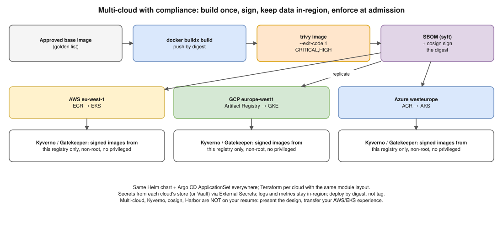

# Docker 01 · Multi-Cloud Docker Deployments With Compliance Restrictions



> **Say this first:** "First I pin down what the compliance rules actually say, usually **data residency** (data and logs stay in a country/region), **approved images only**, **encryption**, and **audit trails**. Then: **build each image once** in one pipeline from approved, minimal base images, generate an **SBOM**, **scan** it (Trivy) and **sign** it (cosign). Push it to a **registry in each cloud and region** (ECR, Artifact Registry, ACR, or Harbor with replication) so nodes never pull across borders. Run on **managed Kubernetes in each cloud** (EKS/GKE/AKS) as the common layer, provisioned with Terraform, deployed with GitOps (Argo CD). An **admission policy** (Kyverno or OPA Gatekeeper) only lets **signed images from the approved registry** run, with the security context rules. Secrets come from each cloud's KMS/secret store or Vault, and logs and metrics stay in-region."

## Step 1: turn "compliance" into concrete rules

| Requirement | What it means technically |
|---|---|
| Data residency (GDPR, RBI data localisation, etc.) | Workloads, databases, backups **and logs** pinned to allowed regions; no cross-region replication outside them |
| Approved software only | Base images from an internal golden list; registry allow-list enforced at admission |
| Vulnerability management | Scan at build and continuously in the registry; block CRITICAL/HIGH with no fix waiver |
| Supply chain integrity | Signed images, SBOM stored, provenance (SLSA) |
| Encryption | TLS in transit (mTLS in mesh if required), KMS-encrypted volumes and secrets at rest |
| Least privilege | Non-root containers, no privileged, read-only root FS, workload identity per cloud (IRSA / EKS Pod Identity, GKE Workload Identity, AKS Workload Identity) |
| Audit | Registry pull logs, K8s audit logs, cloud audit logs (CloudTrail, Cloud Audit Logs, Azure Activity Log) kept per retention rules |

## Step 2: the pipeline (one, for all clouds)

```bash
docker buildx build --platform linux/amd64,linux/arm64 -t $REG/app:$GIT_SHA --push .
trivy image --exit-code 1 --severity CRITICAL,HIGH --ignore-unfixed $REG/app:$GIT_SHA
syft $REG/app:$GIT_SHA -o spdx-json > sbom.json
cosign sign --key awskms:///alias/cosign $REG/app@$DIGEST       # sign the digest, not the tag
cosign attest --key awskms:///alias/cosign --type spdxjson --predicate sbom.json $REG/app@$DIGEST
```

- Replicate the **signed digest** to in-region registries (ECR replication rules, Harbor replication, or the pipeline pushes to each).
- Deploy by **digest** (`app@sha256:…`), not mutable tags.

## Step 3: enforce at runtime in every cluster

```yaml
# (illustrative) Kyverno: only signed images from our registries
apiVersion: kyverno.io/v1
kind: ClusterPolicy
metadata:
  name: verify-signed-images
spec:
  validationFailureAction: Enforce
  rules:
    - name: check-signature
      match:
        any:
          - resources:
              kinds: [Pod]
      verifyImages:
        - imageReferences:
            - "111122223333.dkr.ecr.eu-west-1.amazonaws.com/*"
            - "europe-west1-docker.pkg.dev/acme/*"
          attestors:
            - entries:
                - keys:
                    publicKeys: |-
                      -----BEGIN PUBLIC KEY-----
                      ...
                      -----END PUBLIC KEY-----
```

Plus policies for `runAsNonRoot`, no `privileged`, no `hostPath`, resource limits (see [Docker 04](04-policy-as-code-docker-security.md)).

## Step 4: keep the clouds consistent

- **Terraform** per cloud (different providers, same module layout and naming); Kubernetes manifests/Helm charts identical, with per-cloud values (storage class, load balancer annotations, identity).
- **GitOps** (Argo CD ApplicationSets) to roll the same version to every cluster, with regions as a list.
- **Observability** stays in-region (a Prometheus per cluster); only aggregated, non-personal metrics go to a central Grafana if allowed.
- **Secrets**: External Secrets Operator reading AWS Secrets Manager / GCP Secret Manager / Azure Key Vault, or a Vault cluster per region.
- **CIS benchmarks** per cloud and per Kubernetes distribution; evidence collected automatically.

## Resume check

**Multi-cloud is not on your resume (AWS only).** Kyverno, OPA Gatekeeper, cosign, Harbor, syft are also not listed. Say: "My production experience is AWS/EKS. For multi-cloud I'd keep Kubernetes as the common layer and do this…" Argo CD, Terraform, GitLab CI, EKS are yours.

## Real-world example (suggested story, adapt it to what you really did)

Don't invent a multi-cloud story. Transfer: "At Koko we ran in more than one AWS region. Images were built once in GitLab CI, scanned, pushed to ECR and replicated to the second region's ECR, and Argo CD deployed the same digest everywhere. Multi-cloud would add a registry and cluster per cloud on the same pattern."

## Follow-up questions

**Q: Why push to a registry in every region instead of one central registry?**
Residency (image pulls and audit logs stay local), speed, and no dependency on another region/cloud being up during an incident.

**Q: Why deploy by digest?**
Tags can be moved to a different image; a digest identifies exactly the bytes that were scanned and signed.

**Q: Docker Swarm or Kubernetes for multi-cloud?**
Kubernetes: every cloud offers it managed, and the policy/GitOps tooling exists for it. Swarm has no managed offering and little ecosystem.

## 🎯 Drill: type this from memory

1. `trivy image --exit-code 1 --severity CRITICAL,HIGH <image>`
2. `cosign sign --key <key> <image>@<digest>` and `cosign verify --key <pub> <image>@<digest>`
3. The Kyverno `verifyImages` skeleton (kind ClusterPolicy, `validationFailureAction: Enforce`, `imageReferences`, `attestors`).
4. The requirement → technical control table.

## 🗣️ 30-second spoken answer

1. Translate compliance into rules: residency, approved images, encryption, audit.
2. Build once, SBOM, scan, sign the digest.
3. Replicate to an in-region registry per cloud; deploy by digest.
4. Managed K8s per cloud + Terraform + Argo CD; admission policy enforces signed images.
5. Secrets and logs stay in-region.
