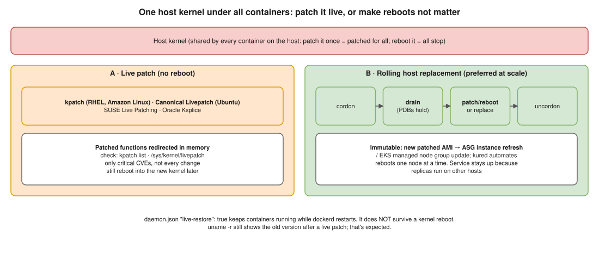

# Docker 02 · Live-Patching the Docker Host Kernel Without Downtime



> **Say this first:** "Containers don't have their own kernel; they all share the host's, so patching the host kernel patches every container at once, and a reboot would stop all of them. There are two ways. **Live patching**: tools like **kpatch** (RHEL), **Canonical Livepatch** (Ubuntu Pro), **SUSE Live Patching** or **Oracle Ksplice** load a kernel module that redirects the vulnerable functions to fixed ones in memory, with no reboot and no container restart. It's for **critical security CVEs**, it doesn't cover every kind of change, and you still need a real reboot into the new kernel later. The second way, which I prefer at scale, is to **make host reboots not matter**: run containers on several hosts behind a load balancer (Kubernetes/ECS/Swarm), and **drain → patch or replace → reboot → uncordon** one host at a time, ideally replacing hosts with a new patched AMI. Then the *service* has zero downtime even though each host restarts."

## Option A: live patching

| Distro | Tool | Check it |
|---|---|---|
| RHEL / Rocky / Alma | **kpatch** (`kpatch-patch-*` packages) | `kpatch list` |
| Ubuntu | **Canonical Livepatch** (Ubuntu Pro, free for a few machines) | `canonical-livepatch status --verbose` |
| SUSE / SLES | SUSE Live Patching (kGraft heritage) | `klp status`, `zypper` patches |
| Oracle Linux | **Ksplice** | `uptrack-show` |
| Amazon Linux 2 / 2023 | **Kernel Live Patching** (kpatch-based) | `kpatch list`, `yum/dnf updateinfo` |

```bash
# Generic: which live patches are loaded?
ls /sys/kernel/livepatch/
cat /sys/kernel/livepatch/*/enabled
uname -r                                  # still the OLD version string, that's expected

# Amazon Linux 2023 example
sudo dnf install -y kpatch-dnf kpatch-runtime
sudo dnf kernel-livepatch -y auto
sudo systemctl enable --now kpatch.service
sudo dnf update --security -y             # pulls in kernel live patches
kpatch list
```

**Limits to say in the interview:**
- Only for patches that change function code in specific ways; big changes (data structure layout, some subsystems) can't be live patched.
- Vendors publish live patches for **critical/important CVEs** only, for a limited time per kernel version.
- It's a bridge: schedule a normal reboot into the new kernel in the next maintenance window.
- Needs a subscription on some distros (RHEL, Ubuntu Pro for many machines, Ksplice with Oracle support).

## Option B: rolling host replacement (zero downtime for the service)

1. Containers run as **multiple replicas spread over hosts/AZs** behind a load balancer, with health checks.
2. For each host, one at a time:
   - Kubernetes: `kubectl cordon <node>` → `kubectl drain <node> --ignore-daemonsets --delete-emptydir-data` (respects PodDisruptionBudgets) → patch + reboot (or terminate) → `kubectl uncordon <node>`.
   - Docker Swarm: `docker node update --availability drain <node>` → patch/reboot → `--availability active`.
   - Plain Docker host behind an ALB: deregister from the target group (deregistration delay lets connections finish) → patch/reboot → re-register.
3. **Immutable version:** bake a patched AMI (Packer), update the launch template, and do an **ASG instance refresh** / EKS managed node group update; new nodes come up patched, old ones drain and terminate. No in-place patching at all.
4. Automation: **kured** (Kubernetes Reboot Daemon) reboots nodes one at a time when `/var/run/reboot-required` appears; **Bottlerocket** with its update operator for EKS.

## Related: restarting Docker itself without stopping containers

`/etc/docker/daemon.json` → `{"live-restore": true}` keeps containers running while **dockerd** restarts or is upgraded. It does **not** help with a kernel reboot, but interviewers sometimes mix the two up.

## Resume check

Linux, EKS, Ansible and AWS AMIs fit your background. **kpatch / Livepatch / Ksplice / kured / Bottlerocket are not on your resume**; describe them, don't claim them. Draining nodes for EKS upgrades is something you can speak to if you did it.

## Real-world example (suggested story, adapt it to what you really did)

"When a critical kernel CVE came out, we didn't patch EKS nodes in place. We updated the node group to the new EKS-optimised AMI and let the managed node group roll: new node, cordon and drain an old one, PodDisruptionBudgets kept at least two replicas of each service up. Users saw nothing." Use only if you've done node group AMI updates.

## Follow-up questions

**Q: Why does patching the host fix all containers?**
Containers are processes isolated with namespaces and cgroups on one shared kernel. There is no guest kernel per container (unlike VMs).

**Q: After a live patch, does `uname -r` change?**
No. It still shows the running kernel version; check `kpatch list` / `/sys/kernel/livepatch`.

**Q: Is live patching enough forever?**
No. It's a stop-gap for urgent CVEs. You still move to the new kernel with a reboot or host replacement.

## 🎯 Drill: type this from memory

1. `kubectl cordon <node>` → `kubectl drain <node> --ignore-daemonsets --delete-emptydir-data` → `kubectl uncordon <node>`
2. `ls /sys/kernel/livepatch/` and `kpatch list`
3. `{"live-restore": true}` in `/etc/docker/daemon.json`
4. `docker node update --availability drain <node>`

## 🗣️ 30-second spoken answer

1. Containers share the host kernel: one patch fixes all, one reboot stops all.
2. Live patch (kpatch, Livepatch, Ksplice) for critical CVEs, no reboot.
3. Limits: not every patch, still reboot later.
4. Better at scale: replicas over many hosts, drain → patch/replace → uncordon, one at a time.
5. Immutable: new AMI + instance refresh.
