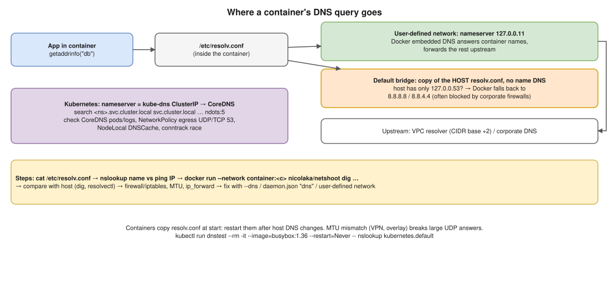

# Docker 03 · Troubleshooting Container DNS Resolution Failures ⭐



> **Say this first:** "First I separate **name resolution** from **connectivity**: inside the container I check `/etc/resolv.conf`, then `nslookup` a name and `ping`/`curl` an IP. If the IP works and the name doesn't, it's DNS. Then I follow the path: on a **user-defined network** Docker's **embedded DNS at 127.0.0.11** answers container names and forwards the rest to the host's upstream servers; on the **default bridge** there's no container-name DNS at all and the container gets a copy of the host's resolv.conf, where a **127.0.0.53 (systemd-resolved)** entry is useless inside a container, so Docker falls back to public DNS which may be blocked. I compare with the host (`dig` there), check firewall/iptables and corporate DNS, and fix with `--dns`, the `dns` key in `daemon.json`, or by using a user-defined network. In Kubernetes the same question becomes CoreDNS: pods running, the `kube-dns` service, `ndots:5`, and NetworkPolicies blocking port 53."

## Step by step

```bash
# 1. What does the container use?
docker exec -it app cat /etc/resolv.conf
docker inspect app --format '{{json .NetworkSettings.Networks}}'

# 2. Name vs IP
docker exec -it app nslookup google.com          # or getent hosts google.com
docker exec -it app ping -c1 8.8.8.8             # connectivity without DNS
docker exec -it app nslookup db                  # another container by name

# 3. Image has no tools? Borrow the network namespace of the container
docker run --rm -it --network container:app nicolaka/netshoot dig google.com
docker run --rm -it --network container:app nicolaka/netshoot dig @8.8.8.8 google.com

# 4. Compare with the host
dig google.com; resolvectl status; cat /etc/resolv.conf
```

## Common causes and fixes

| Symptom | Cause | Fix |
|---|---|---|
| Container names don't resolve (`db` not found) | Containers on the **default bridge** (no embedded DNS for names), or on **different networks** | `docker network create app-net`, run both with `--network app-net` (Compose does this automatically) |
| External names fail, IPs work | Host resolv.conf has only `127.0.0.53` (systemd-resolved) → Docker drops loopback servers and falls back to `8.8.8.8`/`8.8.4.4`, which the corporate firewall blocks | Set real upstream DNS: `--dns 10.0.0.2` or `daemon.json` `"dns": ["10.0.0.2"]` (VPC resolver on AWS is VPC CIDR base + 2, or 169.254.169.253) |
| Internal company names fail | Corporate DNS / VPN search domains not passed into containers | `--dns`, `--dns-search corp.example.com`, or `daemon.json` `dns-search` |
| Intermittent timeouts | Firewall (firewalld/iptables) rules flushed and Docker's rules lost, UDP blocked, conntrack table full | `systemctl restart docker` to recreate rules, check `iptables -t nat -L -n`, `conntrack -S` |
| Large responses fail / only some names | MTU mismatch (VPN, overlay networks) → fragmented UDP dropped | Set `"mtu": 1400` in daemon.json or on the network |
| Works with `--network host` only | Bridge/NAT problem: `net.ipv4.ip_forward=0`, iptables FORWARD policy DROP | `sysctl net.ipv4.ip_forward=1`, check FORWARD chain |
| Changes to host resolv.conf not picked up | Containers copy resolv.conf at start | Restart the container |

```json
// /etc/docker/daemon.json, then: sudo systemctl restart docker
{
  "dns": ["10.0.0.2", "1.1.1.1"],
  "dns-search": ["corp.example.com"],
  "mtu": 1400
}
```

## The Kubernetes version

```bash
kubectl -n kube-system get pods -l k8s-app=kube-dns          # CoreDNS running?
kubectl -n kube-system logs -l k8s-app=kube-dns --tail=50
kubectl get svc -n kube-system kube-dns                       # ClusterIP matches pod's nameserver?
kubectl run dnstest --rm -it --image=busybox:1.36 --restart=Never -- nslookup kubernetes.default
kubectl exec -it <pod> -- cat /etc/resolv.conf                # search list + ndots:5
kubectl get networkpolicy -A                                  # egress to UDP/TCP 53 allowed?
```

- **`ndots:5`**: a name with fewer than 5 dots is tried with every search domain first (`api.example.com.default.svc.cluster.local`…), multiplying queries. Use FQDNs with a trailing dot or lower `ndots` in `dnsConfig`.
- **Conntrack race** with parallel A/AAAA UDP queries (older kernels) → 5-second delays; **NodeLocal DNSCache** fixes it and offloads CoreDNS.
- CoreDNS **CPU-throttled or too few replicas** under load → scale it (or the cluster-proportional autoscaler).
- A default-deny **NetworkPolicy** without an egress rule to `kube-dns` port 53 breaks every lookup in that namespace.

More background: [Docker networking](../../docker/08-networking.md), [Kubernetes services and DNS](../../kubernetes/08-services-and-dns.md).

## Resume check

Docker, Linux, EKS fit. **netshoot, NodeLocal DNSCache** are tools you may not have used; fine to mention as the approach.

## Real-world example (suggested story, adapt it to what you really did)

"On a new Ubuntu build server, Docker builds failed at `apt-get update` with 'Temporary failure resolving'. The host resolv.conf pointed at 127.0.0.53, so containers fell back to 8.8.8.8, which our network blocked. I set the VPC resolver in daemon.json and builds worked." Only use if it matches what you've seen.

## Follow-up questions

**Q: What is 127.0.0.11?**
Docker's embedded DNS server, available on user-defined networks. It resolves container names, service names and aliases on that network and forwards other queries to the configured upstream servers.

**Q: Why can't containers on the default bridge reach each other by name?**
The default bridge doesn't use the embedded DNS for container names (only the legacy `--link`). Use a user-defined network.

**Q: First command when a pod can't resolve a service?**
`kubectl exec` into it, `cat /etc/resolv.conf`, `nslookup <svc>.<ns>.svc.cluster.local`, then check CoreDNS pods/logs and NetworkPolicies.

## 🎯 Drill: type this from memory

1. `docker exec -it <c> cat /etc/resolv.conf` and `docker exec -it <c> nslookup <name>`
2. `docker run --rm -it --network container:<c> nicolaka/netshoot dig <name>`
3. The `daemon.json` with `dns`, `dns-search`, `mtu`.
4. `kubectl run dnstest --rm -it --image=busybox:1.36 --restart=Never -- nslookup kubernetes.default`
5. `kubectl -n kube-system get pods -l k8s-app=kube-dns`

## 🗣️ 30-second spoken answer

1. Name vs IP: resolv.conf, nslookup, ping an IP.
2. User-defined network → 127.0.0.11; default bridge → no names, host resolv.conf copy.
3. 127.0.0.53 on the host → fallback to 8.8.8.8 blocked → set `--dns` / daemon.json.
4. Check firewall, MTU, ip_forward.
5. K8s: CoreDNS pods, kube-dns svc, ndots:5, NetworkPolicy on port 53.
