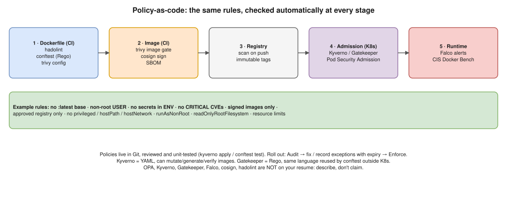

# Docker 04 · Enforce Policy-as-Code for Docker Security



> **Say this first:** "Policy-as-code means the security rules are **written as code in Git**, versioned and reviewed, and **checked automatically** at every stage instead of in a wiki. I enforce at four points: **(1) Dockerfile** in CI with **hadolint** and **conftest** (OPA Rego), e.g. no `latest` base image, must set a non-root `USER`, no secrets in `ENV`; **(2) image** with **Trivy** failing the build on CRITICAL/HIGH and misconfigurations, then **signing** it with cosign; **(3) deploy time** with a Kubernetes admission controller, **Kyverno** or **OPA Gatekeeper**, which rejects pods that are privileged, run as root, use unapproved registries or unsigned images; **(4) runtime** detection with **Falco**. I start policies in **audit mode**, fix the violations, then switch to **enforce**, with an exception process."

## Stage 1: the Dockerfile (CI, before build)

```bash
hadolint Dockerfile                                   # best practices: pin versions, no sudo, etc.
conftest test Dockerfile --policy policy/             # your own rules in Rego
trivy config .                                        # misconfig scan of Dockerfile / K8s YAML / Terraform
```

```rego
# policy/dockerfile.rego  (conftest parses a Dockerfile into a list of instructions)
package main

import rego.v1

deny contains msg if {
  some i
  input[i].Cmd == "from"
  image := input[i].Value[0]
  endswith(image, ":latest")
  msg := sprintf("Base image %s uses the latest tag; pin a version", [image])
}

deny contains msg if {
  not has_user
  msg := "Dockerfile must switch to a non-root USER"
}

has_user if {
  some i
  input[i].Cmd == "user"
  input[i].Value[0] != "root"
  input[i].Value[0] != "0"
}

deny contains msg if {
  some i
  input[i].Cmd == "env"
  regex.match(`(?i)(password|secret|token|key)`, concat(" ", input[i].Value))
  msg := "Do not put secrets in ENV; use build secrets or runtime secrets"
}
```

## Stage 2: the image (CI, after build)

```bash
trivy image --exit-code 1 --severity CRITICAL,HIGH --ignore-unfixed registry/app:$SHA
cosign sign --key awskms:///alias/cosign registry/app@$DIGEST
```

- Allowed base images list (distroless / Chainguard / internal golden images).
- `.trivyignore` with an expiry and a ticket for accepted risks: that's your exception process, in Git.

## Stage 3: admission (Kubernetes rejects bad pods)

```yaml
# (illustrative) Kyverno: block privileged + root, require approved registry
apiVersion: kyverno.io/v1
kind: ClusterPolicy
metadata:
  name: container-baseline
spec:
  validationFailureAction: Audit          # start in Audit, switch to Enforce later
  background: true
  rules:
    - name: no-privileged
      match: { any: [ { resources: { kinds: [Pod] } } ] }
      validate:
        message: "Privileged containers are not allowed"
        pattern:
          spec:
            containers:
              - =(securityContext):
                  =(privileged): "false"
    - name: run-as-non-root
      match: { any: [ { resources: { kinds: [Pod] } } ] }
      validate:
        message: "Containers must set runAsNonRoot: true"
        pattern:
          spec:
            containers:
              - securityContext:
                  runAsNonRoot: true
    - name: approved-registry
      match: { any: [ { resources: { kinds: [Pod] } } ] }
      validate:
        message: "Images must come from our ECR"
        pattern:
          spec:
            containers:
              - image: "111122223333.dkr.ecr.*.amazonaws.com/*"
```

- **Pod Security Admission** (built in since K8s 1.25): label a namespace `pod-security.kubernetes.io/enforce: restricted` for the standard baseline without any extra tool.
- **OPA Gatekeeper** does the same with `ConstraintTemplate` (Rego) + `Constraint` objects; the Gatekeeper policy library has ready-made templates.
- Test policies in CI too: `kyverno apply policy.yaml --resource deployment.yaml`, or `conftest test` on rendered Helm output.

## Stage 4: runtime and hosts

- **Falco**: alerts on a shell spawned in a container, writes to `/etc`, unexpected outbound connections.
- **Docker Bench for Security** / CIS Docker Benchmark on hosts; Docker daemon: `userns-remap`, `no-new-privileges`, `live-restore`, no TCP socket without TLS.
- For plain Docker hosts (no Kubernetes), a Docker **authorization plugin** (e.g. opa-docker-authz) can deny `docker run --privileged` at the daemon.

## Rollout that doesn't break everyone

1. Policies in Git, reviewed like code, unit-tested.
2. **Audit/warn mode** first → report of violations per team.
3. Fix or record exceptions (namespace/label based, with expiry).
4. **Enforce**, starting with new namespaces.
5. Dashboards of policy reports (Kyverno PolicyReports, Gatekeeper audit) in Grafana.

## Resume check

Docker, GitLab CI, EKS, Argo CD fit. **OPA/Rego, conftest, Kyverno, Gatekeeper, Falco, cosign, hadolint are not on your resume.** If you've only used Trivy or none of these, say "I'd implement it like this" and focus on the stages. Trivy: claim only if you used it.

## Real-world example (suggested story, adapt it to what you really did)

Keep it honest: "We had image scanning in GitLab CI that failed the pipeline on critical CVEs and we ran containers as non-root. The next step I'd take is admission policies with Kyverno in audit mode, then enforce." Only claim what you set up.

## Follow-up questions

**Q: Kyverno vs OPA Gatekeeper?**
Kyverno policies are Kubernetes YAML (easy for platform teams) and can also mutate and generate resources and verify image signatures. Gatekeeper uses Rego, more flexible, and the same Rego/OPA can be used outside Kubernetes (conftest, Terraform, APIs).

**Q: Why not just scan images?**
Scanning finds known CVEs in packages; it doesn't stop someone running a privileged container, mounting the host file system, or deploying an image from Docker Hub that never went through CI. Admission control does.

**Q: What does "audit mode" give you?**
Visibility of what would be blocked without breaking deploys, so teams can fix things before you enforce.

## 🎯 Drill: type this from memory

1. `hadolint Dockerfile` · `conftest test Dockerfile --policy policy/` · `trivy image --exit-code 1 --severity CRITICAL,HIGH `
2. A Rego `deny contains msg if { … }` rule that blocks `:latest` in FROM.
3. A Kyverno ClusterPolicy skeleton with `validationFailureAction`, `match`, `validate.pattern`.
4. `kubectl label ns prod pod-security.kubernetes.io/enforce=restricted`

## 🗣️ 30-second spoken answer

1. Rules in Git, checked automatically.
2. Dockerfile: hadolint, conftest Rego.
3. Image: Trivy gate, cosign sign.
4. Admission: Kyverno/Gatekeeper or Pod Security Admission blocks root, privileged, unsigned, unapproved registry.
5. Runtime: Falco. Audit first, then enforce.
