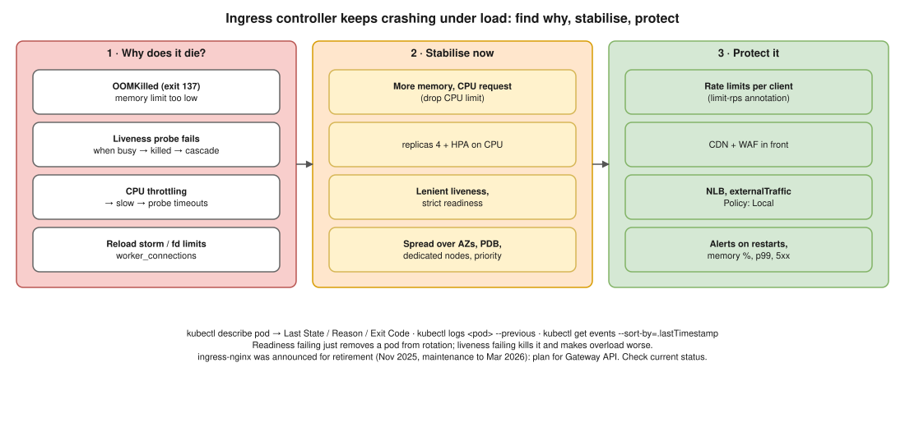

# K8s 01 · Ingress Controller Crashes Repeatedly Under Heavy Load ⭐



> **Say this first:** "First I find **why** it dies, because 'crash' has different causes: `kubectl describe` shows the last state, **OOMKilled** (memory limit too low), exit code 137 from a **failed liveness probe** because it was too busy to answer, or a **reload storm** from frequent config changes. I check CPU **throttling** and the controller's own metrics. To stabilise right away: raise its **requests/limits**, **scale out** the replicas and add an **HPA**, relax the liveness probe so a busy pod isn't killed, spread replicas across nodes/AZs with **anti-affinity/topology spread** and a **PDB**, and put them on **dedicated nodes**. Then protect it: **rate limiting**, a CDN/WAF in front, `externalTrafficPolicy: Local` with an NLB, and tuned worker/keepalive settings. Long term, load test it and alert on its saturation before it falls over."

## Step 1: diagnose

```bash
kubectl -n ingress-nginx get pods -o wide                       # restarts, which nodes
kubectl -n ingress-nginx describe pod <pod>                     # Last State: OOMKilled? Exit Code 137? Liveness failed?
kubectl -n ingress-nginx logs <pod> --previous | tail -100      # logs from BEFORE the crash
kubectl -n ingress-nginx get events --sort-by=.lastTimestamp | tail -20
kubectl top pods -n ingress-nginx                               # near the limit?
kubectl get hpa -n ingress-nginx
```

| What you see | Meaning | Fix |
|---|---|---|
| `Reason: OOMKilled`, exit 137 | Hit the memory limit (many connections, big buffers, large configs, Lua shared dicts) | Raise memory request/limit; more replicas so each handles fewer connections |
| `Liveness probe failed` in events, then restart | Pod too busy to answer `/healthz` in time → kubelet kills it → remaining pods get more load → cascade | Higher `timeoutSeconds`/`failureThreshold`; readiness can be strict, liveness should be lenient |
| High CPU throttling (`container_cpu_cfs_throttled_periods_total`) | CPU limit too low → slow responses → probes time out | Raise CPU request; consider removing the CPU limit |
| Logs show constant `reload` / `Backend successfully reloaded` | Config reloads (ingress/secret/cert changes, many Ingress objects) → each reload spawns new workers, memory spikes | Reduce churn, update the controller; ingress-nginx updates endpoints dynamically without reloads, but Ingress/annotation changes still reload |
| `too many open files`, `worker_connections are not enough` | File descriptor / connection limits | Tune `max-worker-connections`, `worker-processes`, ulimits |
| Node itself under pressure / evictions | Controller shares nodes with noisy apps | Dedicated node group with taints, `priorityClassName: system-cluster-critical` |
| Connection resets from the cloud LB | Not enough controller replicas in each AZ | Spread replicas over all AZs |

## Step 2: stabilise now

```yaml
# (illustrative) Helm values for ingress-nginx
controller:
  replicaCount: 4
  resources:
    requests: { cpu: "1", memory: 1Gi }
    limits:   { memory: 2Gi }            # memory limit yes; CPU limit often removed to avoid throttling
  autoscaling:
    enabled: true
    minReplicas: 4
    maxReplicas: 20
    targetCPUUtilizationPercentage: 60
  livenessProbe:
    timeoutSeconds: 5
    failureThreshold: 5
  topologySpreadConstraints:
    - maxSkew: 1
      topologyKey: topology.kubernetes.io/zone
      whenUnsatisfiable: ScheduleAnyway
      labelSelector:
        matchLabels: { app.kubernetes.io/component: controller }
  podDisruptionBudget: { enabled: true, minAvailable: 2 }   # key name depends on the chart version
  nodeSelector: { role: ingress }
  tolerations: [ { key: dedicated, value: ingress, effect: NoSchedule } ]
  priorityClassName: system-cluster-critical
  service:
    externalTrafficPolicy: Local          # keeps client IP, avoids an extra node hop
  config:
    worker-processes: "auto"
    max-worker-connections: "65536"
    keep-alive-requests: "10000"
    upstream-keepalive-connections: "320"
```

## Step 3: protect it from the load

- **Rate limiting** per client: annotations `nginx.ingress.kubernetes.io/limit-rps: "20"`, `limit-connections`.
- **CDN / WAF** in front (CloudFront + AWS WAF) to cache static content and drop bots before the cluster.
- **AWS NLB** (via AWS Load Balancer Controller) in front of the controller, or replace the in-cluster proxy with **ALB Ingress** so AWS handles the L7 scaling.
- **Backends**: if the apps behind are slow, the controller holds connections longer and uses more memory; fix timeouts (`proxy-read-timeout`) and scale the backends too.

## Step 4: make it not happen again

- **Alerts**: controller pod restarts, memory > 80% of limit, `nginx_ingress_controller_requests` rate, p99 latency, 5xx ratio, CPU throttling.
- **Load test** (k6, Locust) to know the requests per second one replica can take; set HPA min from that.
- Keep the controller version current. Note: the community **ingress-nginx** project was announced for retirement in Nov 2025 (best-effort maintenance until March 2026), so new clusters should plan for a **Gateway API** implementation (e.g., Envoy Gateway, NGINX Gateway Fabric, Istio) or the AWS Load Balancer Controller. Check the current status before saying this in an interview.

## Resume check

EKS, Prometheus, Grafana, Helm/Argo CD fit. If you used the **AWS Load Balancer Controller (ALB)** rather than ingress-nginx, say so; that's a fine answer. k6/Locust, Gateway API implementations: don't claim unless used. **NGINX as a web server is not on your resume**; NGINX ingress tuning is a separate thing, only claim it if you did it.

## Real-world example (suggested story, adapt it to what you really did)

"During a marketing campaign our ingress-nginx pods kept restarting. `describe` showed OOMKilled at a 512Mi limit, and once two pods died the third got all the traffic and died too. I raised the memory to 1.5Gi, moved to 4 replicas spread over three AZs with an HPA and a PDB, and relaxed the liveness timeout. Then I added Grafana alerts on controller memory and restarts." Use only what matches your experience.

## Follow-up questions

**Q: Why relax the liveness probe and not the readiness probe?**
Readiness failing just takes the pod out of the load balancer for a moment, which is what you want when it's overloaded. Liveness failing **kills** it, which removes capacity and makes the overload worse.

**Q: Why remove CPU limits on the ingress controller?**
CFS throttling adds latency spikes even when the node has free CPU. Keep a solid CPU **request** for scheduling and leave the limit off (memory limit stays).

**Q: What's `externalTrafficPolicy: Local`?**
The load balancer only sends traffic to nodes that run a controller pod, and the client source IP is preserved. Downside: uneven load if pods are unevenly spread.

## 🎯 Drill: type this from memory

1. `kubectl -n <ns> describe pod <pod>` → find `Last State`, `Reason`, `Exit Code`.
2. `kubectl -n <ns> logs <pod> --previous`
3. `kubectl get events -n <ns> --sort-by=.lastTimestamp`
4. A `topologySpreadConstraints` block by zone and a `PodDisruptionBudget` with `minAvailable: 2`.
5. The causes table: OOMKilled, liveness, throttling, reloads, fd limits.

## 🗣️ 30-second spoken answer

1. Why: describe/logs --previous → OOMKilled, liveness kill, throttling, reloads.
2. Now: more memory/CPU, more replicas + HPA, lenient liveness.
3. Resilience: spread over AZs, PDB, dedicated nodes, priority class.
4. Protect: rate limits, CDN/WAF, NLB, keepalive tuning.
5. Prevent: alerts on its saturation, load tests.
