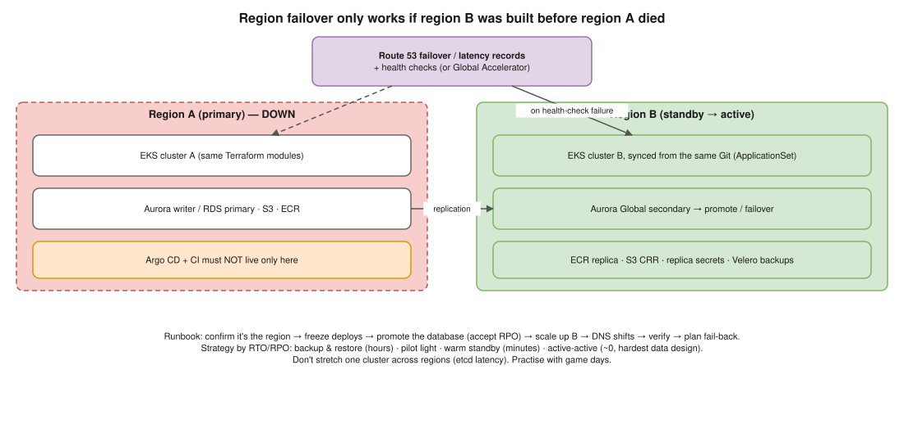

# K8s 02 · An Entire Kubernetes Region Goes Down: How Do You Fail Over? ⭐



> **Say this first:** "You can't fail over a region at the moment it goes down unless you prepared for it, so the answer is mostly the setup. A **second cluster in another region**, built from the **same Terraform** and kept in sync by **GitOps** (Argo CD deploys the same manifests to both clusters). **Images replicated** to the second region's registry. **Data replicated**: Aurora Global Database or a cross-region read replica, DynamoDB global tables, S3 cross-region replication. In front, **Route 53 failover (or latency) records with health checks**, or AWS Global Accelerator, so traffic moves automatically. When the region dies: confirm it, **promote the database** in the standby region, scale the standby cluster up if it was warm-standby, and let DNS shift traffic. The design choice is driven by **RTO/RPO**: active-active, warm standby, or backup-and-restore with **Velero**. And we practise it with game days."

## Pick a strategy from RTO / RPO

| Strategy | Standby region | RTO | RPO | Cost |
|---|---|---|---|---|
| **Backup & restore** | Nothing running; Velero backups + Terraform to rebuild | Hours | Last backup | $ |
| **Pilot light** | Cluster + DB replica exist, apps scaled to 0/min | 10s of minutes | Seconds–minutes (replication lag) | $$ |
| **Warm standby** | Smaller full copy serving nothing (or a little) | Minutes | Seconds | $$$ |
| **Active-active** | Both regions serve users all the time | ~0 (DNS/health check time) | ~0, but writes need multi-region data design | $$$$ |

## What has to exist in region B before the disaster

| Layer | How it gets to region B |
|---|---|
| Cluster + VPC + IAM | Same Terraform modules, region variable, separate state ([Terraform 04](../terraform/04-ten-regions.md)) |
| Workloads | Argo CD **ApplicationSet** generating one Application per cluster from the same Git repo |
| Container images | ECR **cross-region replication** rules (or push to both in CI) |
| Secrets | Secrets Manager **replica secrets** + External Secrets Operator in each cluster |
| Database | **Aurora Global Database** (storage-level replication, typically < 1 s lag, managed failover/switchover) or RDS cross-region read replica (promote), or DynamoDB global tables |
| Object storage | S3 **CRR** (+ Multi-Region Access Points) |
| Cluster state not in Git (PVs, CRDs created at runtime) | **Velero** backups to S3 in region B, restored there |
| DNS / traffic | Route 53 **failover** records (primary/secondary) + health checks, or latency/weighted records for active-active, or Global Accelerator |
| Certificates | ACM certificates requested in **each** region |
| Observability | Prometheus/Grafana and alerting in region B too (not only in the region that died) |

```bash
# Argo CD: is region B in sync with Git?
argocd app list
argocd app get payments-eu-west-1

# Velero: back up a namespace (to an S3 bucket in the other region), restore it there
velero backup create payments-$(date +%F) --include-namespaces payments
velero restore create --from-backup payments-2026-11-12        # run against cluster B

# Promote an RDS cross-region read replica to a standalone writable DB
aws rds promote-read-replica --region eu-west-1 --db-instance-identifier payments-replica

# Aurora Global Database: managed failover to the secondary region
aws rds failover-global-cluster --global-cluster-identifier payments-global \
  --target-db-cluster-identifier arn:aws:rds:eu-west-1:111122223333:cluster:payments-eu \
  --allow-data-loss                 # unplanned outage; planned switchover uses switchover-global-cluster
```

## The failover runbook (when it happens)

1. **Confirm** it's the region, not your app: AWS Health Dashboard, health checks failing from several locations, other services in the region down.
2. **Declare the incident**, freeze deploys to region A.
3. **Database first**: promote / fail over the global database in region B (accept the RPO).
4. **Scale up** region B (HPA min, node groups / Karpenter limits) if it was pilot light or warm standby.
5. **Traffic**: Route 53 health checks fail over automatically; if they didn't, change the record or flip the Application Recovery Controller routing control.
6. **Verify**: synthetic checks, error rates, queue backlogs.
7. **Communicate**, then plan the **fail-back** (re-sync data to region A first; don't rush it).

## Things that bite people

- **Hidden dependencies on region A**: a global service whose control plane lives in us-east-1, a config bucket only in region A, a hard-coded endpoint, the CI runners or Argo CD itself running only in region A. Run Argo CD (or a second instance) where it can still reach region B.
- **Capacity**: region B may not have enough capacity or quota when everyone fails over at once. Pre-provision or reserve.
- **DNS TTL** and clients that cache DNS for a long time.
- **Split brain** in active-active writes; prefer a single writer region with fast failover unless the data model supports multi-writer.
- **Untested runbooks** don't work. Game days at least twice a year.

## Resume check

EKS, Terraform, Argo CD, AWS fit your resume. **Velero, Aurora Global Database, Global Accelerator, Application Recovery Controller** are not; present them as the design. Don't claim you ran a real regional failover unless you did.

## Real-world example (suggested story, adapt it to what you really did)

"We had our main EKS cluster in one region and a DR requirement of 1-hour RTO. We kept a small second cluster in another region managed by the same Argo CD ApplicationSet, replicated ECR images, used a cross-region read replica for Postgres, and had Route 53 failover records. We tested it once a quarter by failing the health check on purpose." Only claim what you actually built.

## Follow-up questions

**Q: Why not stretch one cluster across two regions?**
etcd needs low latency for quorum; cross-region latency makes the control plane slow and fragile, and EKS clusters are regional anyway. Use one cluster per region.

**Q: How does Route 53 failover know the region is down?**
Health checks from multiple AWS locations probe the primary endpoint (or a CloudWatch alarm); when they fail, Route 53 answers with the secondary record.

**Q: Hardest part?**
Data: replication lag (RPO), promoting the database, and making the app tolerate the switch. Stateless apps are easy.

## 🎯 Drill: type this from memory

1. The strategy table: backup/restore, pilot light, warm standby, active-active with RTO/RPO.
2. `velero backup create <name> --include-namespaces <ns>` / `velero restore create --from-backup <name>`
3. `aws rds promote-read-replica --region <r> --db-instance-identifier <id>`
4. The 7-step runbook.

## 🗣️ 30-second spoken answer

1. Prepare: second cluster from the same Terraform, Argo CD syncs both.
2. Replicate images, secrets, data (Aurora Global / replica, S3 CRR).
3. Route 53 health-checked failover in front.
4. On failure: confirm, promote DB, scale up B, traffic shifts, verify.
5. Strategy from RTO/RPO; practise with game days.
