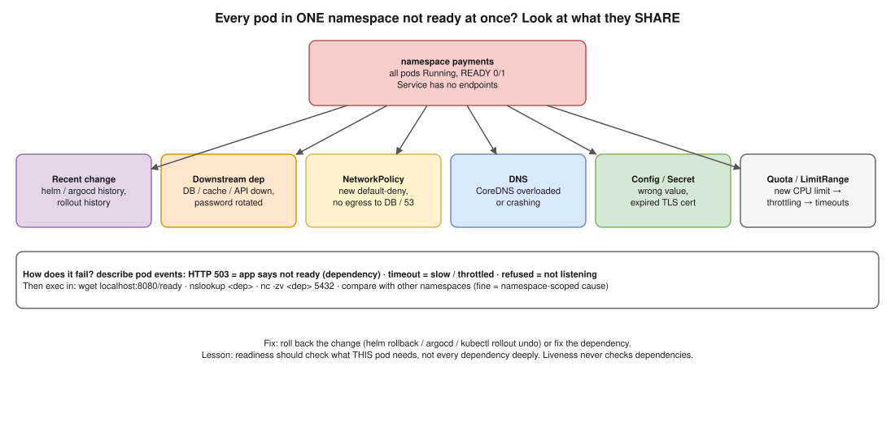

# K8s 03 · All Pods in One Namespace Suddenly Fail Readiness Checks ⭐



> **Say this first:** "When **every** pod in one namespace fails at the same time, it's rarely the pods themselves; it's something they **share**. So I ask: what **changed** at that time, and what do they all **depend on**? I look at one pod's events to see *how* the probe fails (timeout, connection refused, HTTP 503), check the logs, and call the readiness endpoint myself from inside the pod. Then I check the shared things: a **downstream dependency** the readiness check calls (database, cache, another service), a new **NetworkPolicy** in the namespace, **DNS/CoreDNS**, a changed **ConfigMap/Secret** or expired certificate, a **ResourceQuota/LimitRange** change causing throttling, or a deploy/Helm/Argo CD change. And I compare with other namespaces: if they're fine, the cause is namespace-scoped."

## Step 1: how exactly does the probe fail?

```bash
kubectl get pods -n payments -o wide                     # READY 0/1 everywhere? Running or restarting?
kubectl describe pod <pod> -n payments | sed -n '/Readiness/,/Events/p;/Events:/,$p'
kubectl get events -n payments --sort-by=.lastTimestamp | tail -30
kubectl logs <pod> -n payments --tail=100
kubectl get endpointslices -n payments                   # no ready endpoints = Service sends traffic nowhere
```

| Event message | Points to |
|---|---|
| `Readiness probe failed: HTTP probe failed with statuscode: 503` | App is up but says "not ready": usually a **dependency** check failing (DB, Redis, downstream API) |
| `... context deadline exceeded (Client.Timeout exceeded ...)` | App too slow: CPU throttling, thread pool exhausted, waiting on a slow dependency |
| `... connect: connection refused` | App not listening on that port/path (crashed, config changed the port, wrong probe port) |
| `... no such host` inside app logs | DNS problem |

## Step 2: test from inside

```bash
kubectl exec -it <pod> -n payments -- sh
  wget -qO- -T 3 http://localhost:8080/ready ; echo $?    # what does readiness return and why?
  nslookup postgres.db.svc.cluster.local                  # DNS
  nc -zv postgres.db.svc.cluster.local 5432               # dependency reachable?
  env | grep -i -E 'db|redis|url'                         # config as the pod sees it
```

## Step 3: check what the pods share

| Shared thing | Check | Typical cause |
|---|---|---|
| **Recent change** | `helm history <rel> -n payments`, `argocd app history <app>`, `kubectl rollout history deploy -n payments`, Git log | New version, new config, new probe settings |
| **Downstream dependency** | Readiness endpoint output, dependency's own health, DB connections (`max_connections` reached?) | Database down/overloaded, password rotated, cache down |
| **NetworkPolicy** | `kubectl get networkpolicy -n payments`, `kubectl describe networkpolicy …` | New default-deny without egress to DB or DNS (port 53) |
| **DNS** | `kubectl -n kube-system get pods -l k8s-app=kube-dns`, CoreDNS logs | CoreDNS overloaded/crashing, NodeLocal DNSCache issue |
| **ConfigMap / Secret** | `kubectl get cm,secret -n payments`, compare with the last good version | Wrong value, rotated credential, **expired TLS certificate** (cert-manager) |
| **ResourceQuota / LimitRange** | `kubectl describe quota -n payments`, `kubectl get limitrange -n payments -o yaml` | New default CPU limit → heavy throttling → probes time out |
| **Service account / IAM** | IRSA / Pod Identity role, AWS API errors in logs | IAM policy changed, role trust broken → app can't reach S3/SQS → not ready |
| **Nodes** | Are all pods on the same node group? `kubectl get pods -o wide` | Node group issue (but then other namespaces on those nodes also suffer) |
| **Service mesh** | Sidecar logs (istio-proxy), mTLS policy | New PeerAuthentication STRICT, sidecar version mismatch |

## Step 4: restore service, then fix properly

- If a change caused it: **roll back** (`helm rollback`, Argo CD sync to the previous revision, `kubectl rollout undo`).
- If a dependency is down: fix the dependency; meanwhile the pods being "not ready" is correct behaviour.
- **Lesson to say:** readiness probes should check what *this pod* needs to serve, not every dependency deeply. If every service's readiness checks the same database, one DB blip takes **all** pods out of every Service at once (a cascading outage), even for endpoints that don't need the DB. Liveness should never check dependencies.

## Resume check

All core Kubernetes; fits your EKS/Argo CD/Prometheus work. Service mesh (Istio) and cert-manager: mention only if you used them. Your K8s self-rating was challenged last time, so practise typing the commands above.

## Real-world example (suggested story, adapt it to what you really did)

"One morning every pod in our payments namespace went 0/1. Events showed HTTP 503 from `/ready`. Exec'ing in, the readiness endpoint reported it couldn't connect to Postgres. Other namespaces were fine. `kubectl get netpol` showed a default-deny policy merged the night before without an egress rule to the database namespace. We added the egress rule, pods went ready within seconds, and we added NetworkPolicy tests to CI." Only use if it fits something you lived.

## Follow-up questions

**Q: Readiness vs liveness vs startup probe?**
Readiness: can I get traffic? (fail → removed from endpoints). Liveness: am I stuck? (fail → restart). Startup: am I still starting? (holds off the other two until it passes, for slow starters).

**Q: The pods are `Running` but `0/1`. Are users affected?**
Yes, if all pods are unready the Service has no endpoints, so requests fail (connection refused / 503 from the ingress).

**Q: Should readiness check the database?**
Only lightly, and only if the pod truly can't serve anything without it. Otherwise report degraded and let the app handle errors; deep checks cause cascading failures.

## 🎯 Drill: type this from memory

1. `kubectl get events -n <ns> --sort-by=.lastTimestamp`
2. `kubectl describe pod <pod> -n <ns>` and read the Readiness line + events.
3. `kubectl get endpointslices -n <ns>`
4. `kubectl get networkpolicy -n <ns>` · `kubectl describe quota -n <ns>`
5. `helm history <rel> -n <ns>` · `kubectl rollout undo deploy/<name> -n <ns>`
6. A readiness probe YAML: `httpGet: {path: /ready, port: 8080}`, `periodSeconds`, `timeoutSeconds`, `failureThreshold`.

## 🗣️ 30-second spoken answer

1. All at once = something shared; what changed?
2. Events: 503 vs timeout vs refused.
3. Exec in: call /ready, nslookup, nc to the dependency.
4. Check NetworkPolicy, DNS, ConfigMap/Secret/cert, quota/limits, IAM, recent deploy.
5. Roll back if it was a change; keep readiness checks shallow.
