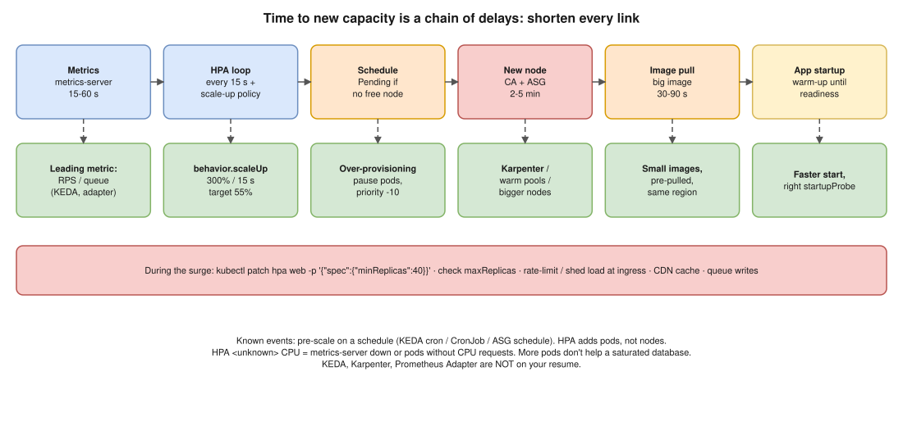

# K8s 04 · Massive Traffic Surge and HPA Can't Scale Pods Fast Enough ⭐



> **Say this first:** "HPA is reactive, and the time to new capacity is a **chain of delays**: metrics-server scrapes about every **15–60 s**, the HPA loop runs every **15 s**, its default scale-up **policy** limits how fast it grows, then the pod needs a **node** (the cluster autoscaler can take **minutes** to add one), the **image pull**, and the app **startup** before readiness passes. So right now I protect the service: **raise `minReplicas`** manually, **rate-limit/shed load** at the ingress, serve from **cache/CDN**. Then I shorten every link: an aggressive HPA **`behavior`** for scale-up, scale on a **leading metric** (requests per second or queue length via **KEDA** or the Prometheus adapter) instead of CPU, **over-provisioning** with low-priority placeholder pods so spare nodes already exist, a faster node autoscaler like **Karpenter**, smaller images and **faster startup**, and **scheduled pre-scaling** for known events."

## Step 1: during the surge (stop the bleeding)

```bash
kubectl get hpa -n shop -w                                # current vs target, replicas
kubectl describe hpa web -n shop                          # events: "failed to get cpu utilization"? at maxReplicas?
kubectl get pods -n shop | grep -c Pending                # pods waiting for nodes?
kubectl scale deploy web -n shop --replicas=40            # works briefly, but the HPA can scale it back (see below)
kubectl patch hpa web -n shop -p '{"spec":{"minReplicas":40}}'   # better: raise the floor
```

- `kubectl scale` alone fights the HPA (it recalculates and can scale back down); **patch `minReplicas`** instead, and check **`maxReplicas`** isn't the ceiling you're hitting.
- **Shed load**: ingress rate limits, return 429/503 fast instead of timing out, turn off expensive features (feature flags).
- **Cache**: CDN for static and cacheable API responses.
- **Queue** writes (SQS/Kafka) so the work is done later instead of failing now.

## Step 2: where the time goes, and how to cut it

| Link in the chain | Default / typical delay | How to make it faster |
|---|---|---|
| Metric collection | metrics-server resolution ~15 s (older/default setups 60 s) | `--metric-resolution=15s`; use request-rate metrics from Prometheus |
| Metric choice | CPU rises **after** requests pile up | Scale on **RPS per pod**, latency, or **queue length** (KEDA ScaledObject, Prometheus Adapter custom metrics) |
| HPA loop | every 15 s (`--horizontal-pod-autoscaler-sync-period`) | Not configurable on EKS; fine as is |
| HPA scale-up policy | Default: max of **+100% or +4 pods per 15 s**, no stabilisation on scale-up | `behavior.scaleUp` with bigger percent/pods per period (below) |
| Target utilisation | e.g. 80% leaves no headroom | Target 50–60% so existing pods absorb the first seconds |
| Pod scheduling | Pending if no free node | **Over-provisioning**: low-priority "pause" pods reserve space; real pods preempt them instantly |
| Node provisioning | Cluster Autoscaler + ASG: often 2–5 min | **Karpenter** (launches right-sized EC2 directly, typically faster), warm pools, bigger nodes |
| Image pull | Large image = 30–90 s | Small images (distroless, multi-stage), pre-pulled images / image cache on the AMI, same-region registry |
| App startup | JVM warm-up, cache loading | Tune startup, `startupProbe` correct, lazy loading, keep readiness honest |
| Max limits | `maxReplicas`, ResourceQuota, node group max, EC2 quotas, IP addresses in subnets (VPC CNI) | Raise them **before** the event |

```yaml
# Aggressive scale-up, cautious scale-down
apiVersion: autoscaling/v2
kind: HorizontalPodAutoscaler
metadata:
  name: web
  namespace: shop
spec:
  scaleTargetRef: { apiVersion: apps/v1, kind: Deployment, name: web }
  minReplicas: 10
  maxReplicas: 200
  metrics:
    - type: Resource
      resource:
        name: cpu
        target: { type: Utilization, averageUtilization: 55 }
  behavior:
    scaleUp:
      stabilizationWindowSeconds: 0
      policies:
        - { type: Percent, value: 300, periodSeconds: 15 }   # can quadruple every 15 s
        - { type: Pods,    value: 20,  periodSeconds: 15 }
      selectPolicy: Max
    scaleDown:
      stabilizationWindowSeconds: 300
      policies:
        - { type: Percent, value: 10, periodSeconds: 60 }
```

```yaml
# Over-provisioning: placeholder pods that real workloads evict instantly
apiVersion: scheduling.k8s.io/v1
kind: PriorityClass
metadata: { name: overprovisioning }
value: -10
globalDefault: false
description: "Placeholder pods, evicted first"
---
apiVersion: apps/v1
kind: Deployment
metadata: { name: overprovisioning, namespace: kube-system }
spec:
  replicas: 5
  selector: { matchLabels: { app: overprovisioning } }
  template:
    metadata: { labels: { app: overprovisioning } }
    spec:
      priorityClassName: overprovisioning
      terminationGracePeriodSeconds: 0
      containers:
        - name: pause
          image: registry.k8s.io/pause:3.10
          resources: { requests: { cpu: "1", memory: 2Gi } }
```

## Step 3: for known events, don't wait for the HPA

- Raise `minReplicas` and node group minimums before a sale/launch (CronJob or KEDA **cron** scaler), see [AWS 05](../aws/05-scheduled-vs-dynamic-scaling.md).
- Load test before the event to know the real ceiling (and whether the **database** is the real bottleneck: more pods don't help a saturated DB).

## Resume check

EKS, HPA, Prometheus, Grafana fit. **KEDA, Karpenter, Prometheus Adapter** are not on your resume: say "I'd use". Cluster Autoscaler: claim only if you ran it.

## Real-world example (suggested story, adapt it to what you really did)

"A partner integration sent 6× normal traffic within a minute. HPA was on CPU at 80%, and new pods were Pending for four minutes waiting for nodes. We raised minReplicas by hand to recover, then changed the HPA target to 55% with a faster scale-up behaviour and added a small over-provisioning deployment so a spare node was always there. The next spike was absorbed in under a minute." Only use parts that match your experience.

## Follow-up questions

**Q: Why not just set `minReplicas` very high?**
You pay for idle pods and nodes all the time. Headroom + fast scaling + scheduled pre-scaling is cheaper.

**Q: HPA shows `<unknown>` for CPU. Why?**
metrics-server missing/unhealthy, or the pods have **no CPU requests** (utilisation is a percentage of the request).

**Q: Does HPA scale nodes?**
No. HPA adds pods; the Cluster Autoscaler / Karpenter adds nodes when pods are Pending.

## 🎯 Drill: type this from memory

1. The HPA `autoscaling/v2` YAML with `behavior.scaleUp` and `scaleDown`.
2. `kubectl patch hpa <name> -n <ns> -p '{"spec":{"minReplicas":40}}'`
3. `kubectl describe hpa <name> -n <ns>` · `kubectl get pods -n <ns> --field-selector=status.phase=Pending`
4. The PriorityClass (value -10) + pause Deployment for over-provisioning.
5. The delay chain: metrics → HPA → schedule → node → pull → startup.

## 🗣️ 30-second spoken answer

1. HPA is reactive: a chain of delays (metrics, loop, policy, node, pull, startup).
2. Now: raise minReplicas, rate-limit, cache, queue.
3. Faster HPA: `behavior` scale-up, lower target, leading metric (RPS/queue, KEDA).
4. Faster capacity: over-provisioning pods, Karpenter, small images, fast startup.
5. Known events: pre-scale on a schedule; load test.
