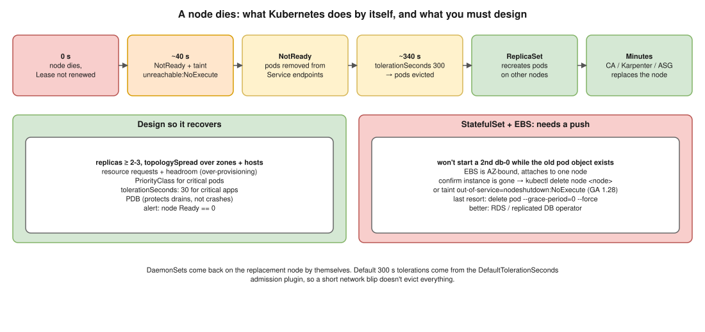

# K8s 05 · A Node With Critical Workloads Crashes Permanently ⭐



> **Say this first:** "Kubernetes recovers stateless workloads by itself **if** I designed for it. When the node stops heartbeating, after about **40 seconds** it's marked **NotReady**, gets the **`node.kubernetes.io/unreachable`** taint, and pods are evicted after their **toleration of 300 seconds**. The **Deployment/ReplicaSet** controller then creates replacements on healthy nodes, and the **Cluster Autoscaler/Karpenter or the ASG** replaces the node. So I make sure: **at least 2 replicas** spread across nodes and AZs (**topology spread / anti-affinity**), **resource requests** and spare capacity so they fit elsewhere, a **PriorityClass** so critical pods preempt less important ones, and maybe a **shorter `tolerationSeconds`** for critical apps. **StatefulSets** are the exception: Kubernetes won't start a second copy until it knows the old pod is gone, so I delete the dead node object (or use the **out-of-service taint**) so the pod and its **EBS volume** can move, and the volume must be in the same AZ."

## What happens, second by second (defaults)

| Time | Event |
|---|---|
| 0 s | Node dies; kubelet stops renewing its Lease |
| ~40 s | `node-monitor-grace-period` passes → node controller marks the node **NotReady/Unknown**, adds taints `node.kubernetes.io/unreachable:NoExecute` (or `not-ready`) |
| 40 s → 340 s | Pods still listed as `Running` on the dead node; **Endpoints controller removes them from Services** once the node is NotReady (pods marked not ready), so traffic stops going there |
| ~340 s | Pods' default toleration `tolerationSeconds: 300` expires → pods are **evicted** (marked for deletion; shown `Terminating` since the kubelet can't confirm) |
| right after | **ReplicaSet** creates replacement pods → scheduler places them on other nodes (if there is room) |
| minutes | Cluster Autoscaler / Karpenter / ASG health check launches a **replacement node**; EKS managed node groups can auto-repair unhealthy nodes |
| StatefulSet pods | **Not replaced** automatically while the old pod object exists (at-most-one guarantee) |

## Design so it recovers automatically

```yaml
# (illustrative) Critical Deployment
apiVersion: apps/v1
kind: Deployment
metadata: { name: payments, namespace: prod }
spec:
  replicas: 3
  selector: { matchLabels: { app: payments } }
  template:
    metadata: { labels: { app: payments } }
    spec:
      priorityClassName: business-critical         # preempts lower-priority pods if space is short
      topologySpreadConstraints:
        - maxSkew: 1
          topologyKey: topology.kubernetes.io/zone
          whenUnsatisfiable: DoNotSchedule
          labelSelector: { matchLabels: { app: payments } }
        - maxSkew: 1
          topologyKey: kubernetes.io/hostname
          whenUnsatisfiable: ScheduleAnyway
          labelSelector: { matchLabels: { app: payments } }
      tolerations:                                  # move faster than the 300 s default
        - { key: node.kubernetes.io/unreachable, operator: Exists, effect: NoExecute, tolerationSeconds: 30 }
        - { key: node.kubernetes.io/not-ready,   operator: Exists, effect: NoExecute, tolerationSeconds: 30 }
      containers:
        - name: app
          image: 111122223333.dkr.ecr.ap-south-1.amazonaws.com/payments@sha256:...
          resources:
            requests: { cpu: 500m, memory: 512Mi }
          readinessProbe: { httpGet: { path: /ready, port: 8080 }, periodSeconds: 5 }
---
apiVersion: policy/v1
kind: PodDisruptionBudget
metadata: { name: payments, namespace: prod }
spec:
  minAvailable: 2
  selector: { matchLabels: { app: payments } }
```

| Control | Why |
|---|---|
| **replicas ≥ 2** (3 for critical), spread over **nodes and AZs** | One node or one AZ can't take all copies |
| **Resource requests** + cluster headroom (or over-provisioning) | Replacements need somewhere to land |
| **PriorityClass** | Critical pods preempt batch jobs when space is short |
| **Shorter `tolerationSeconds`** | Faster eviction for critical apps (trade-off: flapping nodes cause churn) |
| **PDB** | Protects against *voluntary* disruptions (drains, upgrades), not crashes, but keeps the remaining copies safe while you recover |
| **Node autoscaling / ASG health checks / managed node group auto repair** | The node itself gets replaced |
| **Monitoring** | Alert on `kube_node_status_condition{condition="Ready",status="true"} == 0` |

## StatefulSets and volumes (the tricky part)

- A StatefulSet pod (`db-0`) on the dead node stays `Terminating`/`Unknown`; Kubernetes won't create a new `db-0` until it's sure the old one isn't running (to avoid two writers on the same volume).
- **EBS volumes** are **AZ-bound** and attach to one node; the attach-detach controller force-detaches after ~6 minutes of the node being unhealthy, but the pod still needs the old object gone.
- **Options:**
  1. Confirm the node is really dead (instance terminated in EC2), then `kubectl delete node <node>` → pods on it are garbage-collected → `db-0` recreated, volume attached to a new node in the **same AZ**.
  2. **Non-graceful node shutdown** (GA in 1.28): `kubectl taint nodes <node> node.kubernetes.io/out-of-service=nodeshutdown:NoExecute` → pods force-deleted and volumes detached right away.
  3. Last resort for one pod: `kubectl delete pod db-0 --grace-period=0 --force` (only when you're sure the node is gone).
- Better: run stateful data on **managed services** (RDS) or databases with their own replication (multiple StatefulSet replicas in different AZs, operator handles failover).

```bash
kubectl get nodes                                       # NotReady
kubectl describe node <node> | sed -n '/Taints/,/Conditions/p'
kubectl get pods -A -o wide --field-selector spec.nodeName=<node>
aws ec2 describe-instance-status --instance-ids <id> --include-all-instances
kubectl delete node <node>                              # only once the instance is confirmed gone
kubectl get volumeattachments | grep <node>
```

## Resume check

EKS, managed node groups, Prometheus alerts fit. If you haven't used the out-of-service taint or Karpenter, describe them as "the documented way". DaemonSets: nothing to do, they run on the new node automatically.

## Real-world example (suggested story, adapt it to what you really did)

"An EKS node with a hardware fault went NotReady at night. Our stateless services had three replicas spread over AZs, so users saw nothing and the ASG replaced the node. A self-hosted Redis StatefulSet with one replica stayed down until we deleted the node object and the pod moved with its EBS volume to another node in the same AZ. After that we moved it to a managed service." Only use what matches your experience. (Redis isn't on your resume; swap in what you ran.)

## Follow-up questions

**Q: Why does it take ~5 minutes for pods to move?**
Default `tolerationSeconds: 300` on the `not-ready`/`unreachable` taints, added to every pod by the DefaultTolerationSeconds admission plugin. It avoids evicting everything during a short network blip.

**Q: Does a PDB stop pods from being evicted when a node crashes?**
No. PDBs only apply to voluntary disruptions through the eviction API (drain, upgrades). A crash is involuntary.

**Q: Why won't the StatefulSet pod restart elsewhere?**
StatefulSets guarantee at most one pod per identity. Kubernetes can't tell a dead node from a network partition, so it waits until the old pod object is deleted.

## 🎯 Drill: type this from memory

1. The `topologySpreadConstraints` block (zone + hostname) and the two `tolerations` with `tolerationSeconds: 30`.
2. A `PodDisruptionBudget` with `minAvailable: 2`.
3. `kubectl get pods -A -o wide --field-selector spec.nodeName=<node>`
4. `kubectl taint nodes <node> node.kubernetes.io/out-of-service=nodeshutdown:NoExecute`
5. The timeline: 40 s NotReady → taint → 300 s eviction → ReplicaSet recreates.

## 🗣️ 30-second spoken answer

1. NotReady at ~40 s, taint, eviction after 300 s, ReplicaSet recreates, autoscaler replaces the node.
2. Design: ≥2–3 replicas spread over nodes and AZs, requests, headroom.
3. PriorityClass, shorter tolerationSeconds for critical apps.
4. StatefulSets: delete the dead node or out-of-service taint; EBS same AZ.
5. Alert on node NotReady.
