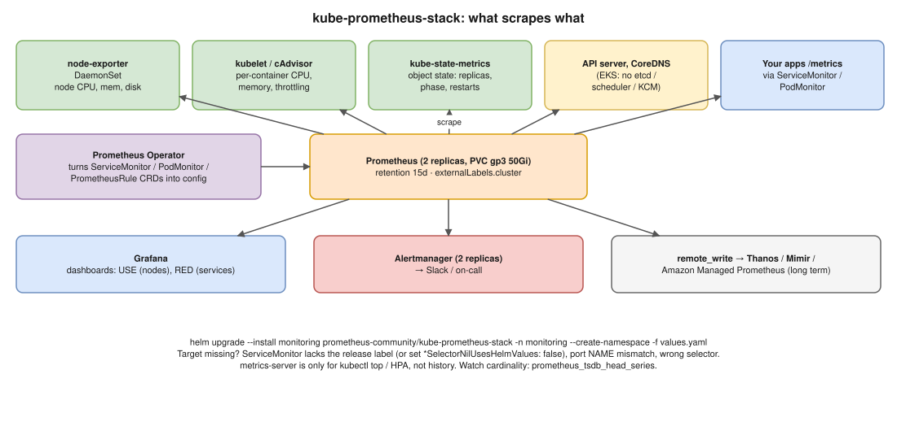

# Monitoring 01 · Kubernetes Cluster-Level Monitoring With Prometheus ⭐



> **Say this first:** "I install **kube-prometheus-stack** with Helm. It brings the **Prometheus Operator**, **Prometheus**, **Alertmanager**, **Grafana**, **node-exporter** as a DaemonSet and **kube-state-metrics**, plus default recording rules, alerts and dashboards. That covers the four sources of cluster metrics: **node-exporter** for node CPU, memory, disk and network; the **kubelet's cAdvisor** endpoint for per-container usage; **kube-state-metrics** for the *state* of objects (desired vs available replicas, pod phase, restarts, node conditions); and the **API server, CoreDNS and other control plane** metrics where the platform exposes them. Applications are added with **ServiceMonitor/PodMonitor** objects. For production I give Prometheus **persistent storage**, run it **HA (2 replicas)**, set retention, and ship to long-term storage (**Thanos, Mimir or Amazon Managed Prometheus**) with `remote_write`."

## The metric sources

| Source | Runs as | Gives you | Example metrics |
|---|---|---|---|
| **node-exporter** | DaemonSet on every node | Node OS: CPU, memory, disk, filesystem, network | `node_cpu_seconds_total`, `node_memory_MemAvailable_bytes`, `node_filesystem_avail_bytes` |
| **kubelet / cAdvisor** | Built into every kubelet (`/metrics/cadvisor`) | Per-container CPU, memory, throttling, network | `container_cpu_usage_seconds_total`, `container_memory_working_set_bytes`, `container_cpu_cfs_throttled_periods_total` |
| **kube-state-metrics** | Deployment | Object state from the API server | `kube_pod_status_phase`, `kube_deployment_status_replicas_available`, `kube_pod_container_status_restarts_total`, `kube_node_status_condition` |
| **API server** | Control plane (`/metrics`) | Request rates, latency, errors | `apiserver_request_total`, `apiserver_request_duration_seconds_bucket` |
| **CoreDNS** | kube-system | DNS request rate, errors, latency | `coredns_dns_requests_total` |
| etcd / scheduler / controller-manager | Control plane | Health of the control plane | **Not scrapeable on managed EKS** the usual way (AWS runs them); disable those jobs in the chart |
| **Your apps** | `/metrics` endpoint | Business + RED metrics | via **ServiceMonitor** |

**metrics-server is different:** it's for `kubectl top` and the HPA (short-lived, in memory), not for monitoring history.

## Install

```bash
helm repo add prometheus-community https://prometheus-community.github.io/helm-charts
helm repo update
helm upgrade --install monitoring prometheus-community/kube-prometheus-stack \
  --namespace monitoring --create-namespace -f values.yaml

kubectl -n monitoring get pods
kubectl -n monitoring port-forward svc/monitoring-kube-prometheus-prometheus 9090    # Status → Targets
kubectl -n monitoring port-forward svc/monitoring-grafana 3000:80
```

```yaml
# values.yaml (illustrative, key parts)
prometheus:
  prometheusSpec:
    replicas: 2
    retention: 15d
    retentionSize: 45GB
    resources:
      requests: { cpu: "1", memory: 4Gi }
    storageSpec:
      volumeClaimTemplate:
        spec:
          storageClassName: gp3
          resources: { requests: { storage: 50Gi } }
    # pick up ServiceMonitors from every namespace, not only those labelled with this release
    serviceMonitorSelectorNilUsesHelmValues: false
    podMonitorSelectorNilUsesHelmValues: false
    ruleSelectorNilUsesHelmValues: false
    externalLabels: { cluster: prod-ap-south-1 }
    remoteWrite:
      - url: https://aps-workspaces.ap-south-1.amazonaws.com/workspaces/ws-xxxx/api/v1/remote_write
        sigv4: { region: ap-south-1 }
alertmanager:
  alertmanagerSpec:
    replicas: 2
grafana:
  adminPassword: ""                 # use an existing secret instead: admin.existingSecret
  persistence: { enabled: true }
kubeEtcd: { enabled: false }        # EKS: control plane not reachable
kubeScheduler: { enabled: false }
kubeControllerManager: { enabled: false }
```

## Adding an application

```yaml
apiVersion: monitoring.coreos.com/v1
kind: ServiceMonitor
metadata:
  name: payments
  namespace: payments
  labels: { release: monitoring }       # needed if you KEEP the default selector
spec:
  selector:
    matchLabels: { app: payments }      # matches the Service's labels
  endpoints:
    - port: http-metrics                # the Service port NAME
      path: /metrics
      interval: 30s
```

Most common reason "my target doesn't appear": the ServiceMonitor lacks the `release: <helm-release>` label the default selector wants, the port **name** doesn't match the Service, or the Service selector doesn't match the pods.

## The queries / dashboards that matter

```promql
# Node CPU usage %
100 * (1 - avg by (instance) (rate(node_cpu_seconds_total{mode="idle"}[5m])))

# Pod memory vs its limit
sum by (namespace, pod) (container_memory_working_set_bytes{container!=""})
  / sum by (namespace, pod) (kube_pod_container_resource_limits{resource="memory"})

# Restarting containers
increase(kube_pod_container_status_restarts_total[15m]) > 3

# Deployments not at desired replicas
kube_deployment_spec_replicas != kube_deployment_status_replicas_available

# Nodes not Ready
kube_node_status_condition{condition="Ready",status="true"} == 0

# CPU throttling ratio per container
rate(container_cpu_cfs_throttled_periods_total[5m]) / rate(container_cpu_cfs_periods_total[5m])
```

Methods to name: **USE** (Utilisation, Saturation, Errors) for nodes/resources; **RED** (Rate, Errors, Duration) for services; the **four golden signals** (latency, traffic, errors, saturation).

## Production checklist

- Persistent volume + retention by time and size; **HA** replicas (Alertmanager clustered).
- Long-term + multi-cluster view: **Thanos** sidecar/receive, **Grafana Mimir**, or **Amazon Managed Service for Prometheus**; `externalLabels.cluster` on every series.
- Watch **cardinality** (`prometheus_tsdb_head_series`); drop high-cardinality labels with `metricRelabelings`.
- Monitor the monitoring: `Watchdog` alert to a dead man's switch, alert when Prometheus targets are down (`up == 0`).
- Grafana via SSO, dashboards as code (ConfigMaps with the sidecar label, or Grafana provisioning).
- Logs (Loki/ELK) and traces (Tempo/Jaeger) next to metrics for full observability.

## Resume check

**Prometheus and Grafana are on your resume**, and EKS is: this is a question you must answer fluently with commands. Thanos, Mimir, Amazon Managed Prometheus are not on your resume; mention as options. ELK only at trainee level, Loki not listed.

## Real-world example (suggested story, adapt it to what you really did)

"At Koko I set up kube-prometheus-stack on our EKS clusters with Helm through Argo CD, disabled the etcd/scheduler/controller-manager jobs because EKS manages them, gave Prometheus a 50Gi gp3 volume with 15 days retention, and added ServiceMonitors for our services. Grafana had the default cluster dashboards plus our own per-service RED dashboards." Only claim what you set up.

## Follow-up questions

**Q: kube-state-metrics vs metrics-server?**
kube-state-metrics exposes the **state** of Kubernetes objects (replicas, phases, conditions) for Prometheus. metrics-server collects current CPU/memory for `kubectl top` and the HPA and keeps no history.

**Q: How does Prometheus find targets in Kubernetes?**
`kubernetes_sd_configs` service discovery (roles: node, pod, service, endpoints/endpointslice, ingress) plus relabelling; with the Operator you write ServiceMonitors/PodMonitors and it generates that config.

**Q: Why not keep a year of data in Prometheus?**
Local TSDB is single-node, sized by one disk, and not built for long retention or global queries. Use remote storage (Thanos/Mimir/AMP) for long-term.

## 🎯 Drill: type this from memory

1. `helm upgrade --install monitoring prometheus-community/kube-prometheus-stack -n monitoring --create-namespace -f values.yaml`
2. A ServiceMonitor (selector, endpoints port name, `release` label).
3. PromQL: node CPU %, restarts in 15 min, deployments not at desired replicas, node not Ready.
4. The source table: node-exporter, cAdvisor, kube-state-metrics, API server, apps.
5. `kubectl -n monitoring port-forward svc/<prometheus-svc> 9090`

## 🗣️ 30-second spoken answer

1. kube-prometheus-stack with Helm: Operator, Prometheus, Alertmanager, Grafana, node-exporter, kube-state-metrics.
2. Sources: node-exporter (nodes), cAdvisor (containers), kube-state-metrics (object state), API server/CoreDNS.
3. Apps via ServiceMonitor; watch the `release` label.
4. Production: PVC, retention, 2 replicas, remote_write to Thanos/Mimir/AMP.
5. Dashboards with USE/RED, alerts via Alertmanager.
