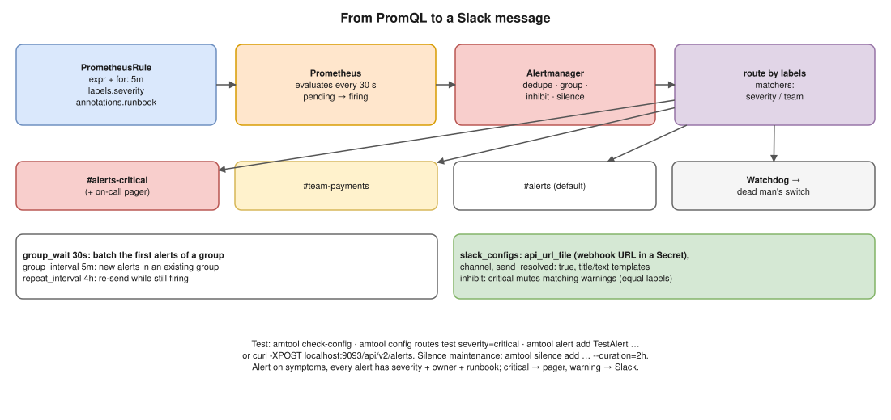

# Monitoring 02 · Prometheus + Alertmanager + Slack for Real-Time Notifications ⭐



> **Say this first:** "Prometheus **evaluates alerting rules** (a PromQL expression with a `for:` duration and labels like `severity`) and sends firing alerts to **Alertmanager**. Alertmanager does the notification logic: **grouping** related alerts into one message, **routing** by labels to the right **receiver**, **inhibition** (a critical alert silences the matching warnings), **silences** during maintenance, and **repeat/resolve** notifications. For Slack I create an **incoming webhook** for the channel, store its URL in a **Kubernetes Secret**, and configure a receiver with `slack_configs`, `send_resolved: true` and a message template that includes the summary, severity and a runbook link. Critical alerts go to an on-call tool too (PagerDuty/Opsgenie), warnings to Slack only. I test the whole path by firing a test alert with `amtool` or the Alertmanager API, and I keep the **Watchdog** alert as a dead man's switch so I know the pipeline itself is alive."

## The flow

1. **Rule** in a `PrometheusRule` (Operator) or a rules file: `expr`, `for`, `labels`, `annotations`.
2. **Prometheus** evaluates every `evaluation_interval` (e.g., 30 s). The alert is **pending** until the condition has held for `for:`, then **firing**, and is sent to Alertmanager (repeatedly while firing).
3. **Alertmanager**: dedupes (HA Prometheus pairs send the same alert twice), groups, applies inhibitions and silences, routes, sends to **Slack**, and later sends **resolved**.

## Alerting rule

```yaml
apiVersion: monitoring.coreos.com/v1
kind: PrometheusRule
metadata:
  name: payments-alerts
  namespace: monitoring
  labels: { release: monitoring }          # so the default ruleSelector picks it up
spec:
  groups:
    - name: payments
      rules:
        - alert: PaymentsHighErrorRate
          expr: |
            sum(rate(http_requests_total{job="payments",code=~"5.."}[5m]))
              / sum(rate(http_requests_total{job="payments"}[5m])) > 0.05
          for: 5m
          labels:
            severity: critical
            team: payments
          annotations:
            summary: "Payments 5xx rate above 5% for 5 minutes"
            description: "Current error ratio: {{ $value | humanizePercentage }}"
            runbook_url: "https://wiki.example.com/runbooks/payments-5xx"
        - alert: PodCrashLooping
          expr: increase(kube_pod_container_status_restarts_total[15m]) > 3
          for: 5m
          labels: { severity: warning }
          annotations:
            summary: "{{ $labels.namespace }}/{{ $labels.pod }} restarted more than 3 times in 15m"
```

## Alertmanager configuration (plain `alertmanager.yml`)

```yaml
global:
  resolve_timeout: 5m

route:
  receiver: slack-default                     # fallback
  group_by: [alertname, namespace, severity]
  group_wait: 30s                             # wait to batch the first alerts of a new group
  group_interval: 5m                          # wait before sending NEW alerts added to a group
  repeat_interval: 4h                         # re-send if still firing
  routes:
    - matchers: [ 'severity="critical"' ]
      receiver: slack-critical
      continue: true                          # also evaluate the next routes
    - matchers: [ 'severity="critical"' ]
      receiver: pagerduty-oncall
    - matchers: [ 'team="payments"' ]
      receiver: slack-payments
    - matchers: [ 'alertname="Watchdog"' ]
      receiver: deadmans-switch
      repeat_interval: 1m

inhibit_rules:
  - source_matchers: [ 'severity="critical"' ]
    target_matchers: [ 'severity="warning"' ]
    equal: [alertname, namespace]             # only if these labels match

receivers:
  - name: slack-default
    slack_configs:
      - api_url_file: /etc/alertmanager/secrets/slack-webhook/url    # keep the URL out of the config
        channel: "#alerts"
        send_resolved: true
        title: '{{ if eq .Status "firing" }}🔥{{ else }}✅{{ end }} [{{ .Status | toUpper }}] {{ .CommonLabels.alertname }}'
        text: |-
          {{ range .Alerts }}
          *Severity:* {{ .Labels.severity }}  *Namespace:* {{ .Labels.namespace }}
          *Summary:* {{ .Annotations.summary }}
          {{ if .Annotations.runbook_url }}*Runbook:* {{ .Annotations.runbook_url }}{{ end }}
          {{ end }}
  - name: slack-critical
    slack_configs:
      - api_url_file: /etc/alertmanager/secrets/slack-webhook/url
        channel: "#alerts-critical"
        send_resolved: true
  - name: slack-payments
    slack_configs:
      - api_url_file: /etc/alertmanager/secrets/slack-webhook/url
        channel: "#team-payments"
        send_resolved: true
  - name: pagerduty-oncall
    pagerduty_configs:
      - routing_key_file: /etc/alertmanager/secrets/pagerduty/key
  - name: deadmans-switch
    webhook_configs:
      - url: https://deadmans.example.com/ping/abc123
```

Notes:
- Newer Slack incoming webhooks are tied to **one channel**; the `channel` field may be ignored, so create one webhook per channel (or use a Slack app bot token with `chat.postMessage`, supported in recent Alertmanager versions).
- `matchers` is the current syntax; old configs use `match:` / `match_re:` (deprecated).

## In kube-prometheus-stack

```bash
# Webhook URL as a Secret, mounted into Alertmanager
kubectl -n monitoring create secret generic slack-webhook \
  --from-literal=url='https://hooks.slack.com/services/T000/B000/XXXX'
```

```yaml
# values.yaml (illustrative)
alertmanager:
  alertmanagerSpec:
    secrets: [slack-webhook]          # mounted at /etc/alertmanager/secrets/slack-webhook/
  config:
    # the whole alertmanager.yml from above goes here (route, inhibit_rules, receivers)
```

Alternatively, teams can own their routing with the **`AlertmanagerConfig`** CRD in their namespace (the Operator merges it, scoped to alerts from that namespace).

## Test the whole path

```bash
amtool check-config alertmanager.yml                        # syntax + receivers
promtool check rules rules.yaml                             # rule syntax (plain rules file)
amtool config routes test --config.file=alertmanager.yml severity=critical team=payments   # which receiver?

# Fire a fake alert straight into Alertmanager
kubectl -n monitoring port-forward svc/monitoring-kube-prometheus-alertmanager 9093
amtool alert add TestAlert severity=warning namespace=demo \
  --annotation=summary="Test from amtool" --alertmanager.url=http://localhost:9093
# or with curl (API v2)
curl -XPOST localhost:9093/api/v2/alerts -H 'Content-Type: application/json' -d \
  '[{"labels":{"alertname":"TestAlert","severity":"warning"},"annotations":{"summary":"curl test"}}]'

# Silence during maintenance
amtool silence add alertname=PodCrashLooping namespace=batch --duration=2h \
  --comment="node upgrade" --alertmanager.url=http://localhost:9093
```

Then check Prometheus → **Alerts** page (pending/firing) and Alertmanager UI (grouping, silences).

## Good alerting practice (say two or three)

- **Alert on symptoms users feel** (error rate, latency, SLO burn rate), not on every cause (CPU 80%).
- Every alert has a **severity**, an **owner/team** label and a **runbook link**; if nobody would act on it, delete it.
- **`for:`** to avoid flapping; grouping to avoid 50 messages for one incident; inhibition to hide the noise below a critical.
- **Critical → pager, warning → Slack, info → dashboard.**
- Review noisy alerts weekly (alert fatigue).

## Resume check

**Prometheus, Grafana and Alertmanager-style alerting fit your resume**, and Nagios shows alerting background. **PagerDuty/Opsgenie are not on your resume**; say "or whatever on-call tool the team uses". Know `amtool`/`promtool` commands by heart since you claim Prometheus.

## Real-world example (suggested story, adapt it to what you really did)

"We had all alerts going to one Slack channel, about 200 messages a day, so people ignored it. I added `severity` and `team` labels to every rule, routed critical to the on-call tool and a critical channel, warnings per team channel, grouped by alertname and namespace, added an inhibition so node-down hid the pod alerts on that node, and runbook links in every annotation. Messages dropped to around 20 a day and people started acting on them." Only use what's true.

## Follow-up questions

**Q: group_wait vs group_interval vs repeat_interval?**
`group_wait`: how long to wait before the first notification of a new group (collect related alerts). `group_interval`: how long before notifying about new alerts added to an existing group. `repeat_interval`: how often to re-send a notification for alerts still firing.

**Q: What's an inhibition rule?**
If a source alert is firing (e.g., `NodeDown`, critical), matching target alerts (e.g., pod warnings on that node) are muted, as long as the `equal` labels match.

**Q: How do you know Alertmanager itself works?**
The always-firing **Watchdog** alert routed to a dead man's switch service that pages you if the heartbeat stops; plus alerts on Alertmanager notification failures (`alertmanager_notifications_failed_total`).

## 🎯 Drill: type this from memory

1. A PrometheusRule with `alert`, `expr`, `for`, `labels.severity`, `annotations.summary/runbook_url`.
2. The `route` block with `group_by`, `group_wait`, `group_interval`, `repeat_interval`, child `routes` with `matchers`.
3. A `slack_configs` receiver with `api_url_file`, `channel`, `send_resolved: true`.
4. An `inhibit_rules` entry with `source_matchers`, `target_matchers`, `equal`.
5. `amtool check-config alertmanager.yml` · `amtool alert add …` · `curl -XPOST localhost:9093/api/v2/alerts …`

## 🗣️ 30-second spoken answer

1. Prometheus evaluates rules (expr + for + severity) → sends to Alertmanager.
2. Alertmanager groups, routes by labels, inhibits, silences, repeats, resolves.
3. Slack: incoming webhook in a Secret, `slack_configs`, `send_resolved`, template with runbook.
4. Critical → pager + critical channel; warning → team channel.
5. Test with amtool/curl; Watchdog dead man's switch.
