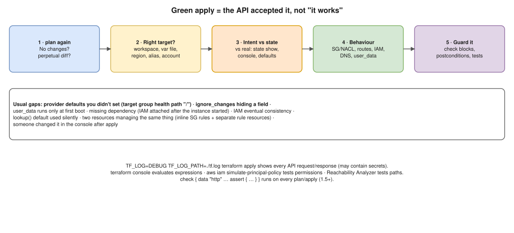

# Terraform 01 · Apply Succeeded, but Resources Don't Behave as Expected ⭐



> **Say this first:** "A green apply only means the **cloud API accepted** what I asked for; it doesn't mean the system works. So I separate two questions: **did Terraform create what I *meant*?** and **is the thing I meant actually right?** First I run **`terraform plan`** again: if it's not empty, something is drifting or a value keeps changing. Then I compare **what I intended** with **state** (`terraform state show`, outputs) and the **real resource** (console/AWS CLI): often a **provider default** I didn't set, the **wrong workspace, var file, region or provider alias**, or `ignore_changes` hiding something. If config is right, I test **behaviour layer by layer**: security groups and NACLs, routes, IAM (including propagation delay), DNS, and things that only run once like **user_data**. I use `TF_LOG=DEBUG` to see the exact API calls, `terraform console` to evaluate expressions, and afterwards I add **`check` blocks / postconditions / `terraform test`** so the next apply catches it."

## Step 1: is Terraform itself consistent?

```bash
terraform plan                                  # should say "No changes". If not: drift or a perpetual diff
terraform workspace show                        # right workspace?
terraform output
terraform state list | grep aws_security_group
terraform state show aws_security_group.web     # what Terraform recorded (real IDs + attributes)
terraform console                               # evaluate: > local.subnet_ids   > var.env
```

- **Perpetual diff** (plan always wants to change something): the provider normalises a value differently (JSON policy formatting, uppercase/lowercase, ordering), or two resources manage the same thing (e.g., inline `ingress` blocks in `aws_security_group` **and** separate `aws_vpc_security_group_ingress_rule` resources fight).

## Step 2: intended vs state vs real

| Common gap | Example | How to spot it |
|---|---|---|
| Wrong target | Applied with `dev.tfvars` to prod workspace, provider alias for `us-east-1` instead of `ap-south-1` | `terraform workspace show`, provider block, `aws sts get-caller-identity`, region in the ARN |
| Provider default you didn't set | `aws_lb_target_group` health check path defaults to `/`; RDS `publicly_accessible`, ALB `idle_timeout` 60 s; S3 bucket without lifecycle | `state show` vs what you assumed |
| Wrong value from an expression | `for_each` key typo, `lookup()` default used silently, `count` index mismatch | `terraform console` |
| Something hidden | `lifecycle { ignore_changes = [...] }` hides drift on that field | grep for `ignore_changes` |
| One-time-only settings | **`user_data` runs only at first boot**; changing it updates the launch template but not running instances (unless `user_data_replace_on_change = true` or an instance refresh) | Instance still has the old behaviour |
| Missing dependency | Resource created before the thing it needs (IAM policy attached after the Lambda/EC2 started; NAT not ready) | Order in `TF_LOG` / apply output; add a reference or `depends_on` |
| Eventual consistency | IAM role or policy used seconds after creation → `AccessDenied` at first, works later | Retry; it often fixes itself in seconds |
| Modified outside Terraform after apply | Someone hot-fixed it in the console | Plan shows drift; CloudTrail shows who |

## Step 3: test the behaviour, layer by layer

```bash
# Network path
aws ec2 describe-security-groups --group-ids sg-0abc
aws ec2 describe-route-tables --filters Name=association.subnet-id,Values=subnet-0abc
# VPC Reachability Analyzer for "why can't A talk to B"

# Load balancer / targets
aws elbv2 describe-target-health --target-group-arn "$TG"

# IAM: what can this role actually do?
aws iam simulate-principal-policy --policy-source-arn arn:aws:iam::111122223333:role/app \
  --action-names s3:GetObject --resource-arns arn:aws:s3:::bucket/key

# The instance / app itself
aws ec2 get-console-output --instance-id i-0abc --latest --output text | tail -50   # did user_data/cloud-init fail?
curl -sv https://app.example.com/health
```

## Step 4: see exactly what Terraform did

```bash
TF_LOG=DEBUG TF_LOG_PATH=./tf-debug.log terraform apply      # full API requests/responses
TF_LOG_PROVIDER=DEBUG terraform plan                         # provider logs only
grep -i "error\|retry\|HTTP/1.1 4" tf-debug.log | head
```

(Debug logs can contain secrets: don't attach them to tickets as-is.)

## Step 5: make the next apply catch it

```hcl
# Continuous validation: runs on every plan/apply, warns if it fails (1.5+)
check "app_health" {
  data "http" "health" {
    url = "https://${aws_lb.web.dns_name}/health"
  }
  assert {
    condition     = data.http.health.status_code == 200
    error_message = "App health endpoint did not return 200"
  }
}

resource "aws_lb_target_group" "web" {
  # ...
  lifecycle {
    postcondition {
      condition     = self.health_check[0].path == "/health"
      error_message = "Target group must health-check /health, not the default /"
    }
  }
}
```

Also: `terraform test` files (`*.tftest.hcl`) in CI, and policy checks (checkov/trivy/tflint) for rules like "no public RDS".

## Resume check

Terraform, AWS, GitLab CI fit your resume. `check` blocks and `terraform test` are newer features; fine to describe, claim only if used.

## Real-world example (suggested story, adapt it to what you really did)

"We added a new service behind an existing ALB with Terraform. Apply was green, but the targets stayed unhealthy. `state show` on the target group showed the health check path was `/`, the default, and our app returned 404 there. I set `health_check { path = "/health" }`, re-applied, and added a postcondition so a module user can't forget it again." Only use if true for you.

## Follow-up questions

**Q: Plan shows a change on every run even though nothing changed. Why?**
Perpetual diff: provider normalisation (JSON, case, ordering), two resources managing the same object, or a value computed at apply time (timestamps, random without keepers).

**Q: You changed user_data and applied. Why didn't the server change?**
user_data runs at first boot only. Set `user_data_replace_on_change = true` (replaces the instance) or roll the ASG with an instance refresh.

**Q: How do you debug a provider bug?**
`TF_LOG=DEBUG`/`TF_LOG_PROVIDER=DEBUG` to see the API calls, try the same call with the AWS CLI, check the provider's GitHub issues and changelog, pin or upgrade the provider version.

## 🎯 Drill: type this from memory

1. `terraform plan` · `terraform state list` · `terraform state show <addr>` · `terraform console`
2. `TF_LOG=DEBUG TF_LOG_PATH=./tf.log terraform apply`
3. A `check` block with a `data "http"` and `assert`.
4. A `lifecycle { postcondition { condition = ... error_message = ... } }`.
5. `aws iam simulate-principal-policy --policy-source-arn <role> --action-names s3:GetObject`

## 🗣️ 30-second spoken answer

1. Green apply = API accepted it, not "it works".
2. Plan again; check workspace, var file, region/alias.
3. Compare intent vs `state show` vs real: defaults, ignore_changes, user_data once.
4. Test behaviour layer by layer; TF_LOG for API calls.
5. Add check blocks, postconditions, terraform test.
