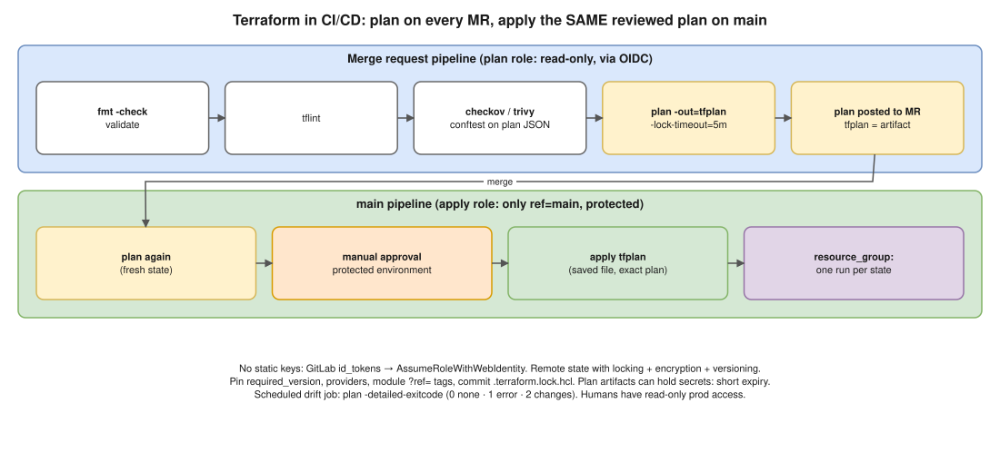

# Terraform 02 · Running Terraform Safely in CI/CD Pipelines ⭐



> **Say this first:** "Five rules. **One: the pipeline is the only way to apply**: humans have read-only access to prod. **Two: no static keys**: the runner gets short-lived AWS credentials through **OIDC**, with a **read-only role for plan** and a separate **apply role** only usable from the protected main branch. **Three: plan on every merge request**, with `fmt`, `validate`, `tflint` and a security scan (checkov/trivy), and the plan posted to the MR for review. **Four: apply exactly the reviewed plan**: save it with `-out=tfplan`, store it as an artifact, and apply that file after a **manual approval** on a protected environment. **Five: state safety**: remote backend with **locking and encryption**, one pipeline per state at a time (GitLab `resource_group`), pinned Terraform/provider versions with the lock file committed, and a scheduled **drift-detection** plan."

## The pipeline

| Stage | When | What | Fails on |
|---|---|---|---|
| **validate** | Every MR | `terraform fmt -check -recursive`, `terraform init -backend=false`, `terraform validate`, `tflint` | Formatting, syntax, unknown args |
| **security** | Every MR | `checkov -d .` / `trivy config .` (or `tfsec`), optional OPA/conftest on the plan JSON | Public S3, open SG 0.0.0.0/0:22, unencrypted RDS |
| **plan** | Every MR + main | `terraform plan -input=false -lock-timeout=5m -out=tfplan`; `terraform show -no-color tfplan` posted to MR; `show -json` for policy checks | Errors; optionally destroys in prod without an approval label |
| **apply** | main only, **manual**, protected environment | `terraform apply -input=false tfplan` (the saved file) | Stale plan (state changed since plan) → re-plan |
| **drift** | Scheduled (daily) | `terraform plan -detailed-exitcode` → exit 2 = drift → alert | Drift found |

```yaml
# (illustrative) .gitlab-ci.yml
stages: [validate, plan, apply]

default:
  image:
    name: hashicorp/terraform:1.13     # tflint/checkov need their own images or an install step
    entrypoint: [""]                   # the image's entrypoint is `terraform`; GitLab needs a shell

variables:
  TF_IN_AUTOMATION: "true"

.aws_oidc: &aws_oidc
  id_tokens:
    GITLAB_OIDC_TOKEN: { aud: sts.amazonaws.com }
  # Terraform's S3 backend and AWS provider read these and call AssumeRoleWithWebIdentity
  variables:
    AWS_ROLE_ARN: $PLAN_ROLE_ARN
    AWS_WEB_IDENTITY_TOKEN_FILE: $CI_PROJECT_DIR/.oidc-token
  before_script:
    - echo "$GITLAB_OIDC_TOKEN" > "$CI_PROJECT_DIR/.oidc-token"
    - cd envs/prod && terraform init -input=false

validate:
  stage: validate
  before_script: [cd envs/prod]
  script:
    - terraform fmt -check -recursive
    - terraform init -backend=false -input=false
    - terraform validate
    - tflint --recursive

plan:
  stage: plan
  <<: *aws_oidc
  resource_group: tf-prod               # one plan/apply against this state at a time
  script:
    - terraform plan -input=false -lock-timeout=5m -out=tfplan
    - terraform show -no-color tfplan > plan.txt
  artifacts:
    paths: [envs/prod/tfplan, envs/prod/plan.txt]
    expire_in: 1 week                   # the plan file can contain secrets
  rules:
    - if: $CI_PIPELINE_SOURCE == "merge_request_event"
    - if: $CI_COMMIT_BRANCH == $CI_DEFAULT_BRANCH

apply:
  stage: apply
  <<: *aws_oidc
  variables:
    AWS_ROLE_ARN: $APPLY_ROLE_ARN       # trust policy: only ref=main, protected
    AWS_WEB_IDENTITY_TOKEN_FILE: $CI_PROJECT_DIR/.oidc-token
  resource_group: tf-prod
  environment: production               # protected environment → approvers
  needs: [plan]
  when: manual
  script:
    - terraform apply -input=false tfplan
  rules:
    - if: $CI_COMMIT_BRANCH == $CI_DEFAULT_BRANCH
```

```json
// Apply role trust policy (AWS side): only GitLab's main branch of this project
{
  "Effect": "Allow",
  "Principal": { "Federated": "arn:aws:iam::111122223333:oidc-provider/gitlab.com" },
  "Action": "sts:AssumeRoleWithWebIdentity",
  "Condition": {
    "StringEquals": { "gitlab.com:aud": "sts.amazonaws.com" },
    "StringLike":   { "gitlab.com:sub": "project_path:acme/infra:ref_type:branch:ref:main" }
  }
}
```

## The safety checklist (say any five)

1. **OIDC, no long-lived keys**; separate plan (read-only) and apply roles.
2. **Saved plan applied**, never `apply -auto-approve` straight from code in prod.
3. **Manual approval** on a protected environment; MR approvals from code owners for `envs/prod/`.
4. **Remote state** (S3 + `use_lockfile = true` or DynamoDB lock), encrypted, versioned; `-lock-timeout` instead of failing instantly.
5. **Serialise** runs per state (`resource_group`), so two pipelines don't race.
6. **Pin versions**: `required_version`, provider `~>` constraints, module `?ref=v1.4.0`, commit `.terraform.lock.hcl`, fixed Terraform image tag.
7. **Fail on danger**: policy check on `terraform show -json tfplan` (e.g., conftest: deny `delete` actions on `aws_db_instance` without a label).
8. **Secrets**: never in code or logs; masked CI variables or fetched from Secrets Manager; mark outputs `sensitive`; restrict who can download plan artifacts.
9. **Small states** per env/component, so one pipeline's blast radius is small ([Terraform 03](03-state-too-large.md)).
10. **Drift detection** on a schedule; **promotion** dev → staging → prod with the same module version.

Tools that wrap this pattern: **Atlantis** (plan/apply from MR comments), **HCP Terraform / Terraform Enterprise**, Spacelift, env0, Terramate.

## Resume check

Terraform, GitLab CI, Jenkins, AWS fit your resume well; this is a question you should own. **Atlantis, HCP Terraform, Spacelift, checkov, conftest** are not on your resume: mention as options. If you used Jenkins for Terraform somewhere, the same rules apply (input step for approval, `lock()` for serialisation).

## Real-world example (suggested story, adapt it to what you really did)

"At Koko, Terraform ran from GitLab CI. Every MR got a plan job whose output was posted to the MR; apply ran only on main, manually, from the saved plan artifact, with a resource_group so two merges couldn't apply at the same time. We replaced the CI user's access keys with GitLab OIDC roles, a read-only one for plans and an apply role restricted to the main branch." Only claim what you did.

## Follow-up questions

**Q: Why apply the saved plan instead of running apply again?**
Something might have changed between review and apply (another merge, drift). The saved plan is exactly what was reviewed; if state changed, Terraform refuses it as stale and you re-plan.

**Q: What does `-detailed-exitcode` return?**
0 = no changes, 1 = error, 2 = changes present. Used for drift detection.

**Q: How do you stop two pipelines from corrupting state?**
State locking in the backend, plus serialising jobs per state (`resource_group` in GitLab, `lock()` in Jenkins).

## 🎯 Drill: type this from memory

1. `terraform fmt -check -recursive` · `terraform validate` · `terraform plan -input=false -out=tfplan` · `terraform apply -input=false tfplan`
2. `terraform show -json tfplan > plan.json`
3. The GitLab `plan`/`apply` jobs with `resource_group`, `environment`, `when: manual`, artifacts.
4. The OIDC trust policy condition on `gitlab.com:sub`.
5. Five safety rules from the checklist.

## 🗣️ 30-second spoken answer

1. Pipeline is the only path to apply; humans read-only.
2. OIDC roles, plan role vs apply role.
3. MR: fmt, validate, tflint, security scan, plan posted.
4. Main: manual approval, apply the saved plan.
5. Locked encrypted state, one run at a time, pinned versions, drift job.
