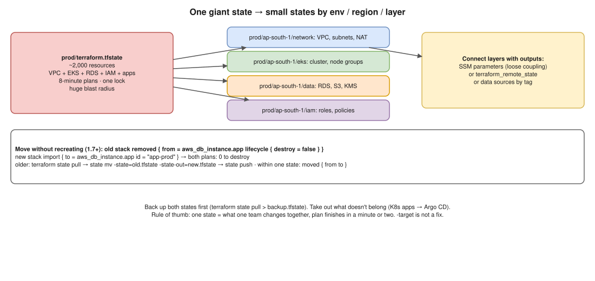

# Terraform 03 · The State File Is Getting Too Large ⭐



> **Say this first:** "A huge state is a symptom of one root module doing too much: plans take minutes because every resource is refreshed, everyone waits on the same **lock**, and one mistake has a huge **blast radius**. The fix is to **split it** into smaller states by **environment, region and layer**: network, cluster, data, applications, each with its own backend key and pipeline. Layers pass values through **outputs** read with `terraform_remote_state` or, better, **SSM parameters / data sources**. To move resources without recreating them I use **`removed` blocks with `destroy = false`** in the old configuration and **`import` blocks** in the new one (Terraform 1.7+), or `terraform state mv` with pulled state files for older versions. I also remove things that shouldn't be in Terraform at all, like Kubernetes app manifests (Argo CD owns those)."

## Symptoms

- `terraform plan` takes 5–20 minutes (refreshing thousands of resources, API rate limiting).
- Teams block each other: "state locked by another pipeline".
- A small change to one app shows up in the same plan as the VPC and the database: scary reviews, big blast radius.
- The state file is tens of MB; `terraform state list | wc -l` is in the thousands.

## How to split

| Split by | Example backend keys | Why |
|---|---|---|
| Environment | `prod/…`, `staging/…`, `dev/…` (better: separate accounts) | Dev mistakes can't touch prod |
| Region | `prod/ap-south-1/…`, `prod/eu-west-1/…` | Region outage/plan isolation ([Terraform 04](04-ten-regions.md)) |
| Layer / lifecycle | `network`, `eks`, `data` (RDS, S3), `iam`, `apps/<team>` | Things that change rarely (VPC) separate from things that change daily |
| Ownership | One state per team/service | Each team's pipeline, permissions and lock |

Rule of thumb: a state should be something one team changes together, with a plan that finishes in a minute or two.

## Connecting the pieces

```hcl
# Option A: read another state's outputs (needs read access to that state = can see its secrets)
data "terraform_remote_state" "network" {
  backend = "s3"
  config = {
    bucket = "acme-tfstate"
    key    = "prod/ap-south-1/network/terraform.tfstate"
    region = "ap-south-1"
  }
}
# use: data.terraform_remote_state.network.outputs.private_subnet_ids

# Option B (looser coupling): the network stack publishes to SSM, consumers read SSM
resource "aws_ssm_parameter" "private_subnets" {          # in the network stack
  name  = "/prod/network/private_subnet_ids"
  type  = "StringList"
  value = join(",", module.vpc.private_subnets)
}
data "aws_ssm_parameter" "private_subnets" {              # in the eks stack
  name = "/prod/network/private_subnet_ids"
}

# Option C: look things up by tag with data sources (data "aws_vpc" { tags = { Name = "prod" } })
```

## Moving resources between states without recreating them

**Terraform 1.7+ (declarative, reviewable in a plan):**

```hcl
# OLD stack: stop managing it, but don't destroy it
removed {
  from = aws_db_instance.app
  lifecycle {
    destroy = false
  }
}

# NEW stack: adopt the existing object
import {
  to = aws_db_instance.app
  id = "app-prod"
}
resource "aws_db_instance" "app" {
  # ... same configuration as before
}
```

1. Back up both states first (`terraform state pull > backup.tfstate`), then plan both stacks and check that neither shows a destroy or replace.
2. Apply the **old** stack: the resource leaves its state and nothing is destroyed (the plan says it "will no longer be managed by Terraform").
3. Apply the **new** stack: the plan says "will be imported" with **0 to destroy**.

**Older versions (imperative):**

```bash
cd old && terraform state pull > old.tfstate
cd ../new && terraform state pull > new.tfstate
terraform state mv -state=../old/old.tfstate -state-out=new.tfstate \
  aws_db_instance.app aws_db_instance.app
terraform state push new.tfstate          # then push the old one from the old dir
# or: terraform state rm in old + terraform import in new
```

**Inside one state** (renaming / moving into a module): `moved { from = aws_instance.web  to = module.web.aws_instance.this }`.

## Other things that help

- **Get things out that don't belong**: Kubernetes Deployments/Helm releases (Argo CD), thousands of Route 53 records generated by apps, per-customer resources (an operator or a separate per-tenant state).
- **Avoid giant `count`/`for_each` lists** of tiny resources in one state; group them.
- **`-refresh=false`** for quick plans when you know there's no drift (keep a scheduled full plan for drift).
- Orchestrate many small states with **Terragrunt** (`dependency` blocks, `run --all`) or CI rules that only run stacks whose files changed.
- `-target` is **not** a fix; it's for emergencies only.

## Resume check

Terraform, S3 backend, GitLab CI fit. `removed` blocks and `import` blocks are newer (1.5/1.7); claim only if used. **Terragrunt is not on your resume.**

## Real-world example (suggested story, adapt it to what you really did)

"Our main Terraform repo had one state for VPC, EKS, RDS and all IAM, about 1,800 resources, plan took 8 minutes and pipelines queued on the lock. I split it into network, eks, data and iam states per environment, moved resources with `terraform state mv` on pulled copies after backing everything up, and the EKS stack read subnet IDs from SSM parameters. Plans dropped to under a minute and each team got its own pipeline." Only use what's true.

## Follow-up questions

**Q: `terraform_remote_state` vs SSM parameters?**
Remote state gives read access to the whole other state (including any secrets in it) and couples you to its backend layout. SSM parameters expose only chosen values and work across tools.

**Q: How do you make sure the move didn't recreate anything?**
Back up both states, then plan both stacks: the old one should show only "no longer managed", the new one only "import", and both **0 to destroy**. Apply only then.

**Q: Is a large state dangerous by itself?**
Mostly slow and risky: long refreshes, rate limits, lock contention and a big blast radius for one bad change.

## 🎯 Drill: type this from memory

1. A `removed` block with `lifecycle { destroy = false }`.
2. An `import` block with `to` and `id`.
3. A `moved` block (`from`/`to`).
4. `terraform state pull > backup.tfstate` · `terraform state list | wc -l`
5. `data "terraform_remote_state"` with an S3 config, and `data "aws_ssm_parameter"`.

## 🗣️ 30-second spoken answer

1. Big state = slow plans, lock contention, big blast radius.
2. Split by environment, region, layer, ownership.
3. Connect with outputs: SSM parameters or remote state.
4. Move with removed (destroy = false) + import blocks; old way state mv; back up first.
5. Take out what doesn't belong (K8s apps → Argo CD).
