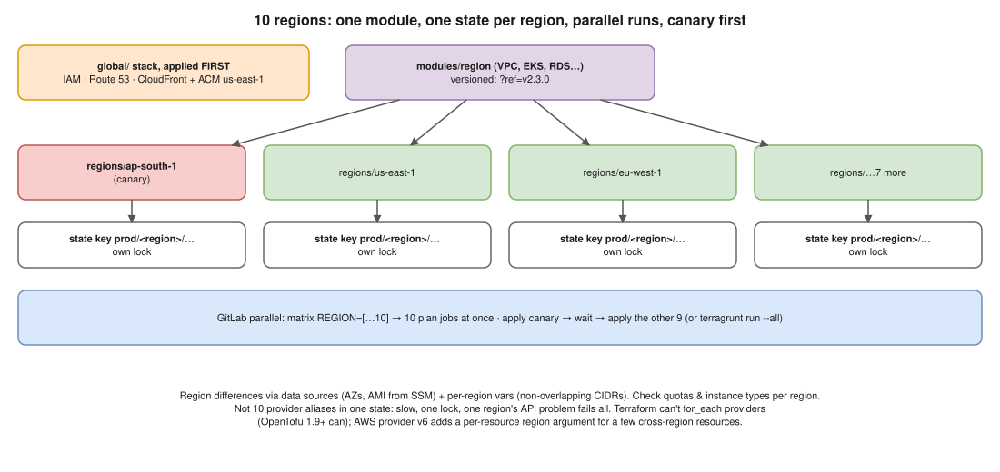

# Terraform 04 · Provisioning Infrastructure in 10 AWS Regions at Once



> **Say this first:** "I write the regional infrastructure **once as a module** and instantiate it **once per region, each with its own state**, so the 10 regions plan and apply **in parallel** and a failure in one region doesn't block or break the others. Things that are **global**, IAM, Route 53 zones, CloudFront, ACM for CloudFront in us-east-1, live in a **separate global stack** applied first. Region differences (AZ names, AMI IDs, CIDRs) come from **data sources** and a per-region variables map, not copy-paste. CI runs the regions as a **matrix** (GitLab `parallel: matrix`) or Terragrunt `run --all`, with a **canary region first**, then the rest. I avoid putting 10 provider aliases in one state, because then every plan touches all 10 regions and one region's API problem blocks everything."

## Layout

```text
infra/
├── modules/
│   └── region/                 # VPC, EKS, RDS, etc. for ONE region
│       ├── main.tf  variables.tf  outputs.tf  versions.tf
├── global/                     # IAM, Route 53 zones, CloudFront, org-level stuff (applied first)
│   └── main.tf  backend.tf
└── regions/
    ├── _common.tf              # shared provider/backend settings (or Terragrunt root.hcl)
    ├── us-east-1/  main.tf  backend.tf  terraform.tfvars
    ├── eu-west-1/  ...
    ├── ap-south-1/ ...
    └── ... (10 folders, or one folder + -var region=… + per-region backend key)
```

```hcl
# regions/ap-south-1/main.tf  (illustrative)
provider "aws" {
  region = var.region
  default_tags { tags = { env = "prod", region = var.region, managed_by = "terraform" } }
}

data "aws_availability_zones" "this" { state = "available" }

data "aws_ssm_parameter" "eks_ami" {        # AMI IDs differ per region: look them up
  name = "/aws/service/eks/optimized-ami/1.33/amazon-linux-2023/x86_64/standard/recommended/image_id"
}

module "region" {
  source   = "git::https://gitlab.com/acme/tf-modules.git//region?ref=v2.3.0"
  region   = var.region
  azs      = slice(data.aws_availability_zones.this.names, 0, 3)
  vpc_cidr = var.vpc_cidr                  # non-overlapping per region, e.g. 10.10.0.0/16, 10.11.0.0/16 …
  ami_id   = data.aws_ssm_parameter.eks_ami.value
}
```

```hcl
# backend.tf: one state per region
terraform {
  backend "s3" {
    bucket       = "acme-tfstate"
    key          = "prod/ap-south-1/terraform.tfstate"
    region       = "ap-south-1"            # the state bucket's region (can be one central bucket)
    use_lockfile = true
    encrypt      = true
  }
}
```

## Running 10 regions in parallel

```yaml
# (illustrative) GitLab CI matrix: 10 parallel plan jobs, canary first for apply
plan:
  stage: plan
  parallel:
    matrix:
      - REGION: [us-east-1, us-west-2, eu-west-1, eu-central-1, ap-south-1,
                 ap-southeast-1, ap-southeast-2, ap-northeast-1, sa-east-1, ca-central-1]
  script:
    - cd regions/$REGION
    - terraform init -input=false
    - terraform plan -input=false -out=tfplan
  artifacts: { paths: [regions/$REGION/tfplan] }

apply_canary:
  stage: apply-canary
  when: manual
  script: [cd regions/ap-south-1, terraform init -input=false, terraform apply -input=false tfplan]

apply_rest:
  stage: apply
  needs: [apply_canary]
  when: manual
  parallel:
    matrix:
      - REGION: [us-east-1, us-west-2, eu-west-1, eu-central-1, ap-southeast-1,
                 ap-southeast-2, ap-northeast-1, sa-east-1, ca-central-1]
  script: [cd regions/$REGION, terraform init -input=false, terraform apply -input=false tfplan]
```

Terragrunt alternative: a `terragrunt.hcl` per region that sets `inputs` and a generated backend key, then `terragrunt run --all plan` (runs independent units in parallel; older syntax `run-all`).

## Why not one state with 10 provider aliases?

| One state, 10 aliases | One state per region |
|---|---|
| Every plan refreshes all 10 regions: slow | Each plan touches one region |
| One region's API outage/throttling fails the whole run | Other regions carry on |
| One lock: no parallelism | 10 locks, 10 parallel jobs |
| Blast radius = the whole world | Blast radius = one region |
| Terraform can't `for_each` over provider blocks, so 10 copies of `module` blocks with `providers = { aws = aws.euw1 }` | One module call, region is a variable |

Notes worth mentioning:
- **AWS provider v6** added a per-resource **`region` argument** on most resources, so one provider configuration can manage several regions. Handy for a few cross-region resources (replication targets), but separate states per region are still better at 10-region scale. *(Check the provider docs for the resources you use.)*
- **OpenTofu** (the Terraform fork) supports `for_each` on provider blocks since 1.9; **HCP Terraform Stacks** model "the same component in many regions" natively. Plain Terraform CLI doesn't.

## Region-specific gotchas

- **Service/instance-type availability** differs per region; validate with data sources or a variable allow-list.
- **Service quotas** are per region; request increases before rollout.
- **Global resources must exist once**: IAM roles, Route 53 zones, CloudFront and its **ACM certificate (must be in us-east-1)**; regional ALB certificates in each region.
- **Non-overlapping CIDRs** per region if you'll ever peer them / Transit Gateway.
- **Data residency**: some regions may not be allowed to hold certain data.
- **Staged rollout**: canary region → wait → the rest; same module version tag everywhere.

## Resume check

Terraform, AWS, GitLab CI fit. Multi-region at 10-region scale may not be something you did; say "I'd structure it". **Terragrunt, OpenTofu, HCP Stacks are not on your resume.**

## Real-world example (suggested story, adapt it to what you really did)

"We ran two regions, primary and DR. The regional infra was one module, instantiated from a folder per region with its own S3 state key, and IAM plus Route 53 sat in a global stack. CI planned both regions in parallel and applied DR first as the canary. The same pattern scales to ten regions by adding folders to the matrix." Only claim the regions you actually ran.

## Follow-up questions

**Q: How do you keep the 10 regions from drifting apart?**
Same module version everywhere, no per-region code (only variables), a scheduled drift plan per region, and CI that always plans all regions when the module changes.

**Q: How do you deploy a module change safely to all regions?**
Release a new module tag, bump it in the canary region, apply, observe, then bump the rest (or all at once with the matrix after the canary is healthy).

**Q: What if one region's apply fails?**
Only that region's state is affected; fix and re-run that matrix job. The other nine are done and consistent.

## 🎯 Drill: type this from memory

1. The folder layout: `modules/region`, `global`, `regions/<region>`.
2. The S3 backend block with a per-region `key` and `use_lockfile = true`.
3. `data "aws_availability_zones"` and the module call with `region`, `azs`, `vpc_cidr`.
4. GitLab `parallel: matrix` with a `REGION` list.

## 🗣️ 30-second spoken answer

1. One regional module, one root + state per region.
2. Global stack (IAM, Route 53, CloudFront/ACM us-east-1) separately, first.
3. Differences via data sources + per-region vars.
4. CI matrix in parallel; canary region first.
5. Not 10 aliases in one state: slow, coupled, huge blast radius.
