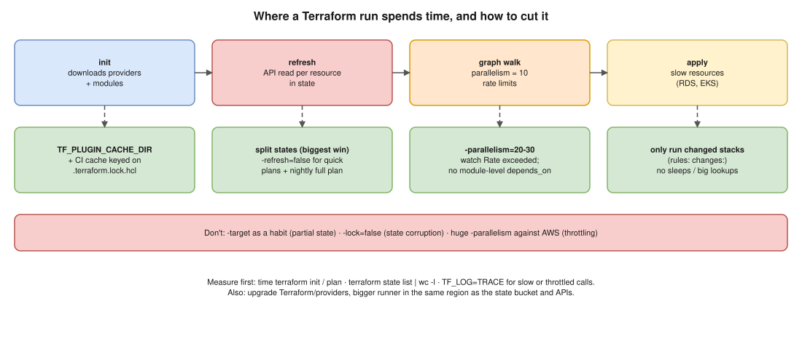

# Terraform 05 · Faster Terraform Runs in Large Projects



> **Say this first:** "First I **measure** where the time goes: `init`, the **refresh** (one or more API calls per resource), or the apply itself. Then the biggest win is almost always **smaller states**: a plan only refreshes what's in its state, so splitting a 2,000-resource state into ten small ones makes each plan fast and lets them run in parallel. Next: **cache providers** (`TF_PLUGIN_CACHE_DIR`, cache `.terraform` in CI) so `init` doesn't download hundreds of MB every time; run **only the stacks whose files changed**; tune **`-parallelism`** (default 10) carefully against API rate limits; use **`-refresh=false`** for quick iterative plans when I know there's no drift, with a scheduled full plan to catch drift; and remove slow patterns such as huge data source lookups, `local-exec` sleeps and unnecessary `depends_on` that serialise the graph."

## Step 1: measure

```bash
time terraform init -input=false
time terraform plan -input=false -out=tfplan
terraform state list | wc -l                       # how many resources does each plan refresh?
TF_LOG=INFO terraform plan 2>&1 | grep -c "Refreshing state"   # rough count of refreshes (older output)
TF_LOG=TRACE TF_LOG_PATH=trace.log terraform plan  # timestamps per provider call; look for retries/throttling
grep -i "throttl\|rate exceeded\|retry" trace.log | head
```

## Step 2: the optimisations, biggest first

| Optimisation | Why it helps | How |
|---|---|---|
| **Split the state** | Refresh time ∝ resources in state; small states plan in seconds and run in parallel | By env / region / layer ([Terraform 03](03-state-too-large.md)) |
| **Only run changed stacks** | Don't plan 40 stacks when one folder changed | GitLab `rules: changes:`, Terragrunt `--queue-include-dir`/filtering, Atlantis autoplan per project, Terramate change detection |
| **Provider plugin cache** | `init` stops re-downloading the AWS provider (several hundred MB) per job | `export TF_PLUGIN_CACHE_DIR=$CI_PROJECT_DIR/.tf-plugin-cache` + CI cache keyed on `.terraform.lock.hcl` |
| **Skip refresh when safe** | No API reads for every resource | `terraform plan -refresh=false` for fast feedback; full plan before apply / nightly drift job |
| **`-parallelism=N`** | Default 10 concurrent operations; raising it helps big applies with independent resources | `-parallelism=30`; too high → AWS API throttling (`Rate exceeded`) and slower overall |
| **Fewer/cheaper data sources** | Each `data` block is an API call every plan; some (e.g., `aws_ami` with broad filters, `aws_iam_policy_document` is local and fine) are slow | Pass IDs as outputs/SSM params; narrow filters |
| **Remove artificial waits** | `local-exec "sleep 60"`, `time_sleep` used as a fix | Proper dependencies/retries instead |
| **Don't over-use `depends_on`** | Module-level `depends_on` makes everything in the module wait (and defers data sources to apply time) | Reference specific attributes instead |
| **Avoid huge `count`/`for_each` in one module** | Thousands of tiny resources (e.g., one per DNS record) | Group or move to the system that owns them |
| **Upgrade Terraform and providers** | Newer versions improve performance and fix slow paths | Planned upgrades with the lock file |
| **Faster runners** | CPU/network on the CI runner; runner in the same region as the API endpoints/state bucket | Bigger runner, same-region |
| **Targeted plans in emergencies only** | `-target` skips most of the graph | Never as a routine speed-up; leaves partial state |

```yaml
# (illustrative) GitLab: cache providers and plan only when this stack changed
plan_network:
  variables:
    TF_PLUGIN_CACHE_DIR: $CI_PROJECT_DIR/.tf-plugin-cache
  cache:
    key:
      files: [stacks/network/.terraform.lock.hcl]
    paths: [.tf-plugin-cache/]
  before_script: [mkdir -p "$TF_PLUGIN_CACHE_DIR"]
  script:
    - cd stacks/network
    - terraform init -input=false
    - terraform plan -input=false -out=tfplan
  rules:
    - changes: [stacks/network/**/*, modules/vpc/**/*]
```

## Things that do NOT make it faster (or aren't safe)

- `-target` as a habit: skips dependencies, leaves state partially applied.
- `-lock=false`: faster to start, risks corrupting state.
- Very high `-parallelism` against AWS: throttling makes it slower and can fail applies.

## Resume check

Terraform and GitLab CI fit. **Terragrunt, Atlantis, Terramate are not on your resume.** The plugin cache and state splitting are things you can do and talk about.

## Real-world example (suggested story, adapt it to what you really did)

"Our infra pipeline took about 12 minutes for any change. Most of it was one big state refreshing ~1,500 resources and `init` downloading providers every job. We cached the plugin directory keyed on the lock file, split the state into network, EKS and data stacks, and only planned stacks whose folders changed. A typical MR pipeline went to about 2 minutes." Use only real numbers.

## Follow-up questions

**Q: What does `-refresh=false` risk?**
The plan is based on the last known state, so drift made outside Terraform isn't seen and the apply could overwrite or fail. Fine for quick iteration; not for the final prod apply.

**Q: Default parallelism?**
10 concurrent graph operations. Set with `-parallelism=N` on plan/apply.

**Q: Why is `init` slow in CI?**
It downloads providers and modules each fresh job. Cache the plugin directory and pin versions with `.terraform.lock.hcl`.

## 🎯 Drill: type this from memory

1. `export TF_PLUGIN_CACHE_DIR=$HOME/.terraform.d/plugin-cache`
2. `terraform plan -refresh=false` · `terraform apply -parallelism=20`
3. `TF_LOG=TRACE TF_LOG_PATH=trace.log terraform plan`
4. The GitLab `cache: key: files: [.terraform.lock.hcl]` and `rules: changes:` snippet.
5. The top five optimisations, biggest first.

## 🗣️ 30-second spoken answer

1. Measure: init, refresh, apply.
2. Split states: biggest win, and parallel runs.
3. Cache providers; plan only changed stacks.
4. `-refresh=false` for quick plans + nightly full plan; tune `-parallelism` vs rate limits.
5. Remove slow patterns: big data lookups, sleeps, module-level depends_on.
