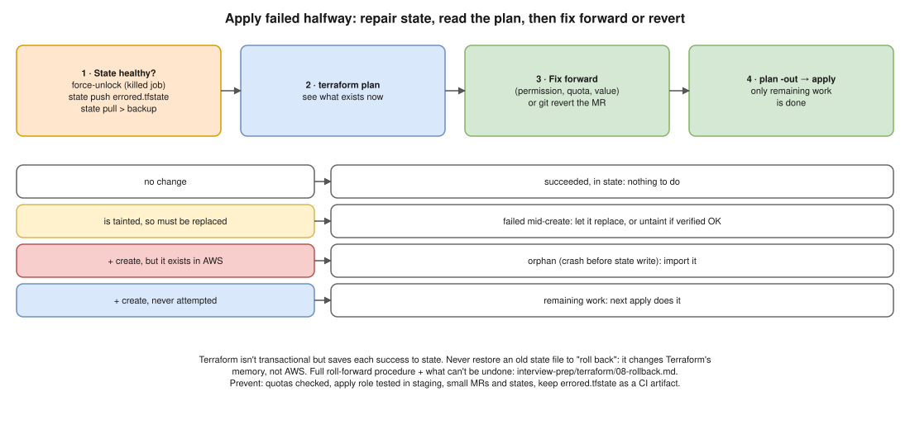

# Terraform 06 · Production Deployment Failed Halfway: Some Resources Created, Others Not ⭐



> **Say this first:** "Terraform isn't transactional, so a failed apply leaves exactly what succeeded, and **state records each success as it goes**. That's good news: I don't clean up by hand. First I make sure the state is healthy: if the job was **killed**, release the **lock** (`force-unlock`, after confirming nothing is running), and if Terraform couldn't save state it writes an **`errored.tfstate`** that I push back with `terraform state push`. Then I run **`terraform plan`** to see the real situation: resources that failed mid-creation are **tainted** and will be replaced; resources created in AWS but **missing from state** (crash between the API call and the state write) show up as duplicates or name conflicts, and I **import** them. Then I either **fix forward** (correct the error and apply again; Terraform only does the remaining work) or **`git revert`** and apply the old config. I never restore an old state file to 'roll back'."

This is the scenario version of [Rollback after a failed deployment](../../terraform/08-rollback.md) in the Terraform notes; that note covers the roll-forward procedure, why not to restore old state, and what can't be undone. This one focuses on **repairing the half-finished apply**.

## Step 1: make sure state is healthy

```bash
# Was the job killed? Lock still held?
terraform plan
# Error: Error acquiring the state lock ... Lock Info: ID: 9db590f1-...
terraform force-unlock 9db590f1-b6fe-c5f2-2f19-1b2c8a6a1d2e   # only after confirming no other run is active

# Did Terraform fail to SAVE state (network/S3 error at the end)? It writes errored.tfstate locally
ls errored.tfstate && terraform state push errored.tfstate
#   in CI: make the job keep errored.tfstate as an artifact (artifacts: when: on_failure)

# Backup before touching anything
terraform state pull > before-repair-$(date +%s).tfstate
```

## Step 2: plan, and read it carefully

```bash
terraform plan -out=tfplan
terraform state list
```

| What the plan shows | Meaning | Action |
|---|---|---|
| Resources that already succeeded: **no change** | They're in state and match the code | Nothing |
| `# aws_instance.web is tainted, so must be replaced` | Creation started but failed (e.g., timed out waiting, provisioner failed) | Let it be replaced, or `terraform untaint` if you've checked it's actually fine |
| `+ create` for something you can **see in the console** | Orphan: created in AWS but not saved in state | `import` it (block or command), otherwise you get a duplicate or "AlreadyExists" error |
| `+ create` for the resources never attempted | Remaining work | Will be done on the next apply |
| Create fails with `already exists` / `EntityAlreadyExists` / `BucketAlreadyOwnedByYou` | Orphan with a fixed name | Import it |

```hcl
# Adopt the orphan created by the failed run (1.5+), then plan shows "import" not "create"
import {
  to = aws_iam_role.app
  id = "app-prod-role"
}
```

```bash
terraform import aws_iam_role.app app-prod-role   # command form, any version
terraform untaint aws_instance.web                # only if you've verified the instance is healthy
```

## Step 3: fix forward or revert

- **Fix forward** (most common): the error was a missing IAM permission, a quota, a wrong value, a dependency timing issue. Fix the code/permission/quota in an MR, plan, apply. Terraform does only what's left.
- **Revert**: the change itself was wrong. `git revert` the merge, plan (Terraform calculates how to remove/undo what was created), apply. See [08-rollback](../../terraform/08-rollback.md).
- **Stabilise users first** if production is affected (shift traffic, scale the old node group back up) before doing either.

## Typical causes of a half-way failure (and how to avoid them)

| Cause | Prevention |
|---|---|
| Missing IAM permission on the apply role | Plan with the same role; least privilege but tested in staging |
| Service quota reached (vCPUs, EIPs, VPCs) | Check quotas before big changes; Service Quotas alarms |
| Name already taken (S3 bucket, IAM role from an earlier failed run) | Imports, name prefixes / random suffixes |
| API eventual consistency / timeouts | Provider retries, `timeouts {}` blocks for slow resources (RDS, EKS) |
| CI job killed / runner died mid-apply | Long enough job timeout, keep `errored.tfstate` as artifact, `resource_group` |
| Huge change in one apply | Smaller states and smaller MRs; staging first |

## Resume check

Terraform, AWS, GitLab CI fit: own this answer. `errored.tfstate` and `force-unlock` are good details to show real experience; only say you've used them if you have.

## Real-world example (suggested story, adapt it to what you really did)

"An apply adding a new EKS node group and its IAM role failed after the role was created: the node group hit the account's vCPU quota. Re-running plan showed the role already in state, the node group to create. We raised the quota and re-applied, and only the node group was created. Another time the runner was killed mid-apply; we released the lock with force-unlock after checking no job was running, and imported a security group that existed in AWS but hadn't reached state." Only use what you lived.

## Follow-up questions

**Q: Why is the state usually still correct after a failure?**
Terraform writes each resource to state as soon as it's created/updated, and saves state at the end even when errors occurred. The rare gap is a crash between the API call and the write.

**Q: What is `errored.tfstate`?**
When Terraform can't persist state to the backend at the end of a run, it writes the state to `errored.tfstate` in the working directory so it isn't lost. Push it with `terraform state push errored.tfstate` once the backend works.

**Q: When do you `untaint`?**
When a resource was marked tainted (failed provisioner or creation step) but you've verified it's actually fine and don't want it replaced.

## 🎯 Drill: type this from memory

1. `terraform force-unlock <LOCK_ID>`
2. `terraform state push errored.tfstate`
3. `terraform state pull > backup.tfstate`
4. `terraform import <addr> <id>` and the `import { to = … id = … }` block.
5. `terraform untaint <addr>`
6. The plan-reading table: no change / tainted / orphan / never attempted.

## 🗣️ 30-second spoken answer

1. Not transactional; state has what succeeded.
2. Healthy state: force-unlock if killed, push errored.tfstate, back up.
3. Plan: tainted → replaced, orphans → import, rest → remaining work.
4. Fix forward (usual) or git revert; never restore old state.
5. Prevent: quotas, permissions tested, small changes, staging first.
