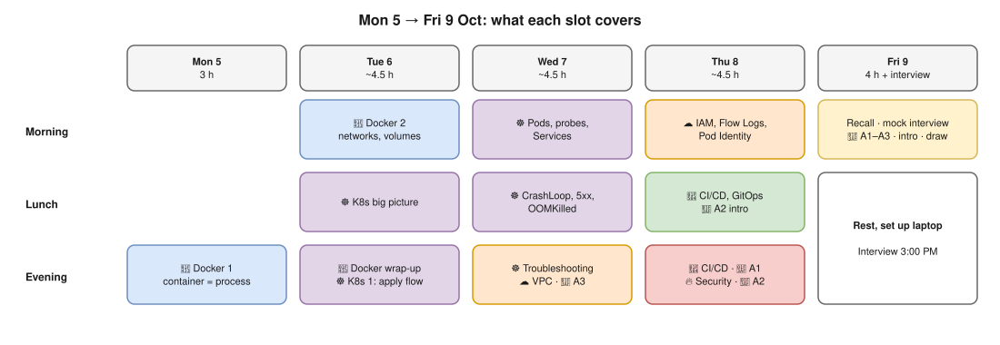
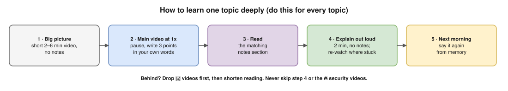

# Study Plan: Mon 5 Oct → Interview Fri 9 Oct, 3:00 PM

**For:** a working professional who learns best from videos, wants deep fundamentals, and is starting from zero.

**Focus (Hemant said):** **Docker · Kubernetes · AWS · CI/CD · Security.** All study time goes to these five.
The basics Hemant digs into are covered **inside** the topic they belong to:
- PID 1, cgroups and namespaces → Docker
- DNS, private IPs and NAT → AWS VPC
- 502 / 503 / 504 errors → Kubernetes troubleshooting

> This replaces the old [3-day plan](devops-interview-prep-plan.md). Every video below was checked: the link works, and the title, channel and length are correct.

> 🎯 **New on 7 Oct:** Hemant said the round will be **scenario-based**, and named three examples:
> - Helm drift after `kubectl edit`
> - two clusters with overlapping VPC CIDRs
> - nodes and pods in different CIDRs (One2N's NodeClass blog post)
>
> They're answered in depth in ⭐🔥 [Scenario deep dives](hemant-scenario-deep-dives.md). The study slots for them are marked 🎯 below (Wed evening, Thu lunch, Thu evening, Fri morning).

---

## Your time (change it if your day is different)

| Day | Time slots | Hours |
|---|---|---|
| Mon 5 Oct | Evening 7:00–10:00 PM | 3 h |
| Tue 6 / Wed 7 / Thu 8 | Morning 6:30–7:30 AM · Lunch 20 min · Evening 7:30–10:30 PM | ~4.5 h each |
| Fri 9 Oct | Morning 8:00 AM–1:00 PM (take a half day off work if you can) · interview 3:00 PM | 4 h |

## How the hours are split

| Topic | Hours | When |
|---|---|---|
| **Docker** | ~5 h | Mon evening, Tue morning, Tue evening (first part) |
| **Kubernetes** | ~5 h | Tue evening, Wed morning and lunch, Wed evening (first part) |
| **AWS** | ~2.5 h | Wed evening (second part), Thu morning |
| **CI/CD** | ~1.5 h | Thu lunch, Thu evening (first part) |
| 🔥 **Security** | ~2 h, plus a security part inside each topic | Thu evening (second part) |
| 🎯 **Scenario deep dives** (Hemant's 3 examples) | ~2.5 h | Wed evening (end), Thu lunch, Thu evening (end), Fri 9:30 |
| **Revision + practice interview** | ~4 h | Fri morning |

## How to learn deeply when you learn slowly ⭐

Do this for **every topic**:

1. **Big picture first:** watch the short video (2–6 min). No notes; just get the idea.
2. **Main video at 1x speed.** Pause every few minutes and write **3 short points in your own words**. If something is confusing, rewind once, then move on and ask me later.
3. **Read** the matching section of your notes (links given each day).
4. **Explain it out loud in 2 minutes** as if teaching a friend, without looking. Wherever you get stuck, re-watch that part.
5. **Morning recall:** each morning, spend the first 10 minutes saying yesterday's "explain out loud" answers again from memory.

**Symbols:** ⭐ = must watch · 🔁 = optional, only if you have time · 🔥 = Hemant's feedback topics (never skip)

**If you fall behind:** drop 🔁 videos first, then shorten the reading. **Never skip** "explain out loud" or the 🔥 security videos.

---

# Monday 5 Oct: 🐳 Docker part 1, what a container really is (Evening, ~3 h)

### Watch (⭐ 112 min)
- [ ] ⭐ [Docker in 100 Seconds](https://www.youtube.com/watch?v=Gjnup-PuquQ) · Fireship · 2 min, the big picture
- [ ] ⭐ [Containers From Scratch](https://www.youtube.com/watch?v=8fi7uSYlOdc) · Liz Rice, GOTO · 43 min. **The most important deep-fundamentals video:** she builds a container live from Linux namespaces and cgroups. Watch slowly.
- [ ] ⭐ [Docker Crash Course for Absolute Beginners](https://www.youtube.com/watch?v=pg19Z8LL06w) · TechWorld with Nana · 67 min: images, containers, Dockerfile, Compose

### Read (~40 min), from your [Docker notes](docker/README.md)
- [ ] [01 Fundamentals](docker/01-fundamentals.md): container vs VM
- [ ] [02 Architecture & internals](docker/02-architecture-internals.md): dockerd, containerd, runc, namespaces, cgroups
- [ ] [04 Containers](docker/04-containers.md): lifecycle, PID 1 and signals, exit codes

### Explain out loud ✔
- [ ] What is a container, really? (a Linux process + namespaces + cgroups + layered filesystem)
- [ ] Container vs VM: what's shared, and why are containers lighter but less isolated?
- [ ] What happens, step by step, when I run `docker run -p 8080:80 nginx`?
- [ ] Why must the app run as PID 1 in exec form, and what does exit code 137 mean?

---

# Tuesday 6 Oct: 🐳 Docker part 2 → ☸️ Kubernetes part 1

## Morning (6:30–7:30): Docker networking and storage
- [ ] 10 min: say Monday's answers from memory
- [ ] ⭐ [Docker Volumes explained in 6 minutes](https://www.youtube.com/watch?v=p2PH_YPCsis) · TechWorld with Nana · 6 min
- [ ] ⭐ [Docker networking is CRAZY!!](https://www.youtube.com/watch?v=bKFMS5C4CG0) · NetworkChuck · 39 min: bridge, host, user-defined networks
- [ ] Read [08 Networking](docker/08-networking.md): the **default-bridge DNS trap** and how `-p` really works

## Lunch (21 min): Kubernetes big picture
- [ ] ⭐ [Kubernetes Explained in 100 Seconds](https://www.youtube.com/watch?v=PziYflu8cB8) · Fireship · 2 min
- [ ] ⭐ [Kubernetes Explained in 6 Minutes (k8s Architecture)](https://www.youtube.com/watch?v=TlHvYWVUZyc) · ByteByteGo · 6 min
- [ ] ⭐ [Kubernetes Architecture explained](https://www.youtube.com/watch?v=umXEmn3cMWY) · TechWorld with Nana · 13 min

## Evening (7:30–10:30)
### Docker wrap-up (45 min)
- [ ] Read [05 Dockerfile](docker/05-dockerfile.md) (CMD vs ENTRYPOINT, ARG vs ENV, multi-stage) and [10 Security](docker/10-security.md)
- [ ] **Try it** (start Docker Desktop first; the commands are in [14 Docker command list](docker/14-docker-commands.md)): `docker run -d --name web -p 8080:80 nginx` · `curl -I localhost:8080` · `docker exec -it web sh` · `docker inspect web` · `docker stop web`

### Kubernetes part 1 (⭐ 98 min)
- [ ] ⭐ [What ACTUALLY Happens When You Run kubectl apply](https://www.youtube.com/watch?v=iRWya4yh5Y8) · Thetips4you · 26 min
- [ ] ⭐ [Kubernetes Crash Course for Absolute Beginners](https://www.youtube.com/watch?v=s_o8dwzRlu4) · TechWorld with Nana · 72 min
- [ ] Read Kubernetes notes ⭐ [01 Fundamentals](kubernetes/01-fundamentals.md) · [02 Architecture](kubernetes/02-architecture.md) · [03 Objects & labels](kubernetes/03-objects-and-api.md) · [04 kubectl apply flow](kubernetes/04-kubectl-apply-flow.md). Short on time? Read each file's **Interview angle** first.

### Optional 🔁 (Docker deep dive)
- [ ] 🔁 [Cgroups, namespaces, and beyond](https://www.youtube.com/watch?v=sK5i-N34im8) · Jérôme Petazzoni · 54 min
- [ ] 🔁 [Demystifying the top Command in Linux](https://www.youtube.com/watch?v=WsR11EGF9PA) · Learn Linux TV · 27 min, how processes look on a host

### Explain out loud ✔
- [ ] Default bridge vs user-defined network: why can't containers find each other by name on the default bridge?
- [ ] Volume vs bind mount vs tmpfs: when do you use each?
- [ ] Name 4 ways to make a container more secure.
- [ ] What happens, step by step, after `kubectl apply -f deployment.yaml`? (API server → etcd → controllers → scheduler → kubelet)

---

# Wednesday 7 Oct: ☸️ Kubernetes part 2 → ☁️ AWS part 1

## Morning (6:30–7:30): Pods in depth and Services
- [ ] 10 min: say Tuesday's answers from memory
- [ ] ⭐ [Liveness vs Readiness Probes Explained](https://www.youtube.com/watch?v=dO97BlKaLog) · CodeLucky · 4 min
- [ ] ⭐ [Pods' Requests and Limits in 12 Minutes](https://www.youtube.com/watch?v=lKH1K5R3kqg) · The Good Guy · 12 min
- [ ] ⭐ [Kubernetes Services explained: ClusterIP vs NodePort vs LoadBalancer](https://www.youtube.com/watch?v=T4Z7visMM4E) · TechWorld with Nana · 24 min
- [ ] Read ⭐ [05 Pods](kubernetes/05-pods.md) (graceful shutdown) and [06 Probes](kubernetes/06-probes.md)

## Lunch (20 min)
- [ ] ⭐ [Kubernetes CrashLoopBackOff explained in 3 minutes](https://www.youtube.com/watch?v=gKuu1toptm8) · Raghav Dua · 2 min
- [ ] ⭐ [HTTP Status Codes Explained (1xx–5xx)](https://www.youtube.com/watch?v=ddnY4hhcUsk) · Infomax · 6 min, for 502 / 503 / 504 from a load balancer or ingress
- [ ] ⭐ [The Real Reason Your Kubernetes Pods Get OOMKilled](https://www.youtube.com/watch?v=PgRBnEphSa4) · Techi Nik · 12 min, links Docker's cgroups to Kubernetes

## Evening (7:30–10:30)
### Kubernetes part 2: troubleshooting and Ingress (⭐ 52 min)
- [ ] ⭐ [Troubleshooting Pods in CrashLoopBackOff, Pending and ImagePullBackOff](https://www.youtube.com/watch?v=ULitVDnqy8Y) · TechyWithLorna · 29 min
- [ ] ⭐ [Kubernetes Ingress Tutorial for Beginners](https://www.youtube.com/watch?v=80Ew_fsV4rM) · TechWorld with Nana · 23 min
- [ ] Read ⭐ [07 Workloads](kubernetes/07-workloads.md) · [08 Services & DNS](kubernetes/08-services-and-dns.md) · [12 Resources & autoscaling](kubernetes/12-resources-and-autoscaling.md) · [17 Troubleshooting](kubernetes/17-troubleshooting.md), plus [model answers](hemant-model-answers.md) **Q28–Q29** (502 vs 503 vs 504)
- [ ] 🔁 [Life of a Packet](https://www.youtube.com/watch?v=0Omvgd7Hg1I) · Michael Rubin, Google (KubeCon) · 34 min, deep Kubernetes networking

### AWS part 1: VPC networking (⭐ 43 min)
- [ ] ⭐ [Public vs Private IP Address](https://www.youtube.com/watch?v=po8ZFG0Xc4Q) · PowerCert · 7 min, needed to understand subnets
- [ ] ⭐ [NAT Explained](https://www.youtube.com/watch?v=FTUV0t6JaDA) · PowerCert · 4 min, needed for NAT Gateway
- [ ] ⭐ [AWS VPC Concept: Public & Private Subnets, Route Tables, Internet & NAT Gateways](https://www.youtube.com/watch?v=TuBA5maXFgc) · Server Gyan · 7 min
- [ ] ⭐ [AWS VPC Explained for Beginners](https://www.youtube.com/watch?v=rAc-v8X0ILw) · BCReddy DevOps · 21 min
- [ ] ⭐ [Security Groups vs Network ACLs](https://www.youtube.com/watch?v=rQ6iwDhk_yM) · Definer · 4 min
- [ ] Read the old plan's [Day 3 AWS](devops-interview-prep-plan.md) "Points to learn" (VPC part)

### 🎯 Scenario A3: nodes and pods in different CIDRs (⭐ 19 min + 20 min reading)
Do this right after the VPC videos, while subnets are fresh in your head.
- [ ] ⭐ [How Amazon VPC CNI for k8s works](https://www.youtube.com/watch?v=RBE3yk2UlYA) · Containers from the Couch · 9 min
- [ ] ⭐ [Running Out of IPs on EKS? Use Secondary CIDR + VPC CNI Plugin](https://www.youtube.com/watch?v=69OE4LwzdJE) · DevOps World · 10 min
- [ ] Read [Scenario A3](hemant-scenario-deep-dives.md#a3--nodes-in-one-cidr-pods-in-another-how-is-that-done-) and the One2N incident under it.
- [ ] If you're out of time, skip 🔁 "Life of a Packet" above, not this.

### Explain out loud ✔
- [ ] 🎯 Nodes show 10.0.x.x and pods show 100.64.x.x. How is that done? What does on-prem see when a pod calls it?
- [ ] Liveness vs readiness. What goes wrong if liveness checks the database?
- [ ] Requests vs limits: what happens when a pod goes over its CPU limit, and over its memory limit?
- [ ] ClusterIP vs NodePort vs LoadBalancer vs Ingress.
- [ ] A pod is in CrashLoopBackOff / Pending / ImagePullBackOff. What do you run, in what order?
- [ ] Public vs private subnet. Why can't a private EC2 instance reach the internet, and how do you fix it?

---

# Thursday 8 Oct: ☁️ AWS part 2 → 🔄 CI/CD → 🔥 Security

## Morning (6:30–7:30): IAM and access
- [ ] 10 min: say Wednesday's answers from memory
- [ ] ⭐ [AWS IAM Core Concepts You NEED to Know](https://www.youtube.com/watch?v=_ZCTvmaPgao) · Be A Better Dev · 21 min
- [ ] ⭐ [A Beginner's Guide to VPC Flow Logs](https://www.youtube.com/watch?v=P-RFSaMLfH4) · Whizlabs · 6 min. Hemant built a Flow Logs analyzer.
- [ ] ⭐ [Comparing Pod Identity and IRSA in EKS](https://www.youtube.com/watch?v=OW2OWgu5tfU) · DevOps World · 6 min: how pods get AWS access without keys
- [ ] Read the old plan's [Day 3 AWS](devops-interview-prep-plan.md) "Points to learn" (IAM, ALB vs NLB) and ⭐ [20 EKS on AWS](kubernetes/20-eks.md)

## Lunch (22 min)
- [ ] ⭐ [CI/CD in 5 Minutes](https://www.youtube.com/watch?v=42UP1fxi2SY) · ByteByteGo · 5 min
- [ ] ⭐ [What is GitOps?](https://www.youtube.com/watch?v=f5EpcWp0THw) · TechWorld with Nana · 11 min
- [ ] 🎯 ⭐ [How to Solve for Overlapping IP Addresses](https://www.youtube.com/watch?v=vM1sO_huJvw) · F5 DevCentral · 4 min
- [ ] 🎯 ⭐ [What Problem AWS VPC Lattice Actually Solves](https://www.youtube.com/watch?v=EpuVruSutAM) · TheBlueprintInfra · 2 min

## Evening (7:30–10:30)
### CI/CD (⭐ 56 min)
- [ ] ⭐ [GitHub Actions Tutorial: CI/CD Pipeline with Docker](https://www.youtube.com/watch?v=R8_veQiYBjI) · TechWorld with Nana · 32 min
- [ ] ⭐ [Top 5 Most-Used Deployment Strategies](https://www.youtube.com/watch?v=AWVTKBUnoIg) · ByteByteGo · 10 min
- [ ] ⭐ [What is Helm in Kubernetes?](https://www.youtube.com/watch?v=-ykwb1d0DXU) · TechWorld with Nana · 14 min
- [ ] Read [model answers](hemant-model-answers.md) **Q35–Q40** (build once, promote; GitOps; CI/CD security)
- [ ] ⭐ [21 Helm, Kustomize & GitOps](kubernetes/21-helm-kustomize-gitops.md), then 🎯 ⭐ [Scenario A1: Helm drift](hemant-scenario-deep-dives.md#a1--helm-drift-someone-edited-the-cluster-then-we-run-helm-upgrade-again-) (20 min). If you have a local cluster, do its 5-minute "Try it yourself".
- [ ] 🔁 [ArgoCD Tutorial for Beginners](https://www.youtube.com/watch?v=MeU5_k9ssrs) · TechWorld with Nana · 47 min

### 🔥 Security (⭐ 85 min, never skip)
- [ ] ⭐ [What is DevSecOps?](https://www.youtube.com/watch?v=nrhxNNH5lt0) · TechWorld with Nana · 8 min
- [ ] ⭐ [DevSecOps: Shifting Security Left](https://www.youtube.com/watch?v=8s4ByoTaEhY) · Uplatz · 6 min
- [ ] ⭐ [Top 10 Security Risks in CI/CD Systems (OWASP)](https://www.youtube.com/watch?v=y-TrVqEwrjs) · OWASP NZ · 29 min, by the people who wrote the OWASP CI/CD list
- [ ] ⭐ [What happens after leaking an AWS key on GitHub?](https://www.youtube.com/watch?v=iyw-qZF_vF8) · GitGuardian · 8 min
- [ ] ⭐ [Authenticate GitHub Actions to AWS using OIDC (no access keys)](https://www.youtube.com/watch?v=_0VQ-FpqbBc) · Tech IT Up · 5 min
- [ ] ⭐ [Kubernetes Security Best Practices](https://www.youtube.com/watch?v=oBf5lrmquYI) · TechWorld with Nana · 29 min
- [ ] Read [model answers](hemant-model-answers.md) 🔥 **Q55–Q57** (shift-left, OWASP CI/CD, secret leaks)
- [ ] Read ⭐🔥 [15 Kubernetes security](kubernetes/15-security.md) and ⭐ [14 NetworkPolicy](kubernetes/14-cluster-networking.md)
- [ ] 🔁 [Secret Scanning in CI: Stop AWS Keys Leaking to GitHub](https://www.youtube.com/watch?v=lZp_FJ07lT8) · DevOps Interview Cloud · 28 min

### 🎯 Scenario A2: overlapping VPC CIDRs (⭐ 15 min + 20 min reading)
- [ ] ⭐ [Fix Overlapping Network Addresses in AWS: How to Use Private NAT Gateway](https://www.youtube.com/watch?v=fIcKD8jASyQ) · Lepczynski · 15 min
- [ ] Read [Scenario A2](hemant-scenario-deep-dives.md#a2--two-clusters-two-vpcs-overlapping-cidrs-how-do-you-connect-them-) and the ["two owners" table](hemant-scenario-deep-dives.md#the-two-owners-pattern-).
- [ ] Thursday evening is the heaviest night. If it's past 10:30, stop here and do A2 at Fri 9:30 instead.

### Explain out loud ✔
- [ ] 🎯 Someone `kubectl edit`ed a Helm-managed Deployment. What happens on the next `helm upgrade`, in Helm 3 and in Helm 4?
- [ ] 🎯 Two clusters, both VPCs 10.0.0.0/16. Why doesn't peering work, and what are your options?
- [ ] IAM user vs role. Trust policy vs permission policy. How does a pod on EKS get S3 access without keys?
- [ ] Security Group vs NACL (stateful vs stateless). What do VPC Flow Logs show?
- [ ] Walk me through your CI/CD from commit to production, with rollback. Why "build once, promote everywhere"?
- [ ] Push vs pull (GitOps) deployment. Rolling vs blue/green vs canary.
- [ ] 🔥 What does shift-left mean in a pipeline? Name 3 OWASP CI/CD risks and their controls.
- [ ] 🔥 An AWS key leaked in Git. What do you do in the first 10 minutes, and how do you stop it happening again?
- [ ] 🔥 How do you secure a container, and how do you secure a Kubernetes cluster?

---

# Friday 9 Oct: Interview day (no new topics)

| Time | Do this |
|---|---|
| 8:00–8:30 | **Recall without notes.** On paper, write the 5 big flows: `docker run` · `kubectl apply` · user request → load balancer → Ingress → pod · commit → production · leaked-key response |
| 8:30–9:30 | **Practice interview with me** (ask me to "act as Hemant"). Make it **scenario-based**, including A1–A3. |
| 9:30–10:30 | 🎯 Say the **30-second answers for A1, A2 and A3** out loud, plus the "two owners" table ([scenario deep dives](hemant-scenario-deep-dives.md)). Finish A2 if Thursday ran out. Then read 🔥 Q55–Q57 once more. |
| 10:30–11:15 | **Introduction:** 60–90 seconds, practise it 3 times out loud. Prepare **2 project stories** (Situation, Task, Action, Result) that use Docker, Kubernetes, AWS or CI/CD. |
| 11:15–11:45 | Draw 2 diagrams from memory: Docker architecture, and a VPC with public/private subnets. He may ask you to share your screen. |
| 11:45–1:00 | Lunch and rest. Don't study. |
| 1:00–1:45 | Light skim only: the ⭐ questions in [scenario deep dives Part B](hemant-scenario-deep-dives.md#part-b-more-scenarios-hemant-style), [Kubernetes interview questions](kubernetes/22-interview-questions.md), the [20 must-know Docker commands](docker/14-docker-commands.md) and your "explain out loud" lists |
| 1:45–2:15 | **Set up your laptop:** Docker Desktop running, terminal open, screen sharing tested |
| 2:15–2:50 | Rest, water, a short walk. Join at **2:50 PM**. |

---

## Not in this plan (and why)

- **Not on Hemant's list, so no study time:**
  - Ansible
  - database migration
  - monitoring
  - on-premise networking
  - Linux and networking as separate subjects

  Short answers are in your [model answers](hemant-model-answers.md) if he asks.
- **Covered inside the five topics instead:** the Linux and networking basics he likes to dig into (PID 1, cgroups, NAT, private IPs, 502/503).
- **Only if you have spare time:** the Linux and networking optional videos are [what happens when you type a URL](https://www.youtube.com/watch?v=AlkDbnbv7dk) (5 min) and [DNS explained](https://www.youtube.com/watch?v=mpQZVYPuDGU) (6 min).

## In the interview: how to answer like a strong candidate

- **Clarify first:** "When you say it's not working, do you mean an error code, a timeout, or wrong data?"
- **Think out loud**, step by step. He cares about *how* you think more than whether you remember everything.
- **Say why:** every choice has a trade-off; mention it.
- **If you don't know:** "I haven't used that directly, but here's how I'd reason about it…" That's far better than guessing.
