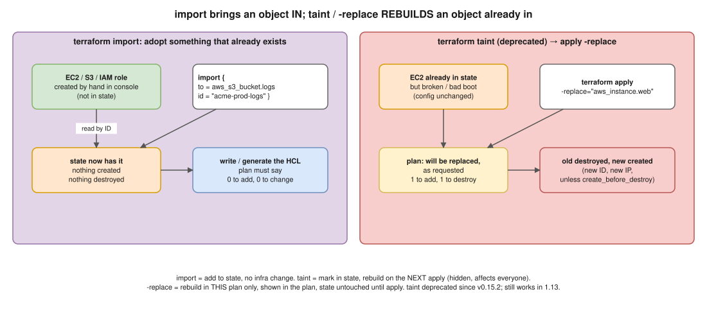

# 01 · `terraform import` vs `terraform taint` ⭐



> **Say this first:** "They do opposite jobs. `import` takes a resource that **already exists** in AWS but **isn't managed** by Terraform and writes it into the state, so Terraform starts managing it; nothing is created or destroyed. `taint` takes a resource that **is already managed** and marks it so the next apply **destroys and recreates** it. `taint` is deprecated since v0.15.2; today I use `terraform apply -replace=ADDRESS`, which shows the replacement in the plan instead of silently changing the state. And since 1.5 I prefer `import` **blocks** over the `terraform import` command, because they go through plan and code review."

## Side by side

| | `terraform import` | `terraform taint` (⚠️ deprecated) → `-replace` |
|---|---|---|
| **Starting point** | Object exists in AWS, **not** in state | Object exists in AWS **and** in state |
| **What it does** | Adds the object to state (address → real ID) | Marks it "tainted" → destroy + create on next apply |
| **Changes real infra?** | No | Yes, on the next apply (new ID, new IP, data on local disks lost) |
| **Writes the `.tf` code?** | CLI: no, you write it. Import block + `-generate-config-out`: generates a draft | No, config is unchanged |
| **Shown in a plan?** | CLI: no (writes state directly). Import block: yes, "will be imported" | `taint`: no (writes state directly). `-replace`: yes, "will be replaced, as requested" |
| **Typical use** | Adopt console-made resources, migrate from CloudFormation / another state | A broken or misconfigured instance that needs a clean rebuild |
| **Undo** | `terraform state rm ADDR` or a `removed {}` block (1.7+) | `terraform untaint ADDR` (for `-replace`: just don't apply) |

## `terraform import`: adopting existing resources

### Old way: the CLI command

You must **write the resource block first**, then import into that address:

```hcl
resource "aws_s3_bucket" "logs" {
  bucket = "acme-prod-logs"
}
```

```bash
terraform import aws_s3_bucket.logs acme-prod-logs
terraform plan      # goal: "No changes". Any diff = your HCL doesn't match reality yet
```

Problems with the CLI command:
- It **writes straight into the (shared) state**, with no plan and no review.
- It does **one resource at a time**, and you must know each ID format (S3 = bucket name, EC2 = `i-0abc…`, IAM role = role name, security group rule = a long composite ID).
- Easy to import into the wrong workspace / environment.

### New way (1.5+): `import` blocks *(illustrative)*

```hcl
import {
  to = aws_s3_bucket.logs
  id = "acme-prod-logs"
}
```

```bash
terraform plan -generate-config-out=generated.tf   # Terraform writes a draft resource block for you
terraform plan                                     # "1 to import, 0 to add, 0 to change, 0 to destroy"
terraform apply
```

- It goes through **plan → MR review → apply** in GitLab CI like any other change.
- `-generate-config-out` writes a **draft**: clean it up (remove computed/default attributes, use variables) before committing.
- Since **1.7**, import blocks support **`for_each`**, so you can import many similar resources at once.
- After the apply you can delete the `import` block (keeping it is harmless: it's a no-op once the object is in state).

The reverse of import (1.7+): stop managing a resource **without destroying it**:

```hcl
removed {
  from = aws_s3_bucket.logs
  lifecycle {
    destroy = false
  }
}
```

(Older equivalent: `terraform state rm aws_s3_bucket.logs`.)

### Real-world example (adapt it to what you really did)

At work, someone created an **IAM role and an S3 bucket by hand** in the console during an incident. Leaving them unmanaged means drift nobody sees. I wrote `import` blocks for them, generated the config, cleaned it up, opened an MR, and the plan showed "2 to import, 0 to change". After the merge, they were managed like everything else. Same approach for adopting resources when moving from CloudFormation or splitting one big state into smaller ones.

## `terraform taint` → `terraform apply -replace`

### What taint does (tested 🧪)

```bash
$ terraform taint 'terraform_data.f["bob"]'
Resource instance terraform_data.f["bob"] has been marked as tainted.

$ terraform plan
  # terraform_data.f["bob"] is tainted, so must be replaced
Plan: 1 to add, 0 to change, 1 to destroy.

$ terraform untaint 'terraform_data.f["bob"]'
Resource instance terraform_data.f["bob"] has been successfully untainted.
```

### What `-replace` does (tested 🧪)

```bash
$ terraform plan -replace='terraform_data.f["bob"]'
  # terraform_data.f["bob"] will be replaced, as requested
Plan: 1 to add, 0 to change, 1 to destroy.

$ terraform apply -replace='aws_instance.web'     # the real command
```

### Why taint was deprecated (v0.15.2)

- `taint` **changes the shared state immediately**. Everyone's next plan suddenly shows a replacement they didn't ask for, and in CI the next unrelated MR could rebuild a production server.
- `-replace` lives **only inside one plan**: you see it, review it, and nothing changes until that plan is applied. If you don't apply, nothing happened.
- Both still work in 1.13 (tested 🧪), but HashiCorp's docs recommend `-replace`.

### When Terraform taints automatically

If a resource is **created** but a **creation-time provisioner fails** (or creation fails part-way), Terraform marks it tainted itself, so the next apply rebuilds it. That's why you sometimes see "tainted" in a plan without anyone running `taint` (see [07](07-local-exec-vs-remote-exec.md)).

### Real-world example (adapt it to what you really did)

An EC2 instance (or a self-managed EKS worker) boots with a broken `user_data` or a corrupted disk. The config is right, so a normal plan says "No changes". `terraform apply -replace="aws_instance.bastion"` rebuilds just that one instance, with the replacement visible in the MR plan. For something that serves traffic, add `lifecycle { create_before_destroy = true }` so the new one exists before the old one goes.

## Gotchas

- **Import doesn't write code** (CLI). If you import and don't write matching HCL, the next plan will try to **destroy** the object because it's in state but not in config.
- **Import needs read permissions** on the real object, and the provider must support importing that resource type (most AWS resources do; check the "Import" section of the provider docs).
- **Replacing = new identity**: new instance ID, new private IP (unless fixed), lost instance-store data, DNS records pointing at the old IP break. Check dependents.
- **`-replace` with modules / for_each** needs the full address in quotes: `-replace='module.eks.aws_eks_node_group.this["general"]'`.

## Interview angle

**Q: Your colleague created an RDS instance by hand. How do you bring it under Terraform?**
Write an `import` block with `to = aws_db_instance.reporting` and `id = "reporting-db"`, run `terraform plan -generate-config-out=generated.tf`, clean the generated code, make sure the plan shows "1 to import, 0 to change, 0 to destroy", then MR and apply. Add `deletion_protection = true` and `lifecycle { prevent_destroy = true }` while I'm there.

**Q: Is `terraform taint` still used?**
It works, but it's deprecated since v0.15.2. I use `terraform apply -replace=ADDR` because it's visible in the plan and doesn't modify shared state ahead of time.

**Q: What happens if you import but the HCL doesn't match?**
The import succeeds, but the next plan shows an update (or a replacement, for force-new attributes like an RDS `engine`) to make reality match your code. That's why the goal after an import is a plan with **zero** changes.

**Q: How do you stop managing a resource without deleting it?**
A `removed` block with `lifecycle { destroy = false }` (1.7+), or `terraform state rm ADDR` on older versions.
