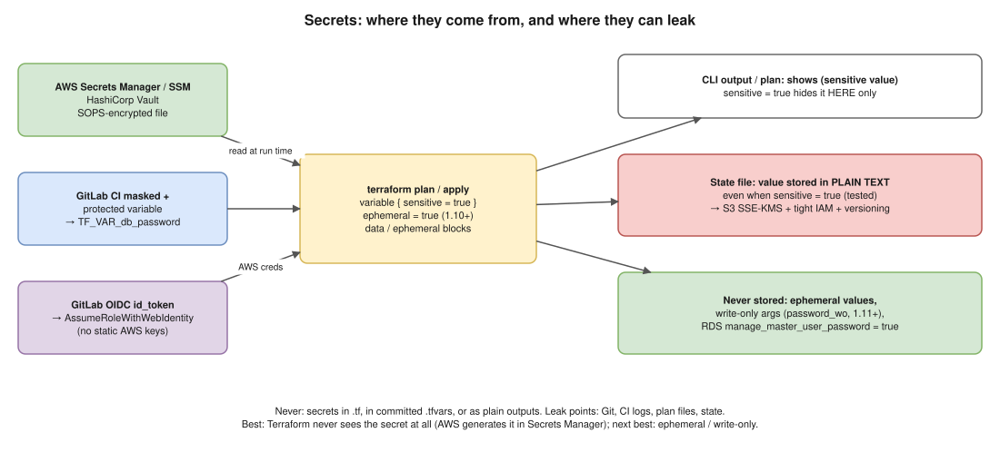

# 02 · Managing Secrets Without Hardcoding ⭐



> **Say this first:** "Three rules. One: secrets never go in `.tf` files or committed `.tfvars`; they come in at run time from a secret store (AWS Secrets Manager / SSM, Vault) or a masked CI variable as `TF_VAR_…`, and the pipeline gets AWS access through OIDC, not static keys. Two: `sensitive = true` only hides values in the CLI output; they are **still stored in plain text in the state**, so the state bucket is encrypted with KMS, versioned and locked down. Three: best of all, Terraform never sees the secret: for RDS I use `manage_master_user_password = true` so AWS generates it in Secrets Manager, and on Terraform 1.10+ I use ephemeral values and write-only arguments, which are never written to state."

## Where secrets leak

| Leak point | How it happens | Fix |
|---|---|---|
| **Git** | `password = "..."` in `.tf`, or a committed `prod.tfvars` | Secret stores, `TF_VAR_`, `.gitignore`, gitleaks pre-commit |
| **CI logs** | `echo $DB_PASS`, `TF_LOG=DEBUG`, plan output | Masked variables, `sensitive = true`, no debug logs in prod |
| **Plan files** | `terraform plan -out=tfplan` contains values | Treat `tfplan` as secret: short-lived artifact, restricted access |
| **State** | Every attribute is stored, including passwords | Encrypted remote backend (05), least-privilege access, ephemeral / write-only |
| **Outputs** | `output "db_password"` printed in CI | Don't output secrets; mark `sensitive = true` if you must |

## 1. Pass secrets in at run time, never in code

### Environment variables: `TF_VAR_<name>`

```hcl
variable "db_password" {
  type      = string
  sensitive = true # redacted in plan/apply output
}
```

```bash
export TF_VAR_db_password="$(aws secretsmanager get-secret-value \
  --secret-id prod/app/db --query SecretString --output text)"
terraform apply
```

In **GitLab CI**: store it as a **masked + protected** CI/CD variable named `TF_VAR_db_password`. Protected = only available on protected branches/tags (e.g., `main`), so a feature-branch pipeline can't read prod secrets. Masked = hidden in job logs.

### Read from a secret store with a data source *(illustrative)*

```hcl
data "aws_secretsmanager_secret_version" "db" {
  secret_id = "prod/app/db"
}

locals {
  db = jsondecode(data.aws_secretsmanager_secret_version.db.secret_string)
}

resource "kubernetes_secret" "app" {
  metadata { name = "app-db" }
  data = { password = local.db.password }
}
```

Same idea with `data "aws_ssm_parameter"` (SecureString), the **Vault** provider (`data "vault_kv_secret_v2"`), or the **SOPS** provider (`carlpett/sops`: an encrypted YAML file in Git, decrypted with KMS at plan time).

⚠️ A data source's result **is stored in the state**. That's fine only if the state is protected (next section), and it's why ephemeral resources were added.

## 2. `sensitive = true`: what it does and doesn't do (tested 🧪)

**It hides values in output:**

```bash
$ terraform output
pw = <sensitive>
```

**It forces you to be explicit.** A root output that uses a sensitive variable fails unless it's marked too:

```text
Error: Output refers to sensitive values

To reduce the risk of accidentally exporting sensitive data that was intended
to be only internal, Terraform requires that any root module output
containing sensitive data be explicitly marked as sensitive, to confirm your
intent.
```

**It does NOT encrypt the state.** After `TF_VAR_db_password=s3cr3t terraform apply`:

```bash
$ grep -c s3cr3t terraform.tfstate
3                          # stored in plain text, 3 times
$ terraform output -raw pw
s3cr3t                     # -raw / -json print the real value
```

So: **`sensitive` protects the screen, not the state.**

## 3. Protect the state

- **Remote backend** with encryption: S3 with `encrypt = true` + a KMS key (`kms_key_id`), versioning on, Block Public Access on.
- **Least privilege**: only the CI role (and a break-glass admin) can read the state bucket/prefix. Developers run `plan` through the pipeline, not with state access on their laptops.
- **Never commit** `terraform.tfstate`, `*.tfstate.backup`, `.terraform/` or `tfplan` files. Standard `.gitignore`:

```gitignore
.terraform/
*.tfstate
*.tfstate.*
*.tfplan
tfplan
crash.log
*.auto.tfvars      # only if they hold secrets; commit non-secret env tfvars
secrets.tfvars
```

- (Aside: **OpenTofu** 1.7+ can encrypt state client-side; Terraform relies on the backend's encryption.)

## 4. Best: Terraform never holds the secret

### RDS: let AWS manage the master password *(illustrative)*

```hcl
resource "aws_db_instance" "app" {
  identifier                  = "app-prod"
  engine                      = "postgres"
  instance_class              = "db.t4g.medium"
  username                    = "app_admin"
  manage_master_user_password = true # AWS generates + rotates it in Secrets Manager
}
```

The app (e.g., a pod on EKS) reads the secret from Secrets Manager through **External Secrets Operator** or the **Secrets Store CSI driver** with **IRSA / EKS Pod Identity**. Terraform only knows the secret's ARN.

### Ephemeral values (Terraform 1.10+) and write-only arguments (1.11+)

- `variable "x" { ephemeral = true }` and `ephemeral "aws_secretsmanager_secret_version" "db" {…}` exist **only during the run**: never written to state or plan files.
- They can only be used where a value isn't persisted: provider configuration, other ephemeral values, and **write-only arguments** such as `password_wo` on `aws_db_instance` (with `password_wo_version`, bumped to trigger a change).

Terraform enforces this (tested 🧪):

```text
Error: Invalid use of ephemeral value

  with terraform_data.x,
  on main.tf line 6, in resource "terraform_data" "x":
   6:   input = var.token

Ephemeral values are not valid for "input", because it is not a write-only
attribute and must be persisted to state.
```

*(illustrative)*:

```hcl
ephemeral "aws_secretsmanager_secret_version" "db" {
  secret_id = "prod/app/db"
}

resource "aws_db_instance" "app" {
  # ...
  password_wo         = jsondecode(ephemeral.aws_secretsmanager_secret_version.db.secret_string).password
  password_wo_version = 2
}
```

## 5. Cloud credentials: no static keys

AWS credentials are secrets too. In GitLab CI, use **OIDC**: the job gets a short-lived `id_token`, and AWS STS swaps it for temporary role credentials. *(illustrative)*

```yaml
plan:
  image: hashicorp/terraform:1.13
  id_tokens:
    GITLAB_OIDC_TOKEN:
      aud: https://gitlab.com
  script:
    - >
      export $(printf "AWS_ACCESS_KEY_ID=%s AWS_SECRET_ACCESS_KEY=%s AWS_SESSION_TOKEN=%s"
      $(aws sts assume-role-with-web-identity
      --role-arn "$TF_ROLE_ARN" --role-session-name "gitlab-$CI_PIPELINE_ID"
      --web-identity-token "$GITLAB_OIDC_TOKEN" --duration-seconds 3600
      --query 'Credentials.[AccessKeyId,SecretAccessKey,SessionToken]' --output text))
    - terraform init
    - terraform plan -out=tfplan
```

The IAM role's trust policy restricts `sub` to your project and branch (e.g., `project_path:acme/infra:ref_type:branch:ref:main` for the apply role). Never put `access_key` / `secret_key` in the `provider "aws"` block.

## 6. Catch mistakes before merge

- **gitleaks** / **trufflehog** as pre-commit and CI jobs: block commits that contain keys.
- **Trivy** (`trivy config .`, which absorbed tfsec) / **Checkov**: flag unencrypted buckets, plain-text passwords, public resources.
- Review the plan in the MR, never the raw values.

## Real-world example (adapt it to what you really did)

On EKS: RDS uses `manage_master_user_password = true`; the app's pods read it via External Secrets Operator using IRSA; Terraform only passes the secret ARN. GitLab CI authenticates to AWS with OIDC; the only CI variable is the role ARN. The state lives in an encrypted, versioned S3 bucket that only the CI role can read.

## Interview angle

**Q: If I mark a variable `sensitive`, is it safe?**
Only from the screen. It's still plain text in the state (I've checked: `grep` finds it). Protect the state, and use ephemeral / write-only arguments where the provider supports them.

**Q: Where do you keep the secrets for CI?**
In a secret store (Secrets Manager / SSM / Vault). CI uses OIDC for AWS, and only masked + protected variables for anything that can't be fetched.

**Q: Someone committed an AWS key to the repo. What do you do?**
Rotate/deactivate the key **first** (removing it from Git doesn't help: it's in history and possibly cloned), check CloudTrail for use, then clean history if needed and add gitleaks to stop it recurring.

**Q: How does the app get the DB password if Terraform doesn't output it?**
It reads it from Secrets Manager at runtime (External Secrets Operator / CSI driver with IRSA or Pod Identity), not from Terraform.
