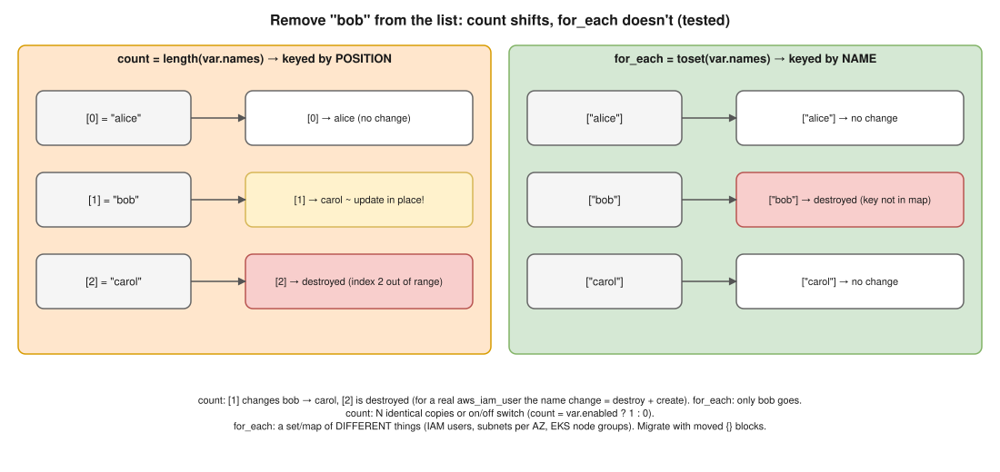

# 03 · `count` vs `for_each` ⭐



> **Say this first:** "Both create multiple instances of a resource or module. `count` takes a **number** and tracks instances by **position**: `[0]`, `[1]`, `[2]`. `for_each` takes a **map or a set of strings** and tracks instances by **key**: `["alice"]`, `["bob"]`. The difference shows when you remove an item from the middle: with `count`, every item after it shifts index, so Terraform updates or recreates resources you didn't touch; with `for_each`, only the removed key is destroyed. So I use `count` for identical copies or an on/off switch (`count = var.create ? 1 : 0`), and `for_each` for collections of distinct things, like IAM users, subnets per AZ or EKS node groups."

## Side by side

| | `count` | `for_each` |
|---|---|---|
| **Takes** | A whole number | A map, or a set of strings (`toset(list)`) |
| **Instance address** | `aws_iam_user.u[0]` | `aws_iam_user.u["alice"]` |
| **Inside the block** | `count.index` | `each.key`, `each.value` |
| **Remove a middle item** | Later items **shift** → updates / replacements | Only that key is destroyed |
| **Reorder the list** | Changes everything after the first moved item | No change (sets/maps aren't ordered by position) |
| **Best for** | N identical copies; conditional create (0 or 1) | Distinct, named things with their own settings |
| **Value must be known at plan time?** | Yes (the number) | Yes (the keys; values may be unknown) |
| **Together on one block?** | No: a block can have `count` **or** `for_each`, not both | |
| **Works on** | Resources, data sources, modules (0.13+) | Resources, data sources, modules (0.13+), `dynamic` blocks |

## The index-shift problem (tested 🧪)

Start with `names = ["alice", "bob", "carol"]` and two resources, one with each meta-argument:

```hcl
resource "terraform_data" "c" {
  count = length(var.names)
  input = var.names[count.index]
}

resource "terraform_data" "f" {
  for_each = toset(var.names)
  input    = each.value
}
```

```bash
$ terraform state list
terraform_data.c[0]
terraform_data.c[1]
terraform_data.c[2]
terraform_data.f["alice"]
terraform_data.f["bob"]
terraform_data.f["carol"]
```

Now remove `bob`:

```bash
$ terraform plan -var 'names=["alice","carol"]'
  # terraform_data.c[1] will be updated in-place
      ~ input  = "bob" -> "carol"
  # terraform_data.c[2] will be destroyed
  # (because index [2] is out of range for count)
      - input  = "carol" -> null
  # terraform_data.f["bob"] will be destroyed
  # (because key ["bob"] is not in for_each map)
      - input  = "bob" -> null
Plan: 0 to add, 1 to change, 2 to destroy.
```

- **count:** `[1]` is **rewritten** from bob to carol, and the real carol `[2]` is destroyed. Carol didn't change, but her resource did.
- **for_each:** only `["bob"]` is destroyed.

With real AWS resources it's worse: for `aws_iam_user` the `name` change on `[1]` is a rename, and for force-new attributes (e.g., an S3 bucket name, a subnet CIDR) it's **destroy + create**, which can mean data loss or downtime for a resource nobody meant to touch.

## Real-world use cases *(illustrative)*

### `for_each`: subnets per AZ

```hcl
variable "private_subnets" {
  type = map(string)
  default = {
    "ap-south-1a" = "10.0.1.0/24"
    "ap-south-1b" = "10.0.2.0/24"
    "ap-south-1c" = "10.0.3.0/24"
  }
}

resource "aws_subnet" "private" {
  for_each          = var.private_subnets
  vpc_id            = aws_vpc.main.id
  availability_zone = each.key
  cidr_block        = each.value
  tags = {
    Name                              = "private-${each.key}"
    "kubernetes.io/role/internal-elb" = "1" # EKS internal load balancers
  }
}

# Use the results
output "private_subnet_ids" {
  value = [for s in aws_subnet.private : s.id] # or values(aws_subnet.private)[*].id
}
```

Dropping `ap-south-1b` later touches only that subnet. With `count` it would shift `1c` into `1b`'s slot and try to recreate it with a different CIDR.

### `for_each` with a map of objects: EKS managed node groups

```hcl
variable "node_groups" {
  type = map(object({
    instance_types = list(string)
    min            = number
    max            = number
    capacity_type  = optional(string, "ON_DEMAND")
  }))
}

resource "aws_eks_node_group" "this" {
  for_each        = var.node_groups
  cluster_name    = aws_eks_cluster.main.name
  node_group_name = each.key
  instance_types  = each.value.instance_types
  capacity_type   = each.value.capacity_type
  subnet_ids      = values(aws_subnet.private)[*].id
  node_role_arn   = aws_iam_role.node.arn
  scaling_config {
    min_size     = each.value.min
    max_size     = each.value.max
    desired_size = each.value.min
  }
  lifecycle {
    ignore_changes = [scaling_config[0].desired_size] # Cluster Autoscaler owns this (see 04)
  }
}
```

```hcl
node_groups = {
  general = { instance_types = ["m6i.large"], min = 2, max = 6 }
  spot    = { instance_types = ["m6i.large", "m5.large"], min = 0, max = 10, capacity_type = "SPOT" }
}
```

Other good `for_each` cases: IAM users / roles from a list of names, one ECR repository per service, Route 53 records, S3 buckets per team, security group rules from a map.

### `count`: conditional creation

```hcl
resource "aws_nat_gateway" "this" {
  count         = var.single_nat_gateway ? 1 : length(var.public_subnet_ids)
  allocation_id = aws_eip.nat[count.index].id
  subnet_id     = var.public_subnet_ids[count.index]
}

resource "aws_cloudwatch_metric_alarm" "cpu" {
  count = var.enable_alarms ? 1 : 0
  # ...
}

# referencing a 0-or-1 resource safely
output "alarm_arn" {
  value = one(aws_cloudwatch_metric_alarm.cpu[*].arn) # null when count = 0
}
```

`count` is fine here because the copies are **identical** or it's a simple **on/off** switch: nothing gets removed from the middle.

### `for_each` inside a block: `dynamic`

```hcl
resource "aws_security_group" "web" {
  name   = "web"
  vpc_id = aws_vpc.main.id
  dynamic "ingress" {
    for_each = var.ingress_ports # e.g. [80, 443]
    content {
      from_port   = ingress.value
      to_port     = ingress.value
      protocol    = "tcp"
      cidr_blocks = ["0.0.0.0/0"]
    }
  }
}
```

## Migrating from `count` to `for_each` without recreating (tested 🧪)

Changing `count` to `for_each` changes every address (`[0]` → `["alice"]`), so Terraform would destroy and recreate everything. Tell it the objects **moved** (1.1+):

```hcl
resource "terraform_data" "user" {
  for_each = toset(var.names)
  input    = each.value
}

moved {
  from = terraform_data.user[0]
  to   = terraform_data.user["alice"]
}
moved {
  from = terraform_data.user[1]
  to   = terraform_data.user["bob"]
}
moved {
  from = terraform_data.user[2]
  to   = terraform_data.user["carol"]
}
```

```bash
$ terraform plan
  # terraform_data.user[0] has moved to terraform_data.user["alice"]
  # terraform_data.user[1] has moved to terraform_data.user["bob"]
  # terraform_data.user[2] has moved to terraform_data.user["carol"]
Plan: 0 to add, 0 to change, 0 to destroy.
```

Older alternative: `terraform state mv 'aws_iam_user.u[0]' 'aws_iam_user.u["alice"]'` (direct state edit, no review). `moved` blocks are better: they're code, reviewed in the MR, and work for everyone who uses the module.

## Gotchas

- **`for_each` keys must be known at plan time.** `for_each = toset(aws_instance.web[*].id)` fails on first apply ("The for_each value depends on resource attributes that cannot be determined until apply"). Use keys you define (names), not IDs that AWS assigns.
- **Sets only hold strings**: `toset(["a","b"])` is fine; for objects use a map. Duplicates in a list vanish in `toset`.
- **Sensitive values can't be `for_each` keys** (they'd appear in resource addresses).
- **Lists for `for_each`**: convert with `toset()`, or build a map: `{ for u in var.users : u.name => u }`.
- **Changing a key = destroy + create** of that instance (the key is its identity). Pick stable keys.

## Interview angle

**Q: When would you still choose `count`?**
For an on/off switch (`count = var.enabled ? 1 : 0`) or N truly identical, interchangeable copies where nothing gets removed from the middle.

**Q: You have 5 IAM users created with `count` and need to delete the 2nd one. What happens and how do you fix it?**
Users 3–5 shift down an index, so Terraform renames/recreates them. Fix: migrate to `for_each` keyed by username with `moved` blocks (plan should show only moves), then remove the user.

**Q: Why does `for_each` fail with "cannot be determined until apply"?**
The keys depend on something only known after apply (like a resource ID). Use static keys (names from variables) and put unknown values in `each.value` instead.

**Q: How do you reference all instances of a `for_each` resource?**
`[for k, v in aws_subnet.private : v.id]`, `values(aws_subnet.private)[*].id`, or a single one with `aws_subnet.private["ap-south-1a"].id`.
