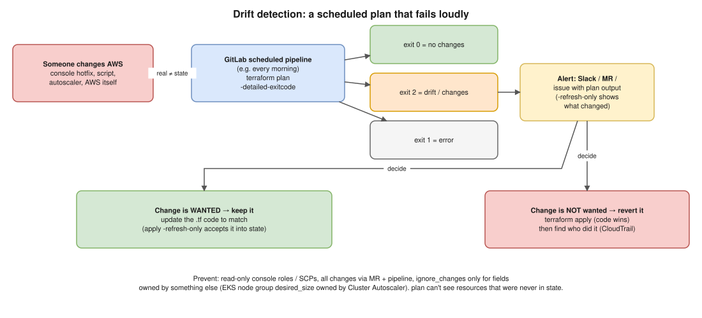

# 04 · Drift Detection ⭐



> **Say this first:** "Drift is when the real infrastructure no longer matches what Terraform last applied, usually because of a console hotfix, a script, or another controller. I detect it with a **scheduled CI pipeline** that runs `terraform plan -detailed-exitcode` (or `-refresh-only`) against every state: exit code 2 means changes, so the job fails and posts the diff to Slack. Then a human decides: if the change was wanted, we update the code; if not, `terraform apply` puts it back. And I prevent it by making the console read-only for humans and using `ignore_changes` only for fields that another system legitimately owns, like a node group's `desired_size` owned by Cluster Autoscaler."

## What drift is (and isn't)

| Situation | Is it drift? | What `plan` shows |
|---|---|---|
| Someone edited a security group in the console | **Yes**: real ≠ state | A change to put it back |
| Someone deleted a resource by hand | **Yes** | A **create** for it |
| You changed the `.tf` code but didn't apply | No: that's a **pending change** (code ≠ state) | Your change |
| Someone created a brand-new resource by hand | **Invisible**: it was never in state | Nothing (see "blind spot") |
| AWS changed a default / a provider upgrade reads attributes differently | Sort of: shows as a diff | A change; check before applying |

## How to detect it

### 1. `terraform plan` (refreshes first)

Every `plan` refreshes state in memory, then compares. Drift appears as "Note: Objects have changed outside of Terraform" followed by the actions needed to undo it.

### 2. `terraform plan -refresh-only`: drift only

Shows **only** what changed in the real world, without mixing in pending code changes (tested 🧪, no drift case):

```bash
$ terraform plan -refresh-only
No changes. Your infrastructure still matches the configuration.

Terraform has checked that the real remote objects still match the result of
your most recent changes, and found no differences.
```

With drift it prints each changed attribute (`~ ingress = [...] -> [...]`) under "Objects have changed outside of Terraform".

### 3. `-detailed-exitcode`: make it machine-readable (tested 🧪)

| Exit code | Meaning |
|---|---|
| `0` | Success, **no changes** |
| `1` | **Error** |
| `2` | Success, **there are changes** (drift or pending code) |

```bash
$ terraform plan -detailed-exitcode >/dev/null; echo exit=$?
exit=0
$ terraform plan -detailed-exitcode -var 'names=["alice","carol"]' >/dev/null; echo exit=$?
exit=2
```

### 4. Scheduled GitLab CI job *(illustrative)*

Create a pipeline **schedule** (CI/CD → Schedules, e.g., `0 6 * * *`) with a variable `DRIFT_CHECK=true`:

```yaml
drift-check:
  stage: check
  image: hashicorp/terraform:1.13
  rules:
    - if: '$CI_PIPELINE_SOURCE == "schedule" && $DRIFT_CHECK == "true"'
  parallel:
    matrix:
      - STACK: [envs/dev, envs/staging, envs/prod]
  script:
    - cd "$STACK"
    - terraform init -input=false
    - set +e
    - terraform plan -refresh-only -detailed-exitcode -input=false -no-color -lock=false > drift.txt
    - code=$?
    - set -e
    - |
      if [ "$code" -eq 2 ]; then
        curl -s -X POST -H 'Content-type: application/json' \
          --data "{\"text\":\"Drift in $STACK: $CI_JOB_URL\"}" "$SLACK_WEBHOOK_URL"
        exit 1
      fi
    - exit $code
  artifacts:
    when: always
    paths: [$STACK/drift.txt]
```

- `-lock=false` is OK for a read-only check so it doesn't block a real apply (a plan never writes state).
- The drift role only needs **read** permissions.
- Run `plan` without `-refresh-only` too if you also want to catch merged-but-not-applied code.

### 5. Other tools

- **HCP Terraform / Terraform Enterprise**: built-in **health assessments** (scheduled drift detection) per workspace.
- **AWS Config** rules and **CloudTrail**: who changed what, outside Terraform.
- **driftctl** used to find unmanaged resources too, but it's no longer maintained; don't build on it.

## How to resolve it

Always ask **"was the change wanted?"** first.

| Wanted? | Do this |
|---|---|
| **Yes** (e.g., an incident hotfix that should stay) | Update the `.tf` code to match, MR, plan shows **no changes**. If only state needs updating: `terraform apply -refresh-only` to accept it into state, then fix the code. |
| **No** (someone fiddled) | `terraform apply`: the code wins and the change is reverted. Then find who and why in **CloudTrail**, and close the gap (permissions, runbook). |
| **Owned by another system** | Add `lifecycle { ignore_changes = [...] }` for **that field only**, with a comment saying who owns it. |

`ignore_changes` example *(illustrative)*:

```hcl
resource "aws_eks_node_group" "general" {
  # ...
  scaling_config {
    min_size     = 2
    max_size     = 10
    desired_size = 2
  }
  lifecycle {
    # Cluster Autoscaler / Karpenter changes desired_size at runtime.
    ignore_changes = [scaling_config[0].desired_size]
  }
}
```

Other common ones: ASG `desired_capacity`, ECS service `desired_count` (Application Auto Scaling), tags added by AWS Backup or a tagging Lambda. Never `ignore_changes = all` on something important: it hides real drift.

## How to prevent it

- **Humans get read-only console access** in staging/prod; write access only through the pipeline role. Break-glass role for emergencies, alarmed.
- **SCPs / permission boundaries** to block risky console actions in prod accounts.
- **Every change via MR → plan → review → apply** (GitOps for infra).
- **Small states** so plans are fast enough to run often.
- After an emergency console fix, the incident isn't closed until the code matches (add it to the postmortem checklist).

## The blind spot

`terraform plan` only checks resources **already in the state**. A security group created by hand in the console is invisible to it. To catch these: AWS Config, tag policies (everything Terraform creates gets `ManagedBy = terraform` via provider `default_tags`, so untagged resources stand out), or Resource Explorer queries.

## Real-world example (adapt it to what you really did)

At work the classic drift was the **EKS node group `desired_size`**: Cluster Autoscaler scales it, and every Terraform plan wanted to set it back to 2, which would have scaled the cluster down mid-day. The fix was `ignore_changes` on `desired_size` only. The second classic was **security group rules added in the console** during an incident: the morning drift job flagged it, we decided the rule was needed, added it to the code, and the next plan was clean.

## Interview angle

**Q: How would you know if someone changed prod by hand last night?**
A scheduled `terraform plan -refresh-only -detailed-exitcode` per state; exit code 2 fails the job and alerts Slack with the diff. CloudTrail tells me who.

**Q: Plan shows drift. Do you just apply?**
No. First decide if the change was intentional. If yes, update the code; if no, apply to revert. Blindly applying can undo an incident fix.

**Q: What's `ignore_changes` for, and what's the risk?**
For attributes legitimately managed elsewhere (autoscaler `desired_size`). The risk is hiding real drift, so keep it to specific attributes with a comment.

**Q: Can Terraform detect resources created outside it?**
No, plan only knows what's in state. Use AWS Config / tagging rules for unmanaged resources, and `import` blocks to adopt them ([01](01-import-vs-taint.md)).
