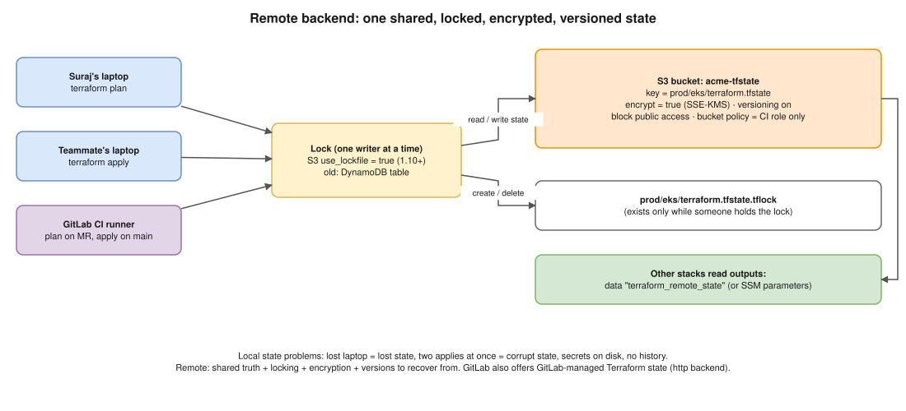

# 05 · Remote Backends ⭐



> **Say this first:** "The backend is where Terraform stores its **state file**. By default it's a local `terraform.tfstate` on your laptop, which breaks as soon as there's a team or a CI pipeline. A remote backend, like S3, stores the state centrally so everyone and the pipeline use the same truth, **locks** it so two applies can't run at once and corrupt it, **encrypts** it because state holds secrets, and **versions** it so we can recover from a bad write. On AWS I use the S3 backend with `encrypt = true`, a KMS key, bucket versioning, and since Terraform 1.10 native S3 locking with `use_lockfile = true` instead of a DynamoDB table."

## Why local state isn't enough

| Problem with local state | What a remote backend gives you |
|---|---|
| Only on one laptop; lost laptop = lost state | **One shared source of truth** for the team and CI |
| Two people apply at the same time → corrupted state, duplicate resources | **State locking**: one writer at a time |
| Secrets in plain text on disks, maybe committed to Git | **Encryption at rest** + access control (IAM) |
| No history; a bad write is permanent | **Versioning**: restore a previous state version |
| CI can't see it | Pipelines read/write the same state |
| Other stacks can't use your outputs | `terraform_remote_state` (or SSM parameters) |

## The S3 backend *(illustrative)*

```hcl
terraform {
  required_version = ">= 1.10"

  backend "s3" {
    bucket       = "acme-tfstate-prod"
    key          = "prod/eks/terraform.tfstate" # one key per stack + env
    region       = "ap-south-1"
    encrypt      = true
    kms_key_id   = "arn:aws:kms:ap-south-1:111122223333:key/abcd-…"
    use_lockfile = true # S3-native lock (1.10+)
  }
}
```

### How the S3 lock works

- With `use_lockfile = true`, Terraform writes **`<key>.tflock`** next to the state (e.g., `prod/eks/terraform.tfstate.tflock`) using an S3 **conditional write**, so only one client can create it. It's deleted when the operation ends.
- Before 1.10 you needed a **DynamoDB table** (`dynamodb_table = "terraform-locks"`, partition key `LockID`). That option is **deprecated** (1.11+) in favour of `use_lockfile`. During migration you can set both.
- If a run is killed (CI job cancelled, laptop closed), the lock stays. Release it after confirming nobody is running:

```bash
terraform force-unlock <LOCK_ID>   # the ID is printed in the "Error acquiring the state lock" message
```

### The state bucket itself

Create it **once**, outside the stacks that use it (a small "bootstrap" stack or by hand, then import it):

- **Versioning ON** (recovery from bad writes / accidental delete).
- **Default encryption SSE-KMS**, Block Public Access ON.
- **Bucket policy**: only the CI roles (plan role = read, apply role = read/write) and break-glass admin; deny non-TLS (`aws:SecureTransport = false`).
- Optionally **one bucket per account/environment**, so a dev role physically can't touch prod state.
- Lifecycle rule to expire old **non-current** versions after, say, 90 days.

## Backend rules worth knowing

- **No variables in the backend block.** It's read before variables exist. Use **partial configuration** instead:

```hcl
terraform {
  backend "s3" {} # values come from init
}
```

```bash
terraform init -backend-config=backend/prod.hcl
# backend/prod.hcl:
#   bucket = "acme-tfstate-prod"
#   key    = "prod/eks/terraform.tfstate"
#   region = "ap-south-1"
#   use_lockfile = true
```

- **Changing the backend** (e.g., local → S3, or one bucket → another): edit the block, then

```bash
terraform init -migrate-state    # copies the existing state to the new backend
terraform init -reconfigure      # use the new config WITHOUT copying (careful)
```

- **Reading another stack's outputs** *(illustrative)*:

```hcl
data "terraform_remote_state" "network" {
  backend = "s3"
  config = {
    bucket = "acme-tfstate-prod"
    key    = "prod/network/terraform.tfstate"
    region = "ap-south-1"
  }
}

resource "aws_eks_cluster" "main" {
  vpc_config {
    subnet_ids = data.terraform_remote_state.network.outputs.private_subnet_ids
  }
  # ...
}
```

It needs read access to the **whole** other state (secrets included), so many teams publish only the needed values to **SSM Parameter Store** and read them with `data "aws_ssm_parameter"` instead.

- **Inspecting state safely**: `terraform state list`, `terraform state show ADDR`, `terraform state pull > backup.tfstate` (take a backup before any `state mv/rm`).

## Other backends

| Backend | When |
|---|---|
| **s3** | AWS shops (most common) |
| **GitLab-managed Terraform state** (`http` backend) | Teams on GitLab: state stored per project, locking built in, access follows GitLab permissions. The CI template sets the address for you. |
| **HCP Terraform / Terraform Enterprise** (`cloud {}` block) | Remote runs, policy (Sentinel/OPA), drift health checks, private registry |
| **azurerm**, **gcs** | Azure Blob / Google Cloud Storage, both with locking |
| **local** | Learning only |

GitLab-managed state, outside CI *(illustrative)*:

```bash
terraform init \
  -backend-config="address=https://gitlab.com/api/v4/projects/<id>/terraform/state/prod" \
  -backend-config="lock_address=https://gitlab.com/api/v4/projects/<id>/terraform/state/prod/lock" \
  -backend-config="unlock_address=https://gitlab.com/api/v4/projects/<id>/terraform/state/prod/lock" \
  -backend-config="username=<user>" -backend-config="password=$GITLAB_TOKEN" \
  -backend-config="lock_method=POST" -backend-config="unlock_method=DELETE" \
  -backend-config="retry_wait_min=5"
```

## Splitting state (blast radius)

One giant state for everything = slow plans, huge blast radius, everyone queued on one lock. Split by **layer and environment**:

```text
s3://acme-tfstate-prod/
├── prod/network/terraform.tfstate     # VPC, subnets, NAT, TGW
├── prod/eks/terraform.tfstate         # EKS cluster, node groups, IRSA roles
├── prod/data/terraform.tfstate        # RDS, ElastiCache, S3 data buckets
└── prod/apps/terraform.tfstate        # per-app IAM, ECR, Route53 records
```

Rarely-changed, dangerous things (network, data) are separate from frequently-changed things (apps).

## Real-world example (adapt it to what you really did)

Our GitLab CI ran `plan` on every MR and `apply` (manual, protected) on `main`, both against the S3 backend. One day a runner was killed mid-apply and the next pipeline failed with "Error acquiring the state lock". I checked the lock info (who, which operation, when), confirmed no job was still running, ran `terraform force-unlock <ID>`, then re-ran plan to see what the killed apply had already done before applying the rest.

## Interview angle

**Q: What's inside the state file and why protect it?**
Every managed resource's address, real ID and attributes, including secrets like DB passwords and private keys, in plain text. Protect it with encryption, IAM and versioning.

**Q: Why can't I use a variable for the bucket name in the backend block?**
The backend is initialised before variables are evaluated. Use partial config: `terraform init -backend-config=prod.hcl`.

**Q: Is DynamoDB still required for locking on S3?**
Not since 1.10: `use_lockfile = true` locks with an S3 conditional write. `dynamodb_table` is deprecated (1.11+), still works during migration.

**Q: The state got corrupted / someone deleted resources from it. What do you do?**
Stop all applies, restore the previous **version** of the state object from S3 versioning (or `terraform state push` a backup), then plan to confirm it matches reality. Note: restoring state doesn't change infrastructure ([08](08-rollback.md)).
