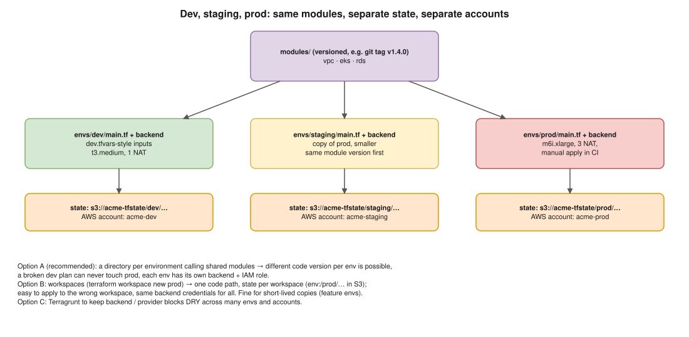

# 06 · Managing dev, staging and prod ⭐



> **Say this first:** "The goal is: same code, different inputs, fully isolated state. I put the reusable infrastructure in **versioned modules**, and each environment gets its own small root folder (`envs/dev`, `envs/staging`, `envs/prod`) that calls those modules with its own values, its own backend key, and ideally its own **AWS account**. That way a mistake in dev can never touch prod, and prod only moves to a new module version after dev and staging have run it. Workspaces also give separate state per environment, but they share one backend and one set of credentials and it's easy to apply to the wrong one, so I keep workspaces for short-lived copies like feature environments."

## The options

| Approach | How | Pros | Cons |
|---|---|---|---|
| **A. Directory per env + shared modules** ⭐ | `envs/prod/main.tf` calls `modules/eks` with prod values; own backend | Strong isolation; envs can run **different module versions**; obvious what you're applying | Some repeated boilerplate (backend, provider blocks) |
| **B. Workspaces** | `terraform workspace new prod`; one code path; `terraform.workspace` in code | No duplication; quick to create copies | Same backend + credentials for all; easy to be in the wrong workspace; can't differ in structure without `if`s everywhere |
| **C. Terragrunt** | `terragrunt.hcl` per env generates backend/provider config | DRY across many envs/accounts/regions; dependencies between stacks | Extra tool to learn and pin |
| **D. Same code, `-var-file` per env** | `terraform apply -var-file=prod.tfvars` + `-backend-config=prod.hcl` | Simple | Easy to mix the wrong tfvars with the wrong backend; relies on CI discipline |

Most real teams use **A** (or **C** when there are many accounts), often with tfvars inside each env folder.

## Option A: directory layout *(illustrative)*

```text
infra/
├── modules/                       # or separate repos, tagged v1.4.0, v1.5.0 …
│   ├── vpc/
│   ├── eks/
│   └── rds/
└── envs/
    ├── dev/
    │   ├── backend.tf             # key = "dev/eks/terraform.tfstate"
    │   ├── providers.tf           # assume_role into the acme-dev account
    │   ├── main.tf                # module "eks" { source = "../../modules/eks" ... }
    │   └── terraform.tfvars       # small, cheap
    ├── staging/
    └── prod/
```

`envs/prod/main.tf`:

```hcl
module "vpc" {
  source = "git::https://gitlab.com/acme/terraform-modules/vpc.git?ref=v1.4.0"

  name               = "prod"
  cidr               = "10.30.0.0/16"
  azs                = ["ap-south-1a", "ap-south-1b", "ap-south-1c"]
  single_nat_gateway = false # dev: true (save money)
}

module "eks" {
  source = "git::https://gitlab.com/acme/terraform-modules/eks.git?ref=v2.1.0"

  cluster_name       = "prod"
  kubernetes_version = "1.33"
  subnet_ids         = module.vpc.private_subnet_ids
  node_groups = {
    general = { instance_types = ["m6i.xlarge"], min = 3, max = 12 }
  }
}
```

`envs/prod/providers.tf`:

```hcl
provider "aws" {
  region = "ap-south-1"
  assume_role {
    role_arn = "arn:aws:iam::333344445555:role/terraform-apply" # the prod account
  }
  default_tags {
    tags = { Environment = "prod", ManagedBy = "terraform", Repo = "acme/infra" }
  }
}
```

**Promotion**: bump `?ref=v2.1.0` → `v2.2.0` in **dev** first, then staging, then prod, each its own MR. Prod changes only when someone deliberately bumps it.

## Option B: workspaces

```bash
terraform workspace list
terraform workspace new staging
terraform workspace select prod
terraform workspace show
```

```hcl
locals {
  instance_type = {
    dev     = "t3.medium"
    staging = "m6i.large"
    prod    = "m6i.xlarge"
  }[terraform.workspace]
}
```

- With the S3 backend, non-default workspaces are stored under **`env:/<workspace>/<key>`** (configurable with `workspace_key_prefix`).
- **Risks**: you `select` dev, get distracted, come back and apply what you thought was dev in prod. Every env uses the **same backend credentials**, so dev access = prod state access. Structural differences turn into `count = terraform.workspace == "prod" ? 1 : 0` everywhere.
- **Good for**: ephemeral copies of the same stack (per-feature-branch preview environments, load-test copies).
- Note: HCP Terraform "workspaces" are a different thing (closer to Option A: a separate state + settings per workspace).

## Option C: Terragrunt in one picture *(illustrative)*

```hcl
# live/prod/eks/terragrunt.hcl
include "root" { path = find_in_parent_folders("root.hcl") } # generates backend + provider

terraform {
  source = "git::https://gitlab.com/acme/terraform-modules/eks.git?ref=v2.1.0"
}

dependency "vpc" { config_path = "../vpc" }

inputs = {
  cluster_name = "prod"
  subnet_ids   = dependency.vpc.outputs.private_subnet_ids
}
```

## Isolation checklist

- **Separate AWS accounts** per environment (AWS Organizations). Strongest boundary: IAM, quotas, billing, blast radius.
- **Separate state** per env (and per layer): different backend keys or buckets.
- **Separate CI roles**: the dev pipeline's OIDC role can't assume the prod role. In GitLab, use **protected environments** and protected branches for prod.
- **Same modules, same versions eventually**: differences are inputs (size, count, flags), not different code.
- **Prod applies are manual** (or require approval) after reviewing the saved plan.

## GitLab CI shape *(illustrative)*

```yaml
stages: [validate, plan, apply]

.tf:
  image: hashicorp/terraform:1.13
  before_script:
    - cd envs/$ENV
    - terraform init -input=false

validate:
  stage: validate
  image: hashicorp/terraform:1.13
  script:
    - terraform fmt -check -recursive
    - for d in envs/*; do (cd $d && terraform init -backend=false -input=false && terraform validate); done

plan:prod:
  extends: .tf
  stage: plan
  variables: { ENV: prod }
  script:
    - terraform plan -out=tfplan -input=false
  artifacts:
    paths: [envs/prod/tfplan]
    expire_in: 1 day

apply:prod:
  extends: .tf
  stage: apply
  variables: { ENV: prod }
  environment: production          # protected environment: only approvers can run it
  rules:
    - if: '$CI_COMMIT_BRANCH == "main"'
      when: manual
  script:
    - terraform apply -input=false tfplan     # exactly the reviewed plan
```

(Same jobs for dev/staging, usually auto-applied for dev.)

## Real-world example (adapt it to what you really did)

At work: one AWS account per environment, `envs/<env>` folders calling shared modules pinned by git tag, an S3 state per account. MRs show the plan for each affected env; dev applies automatically on merge, staging and prod are manual jobs in protected environments. An EKS module change rolls dev → staging → prod over a few days, by bumping the module tag in each env.

## Interview angle

**Q: Workspaces or folders?**
Folders (or Terragrunt) for long-lived envs: isolation, separate credentials, different versions possible. Workspaces for short-lived identical copies.

**Q: How do you stop a dev change from reaching prod by accident?**
Separate accounts and state, separate CI roles via OIDC, prod pinned to a module version, manual approval on a protected environment, and applying the saved plan.

**Q: How do you keep envs consistent?**
Same modules; differences only in inputs; promote the same module version through dev → staging → prod; drift checks on all of them.

**Q: Where do env-specific values live?**
In each env folder (`terraform.tfvars` / module arguments). Secrets don't: they come from Secrets Manager / CI at run time ([02](02-secrets.md)).
