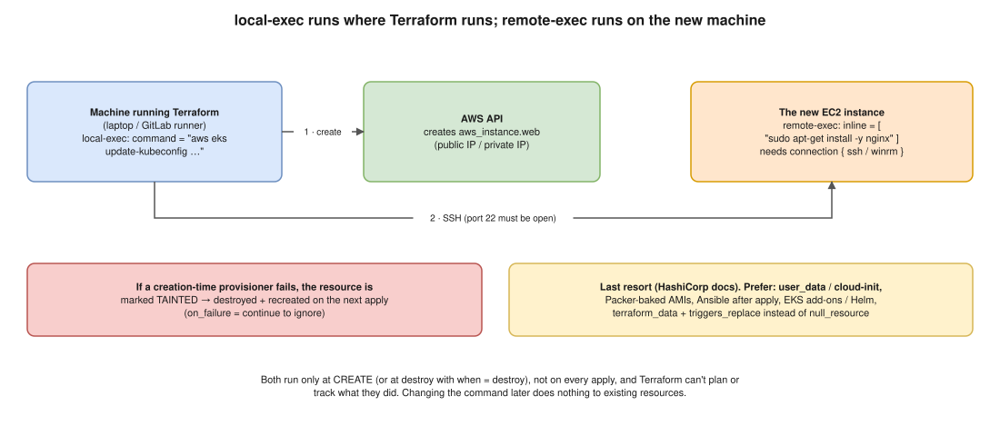

# 07 · `local-exec` vs `remote-exec` Provisioners



> **Say this first:** "Both run a command after a resource is created. `local-exec` runs on the **machine running Terraform**, my laptop or the GitLab runner, for example to call the AWS CLI or update a kubeconfig. `remote-exec` runs **on the new resource itself** over SSH or WinRM, so it needs a `connection` block, network access and credentials. HashiCorp calls provisioners a **last resort**: Terraform can't plan or track what they do, they only run at create time, and a failure taints the resource. So I prefer `user_data`/cloud-init, Packer-built AMIs or Ansible, and if I need a local command I use `terraform_data` with `triggers_replace` instead of the old `null_resource`."

## Side by side

| | `local-exec` | `remote-exec` |
|---|---|---|
| **Runs on** | The machine running `terraform` (laptop / CI runner) | The created resource (EC2 / VM) |
| **Needs** | The tools on that machine (aws, kubectl, curl…) | `connection { type = "ssh" / "winrm", host, user, private_key / password }`, port 22/5985-5986 reachable |
| **Arguments** | `command`, `interpreter`, `working_dir`, `environment`, `quiet` | `inline = [...]`, or `script = "path"`, or `scripts = [...]` |
| **Typical use** | Call an API/CLI, write a local file, update kubeconfig, trigger Ansible | Install packages, start a service, bootstrap an agent on the VM |
| **Better alternative** | A real provider resource; `terraform_data` + `triggers_replace` | `user_data` / cloud-init, Packer AMI, Ansible, SSM Run Command |

## `local-exec` *(illustrative)*

```hcl
resource "aws_eks_cluster" "main" {
  name     = "dev"
  role_arn = aws_iam_role.cluster.arn
  vpc_config { subnet_ids = var.subnet_ids }

  provisioner "local-exec" {
    command = "aws eks update-kubeconfig --name ${self.name} --region ap-south-1"
  }
}
```

With environment variables and a different interpreter:

```hcl
provisioner "local-exec" {
  command     = "ansible-playbook -i '${self.private_ip},' site.yml"
  working_dir = "${path.module}/ansible"
  environment = {
    ANSIBLE_HOST_KEY_CHECKING = "False"
  }
}

provisioner "local-exec" {
  interpreter = ["/bin/bash", "-c"]
  command     = "echo ${self.id} >> created.txt"
}
```

- Use **`self`** to refer to the parent resource's attributes (you can't reference the resource by its own name inside its provisioner).
- It runs on the **CI runner**, so the runner image must have the CLI, and the job's credentials are what the command uses.

## `remote-exec` *(illustrative)*

```hcl
resource "aws_instance" "web" {
  ami                    = data.aws_ami.ubuntu.id
  instance_type          = "t3.micro"
  key_name               = "deploy"
  vpc_security_group_ids = [aws_security_group.ssh.id]

  connection {
    type        = "ssh"
    user        = "ubuntu"
    private_key = file("~/.ssh/deploy.pem")
    host        = self.public_ip # or private_ip + bastion_host = "..."
  }

  provisioner "file" {
    source      = "app.conf"
    destination = "/tmp/app.conf"
  }

  provisioner "remote-exec" {
    inline = [
      "sudo apt-get update",
      "sudo apt-get install -y nginx",
      "sudo mv /tmp/app.conf /etc/nginx/conf.d/app.conf",
      "sudo systemctl restart nginx",
    ]
  }
}
```

- Needs SSH reachability from wherever Terraform runs (public IP, or `bastion_host` in the `connection` block). Opening port 22 just for Terraform is a security cost.
- The private key must be available to the runner (a secret).
- The `file` provisioner (copy files to the resource) uses the same `connection`.

## Behaviour common to both

- **Creation-time by default.** They run **once, when the resource is created**, not on later applies and not when the command text changes.
- **Destroy-time provisioners**: `when = destroy` runs before the resource is destroyed (e.g., deregister from a service). They can only reference `self`, `count.index` and `each.key`, and they only run if the block is **still in the configuration** when the resource is destroyed: delete the whole resource block and the destroy provisioner goes with it (set `count = 0` instead, or destroy first).
- **Failure handling**: `on_failure = fail` (default) → apply errors **and the resource is marked tainted**, so the next apply destroys and recreates it ([01](01-import-vs-taint.md)). `on_failure = continue` → ignore the error.
- **Not in the plan.** Terraform can't show or diff what a script will do, can't detect drift in what it configured, and can't undo it.

```hcl
provisioner "local-exec" {
  when       = destroy
  command    = "curl -X POST https://inventory.example/api/remove/${self.id}"
  on_failure = continue
}
```

## Why "last resort", and what to use instead

| Need | Better option |
|---|---|
| Configure an EC2 at boot | **`user_data` / cloud-init** (runs on the instance, no SSH from CI) |
| Same setup on many instances, fast boot | **Packer**-baked AMI (immutable) |
| Ongoing configuration management | **Ansible** after Terraform (inventory from Terraform outputs or the AWS dynamic inventory plugin) |
| Run a command on instances without SSH | **AWS SSM Run Command** / State Manager (`aws_ssm_association`) |
| Install things on EKS | Helm / Argo CD, EKS add-ons (`aws_eks_addon`) |
| Re-run a local command when something changes | **`terraform_data` + `triggers_replace`** (1.4+; replaces `null_resource` + `triggers`) |

`terraform_data` pattern *(illustrative)*:

```hcl
resource "terraform_data" "db_migrate" {
  triggers_replace = [var.app_version] # re-run when the version changes

  provisioner "local-exec" {
    command = "./scripts/migrate.sh ${var.app_version}"
  }
}
```

## Real-world example (adapt it to what you really did)

On EKS, a `local-exec` running `aws eks update-kubeconfig` after cluster creation was handy for a dev stack, but in CI it's fragile (depends on the runner's tools and credentials). For EC2 bootstrap I used `user_data` and Ansible rather than `remote-exec`: no SSH from the runner, and Ansible runs are repeatable and visible.

## Interview angle

**Q: Where does `local-exec` run in a GitLab pipeline?**
On the GitLab runner executing the Terraform job, with that job's tools and credentials, not on the created resource.

**Q: What happens if a `remote-exec` fails?**
The apply fails and the resource is marked tainted, so the next apply destroys and recreates it (unless `on_failure = continue`).

**Q: I changed the script in my provisioner. Will Terraform re-run it?**
No. Provisioners run only at creation. Use `terraform_data` with `triggers_replace`, or `-replace` the resource.

**Q: Why avoid provisioners?**
Not plannable, not tracked in state, create-time only, need network/credentials, and failures taint resources. Prefer cloud-init, Packer, Ansible or SSM.
