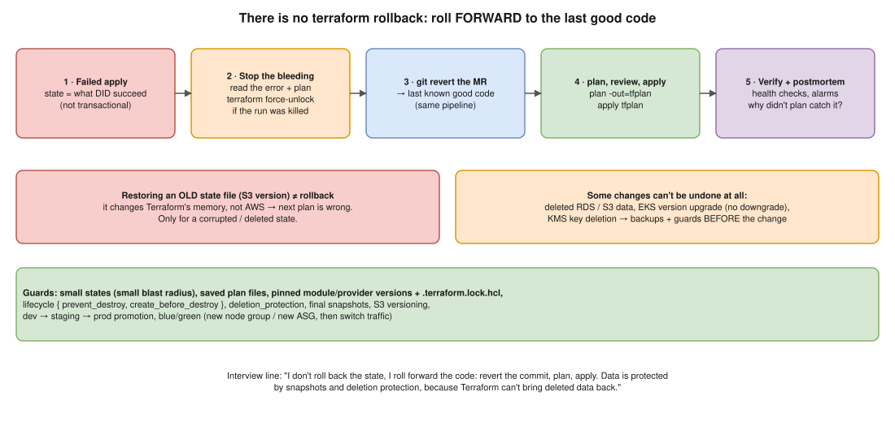

# 08 · Rolling Back After a Failed Deployment ⭐



> **Say this first:** "Terraform has no rollback command, and an apply isn't a transaction: if it fails half-way, the resources that were created stay created and are recorded in state. So I roll **forward**: fix or **`git revert`** the change, and run the same plan → review → apply pipeline to get back to the last known good configuration. I don't restore an old state file to roll back; that only changes Terraform's memory, not AWS. And because some things can't be undone at all, deleted data or an EKS version upgrade, safety comes before the apply: small states, saved plans, `prevent_destroy`, deletion protection, snapshots, and dev → staging → prod promotion."

## What a failed apply leaves behind

- Terraform applies resources in dependency order and **records each success in state as it goes**.
- If resource 7 of 10 fails, resources 1–6 exist and are in state; 7 may be partially created (then **tainted**); 8–10 weren't attempted.
- So: **re-run `plan` first** to see the real situation before doing anything else.
- If the job was **killed** (not just failed), the state lock may still be held → `terraform force-unlock <ID>` after making sure nothing is running ([05](05-remote-backend.md)).

## The roll-forward procedure

1. **Stabilise.** Read the error. Is prod broken or just the deploy? If users are affected, act on the app/traffic side first (shift traffic, scale up the old node group).
2. **`terraform plan`** with the current code to see what's done and what's left.
3. Decide:
   - **Small fix** (typo, wrong value, missing IAM permission): fix forward in a new MR, plan, apply.
   - **Change was wrong**: **`git revert <merge-commit>`** → MR → the pipeline plans the old configuration → review → apply. Terraform calculates how to get from the current reality back to the old code.
4. **Apply the saved plan**: `terraform plan -out=tfplan` then `terraform apply tfplan`, so what runs is exactly what was reviewed.
5. **Verify** (health checks, alarms, `kubectl get nodes`), then a **postmortem**: why did plan/review/staging not catch it?

```bash
git revert -m 1 <merge_commit_sha>      # -m 1 for a merge commit
git push origin revert-eks-change       # open an MR; pipeline shows the plan
# after review, in the pipeline:
terraform plan -out=tfplan
terraform apply tfplan
```

## Why NOT restore an old state file

S3 versioning lets you restore an older `terraform.tfstate`. That does **not** roll back infrastructure:

- The real resources stay exactly as they are.
- Terraform now has a **wrong picture**: resources created by the failed apply exist in AWS but not in state (orphans, possible duplicates / name clashes), and changed attributes show as drift.
- The next apply can create duplicates or fail.

Restoring state is only for **state problems**: a corrupted state, a bad `terraform state rm`, a deleted state object. Then: stop all pipelines, restore the previous version (or `terraform state push backup.tfstate`), and `plan` to confirm it matches reality.

## Things you can't roll back

| Change | Why you can't undo it | Guard |
|---|---|---|
| Deleting an RDS instance / S3 bucket / EBS volume | The data is gone | `deletion_protection = true`, `skip_final_snapshot = false` + `final_snapshot_identifier`, `prevent_destroy`, S3 versioning, AWS Backup |
| **EKS control plane upgrade** (e.g., 1.32 → 1.33) | EKS doesn't support downgrades | Upgrade dev/staging first, check deprecated APIs, add-on compatibility, then prod |
| KMS key deletion | Data encrypted with it is unreadable after the waiting period | `deletion_window_in_days = 30`, cancel deletion in time |
| Replacing a resource with a fixed identity (new EIP, new LB DNS name) | The old ID/IP is gone | `create_before_destroy`, stable DNS names in front |
| RDS major engine version upgrade | No in-place downgrade | Snapshot before, test restore |

## Guards that make rollback rarely needed

```hcl
resource "aws_db_instance" "app" {
  # ...
  deletion_protection       = true
  skip_final_snapshot       = false
  final_snapshot_identifier = "app-prod-final"
  backup_retention_period   = 14

  lifecycle {
    prevent_destroy = true # plan errors out if anything tries to destroy it
  }
}

resource "aws_launch_template" "web" {
  # ...
  lifecycle {
    create_before_destroy = true # new one first, then delete the old one
  }
}
```

- **Small states** = small blast radius ([05](05-remote-backend.md)).
- **Pin versions**: `required_version`, provider `version = "~> 5.80"`, module `?ref=v1.4.0`, and commit **`.terraform.lock.hcl`**, so the code you revert to behaves the same as before (a revert with floating versions can bring in a new provider).
- **Saved plans** in CI; never `apply -auto-approve` against prod without a reviewed plan.
- **Read the plan for `-/+` (replace) and `-` (destroy)**; some teams fail the pipeline if prod plans contain destroys without an approval label.
- **Promotion**: dev → staging → prod with the same module version.
- **Blue/green for risky changes**: e.g., a new EKS node group (new AMI / instance type), cordon and drain the old one, delete it only when the new one is healthy. Rolling back = move workloads back to the old group.
- **`-target`** only for emergencies (it skips dependencies and leaves partial state); always follow with a full plan.

## Real-world example (adapt it to what you really did)

An MR changed the launch template of an EKS node group (new AMI). The apply replaced the node group and the new nodes failed to join (a bootstrap problem in the AMI). Workloads were still on the old nodes because we used a **new node group** instead of an in-place change, so users weren't affected. Rollback = `git revert` the MR, pipeline plan showed the new node group being removed, apply. Then we fixed the AMI and tested it in dev first. The guard that would have caught it earlier: the same change in staging a day before.

## Interview angle

**Q: How do you roll back a Terraform change?**
`git revert` the change and apply the previous configuration through the normal pipeline (roll forward). Terraform has no rollback, and applies aren't transactional.

**Q: Why not just restore yesterday's state file?**
It changes Terraform's records, not AWS. You'd get orphans and drift. State restore is only for corrupted/lost state.

**Q: An apply failed half-way. What's your first command?**
`terraform plan` (after `force-unlock` if the job was killed) to see what actually exists now.

**Q: How do you protect the database during Terraform changes?**
`deletion_protection`, `prevent_destroy`, final snapshots, automated backups, and reviewing every plan for replace/destroy on stateful resources.
