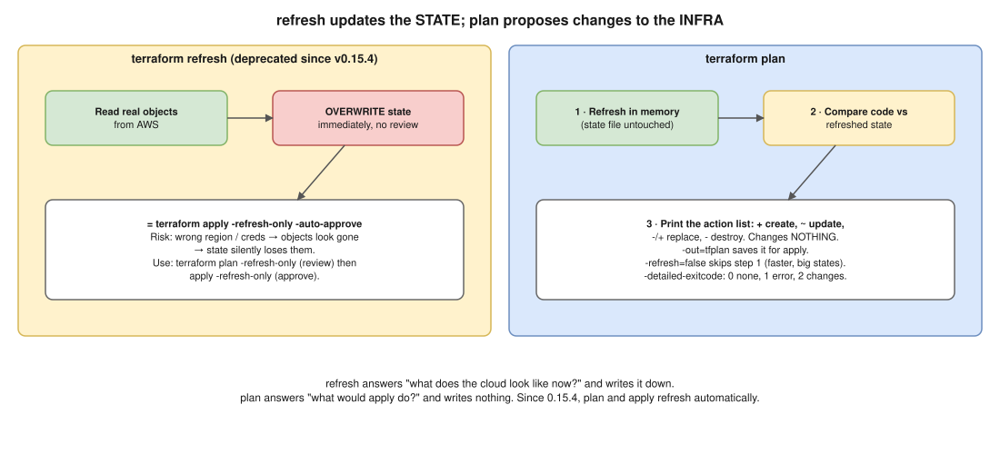

# 09 · `terraform refresh` vs `terraform plan`



> **Say this first:** "`terraform refresh` reads the real resources and **updates the state file** to match them; it never changes infrastructure or code. `terraform plan` refreshes **in memory**, compares the code with that refreshed state, and **shows** what apply would create, change or destroy; it writes nothing. Standalone `refresh` is deprecated since v0.15.4 because it overwrites state with no review: with wrong credentials or region, resources can look deleted and silently drop out of state. Today I use `terraform plan -refresh-only` to review drift and `terraform apply -refresh-only` to accept it."

## Side by side

| | `terraform refresh` ⚠️ | `terraform plan` |
|---|---|---|
| **Reads real infra** | Yes | Yes (unless `-refresh=false`) |
| **Compares with code** | No | Yes |
| **Writes state** | **Yes, immediately** | No |
| **Changes infra** | No | No |
| **Shows a review** | No | Yes: `+` create, `~` update, `-/+` replace, `-` destroy |
| **Output used for** | Updating state after out-of-band changes | Review in an MR; input to `apply` (`-out=tfplan`) |
| **Status** | Deprecated (v0.15.4); alias for `apply -refresh-only -auto-approve` | Core command |
| **Modern replacement** | `plan -refresh-only` → `apply -refresh-only` | |

## `terraform refresh`

What it does (tested 🧪, it still works in 1.13):

```bash
$ terraform refresh
terraform_data.c[2]: Refreshing state... [id=a872815a-c879-f46b-58a3-e04994b7278a]
terraform_data.c[0]: Refreshing state... [id=609d0442-35d2-fc91-12a9-be5e4a0d6b77]
terraform_data.c[1]: Refreshing state... [id=f356d6b4-4cb3-76bd-68e2-4c4ab5573c24]
...
```

- For each resource in state: call the provider's read (e.g., `DescribeInstances`), and write the current attributes into the state.
- Doesn't look at your `.tf` changes at all, and doesn't find resources that aren't in state.

**Why it was deprecated:** it writes state **without showing you anything first**. HashiCorp's example: if the provider is misconfigured (wrong account credentials, wrong region), every resource "doesn't exist", and refresh removes them all from state. The next plan then wants to **create everything again**.

## The modern way: `-refresh-only`

```bash
terraform plan -refresh-only      # review: "Objects have changed outside of Terraform" + the diff
terraform apply -refresh-only     # accept: asks for confirmation, then updates state only
```

No changes case (tested 🧪):

```bash
$ terraform plan -refresh-only
No changes. Your infrastructure still matches the configuration.

Terraform has checked that the real remote objects still match the result of
your most recent changes, and found no differences.
```

Use it when someone changed infrastructure outside Terraform and you want state to reflect it (then update the code too, see [04](04-drift-detection.md)), or after recovering a state file to see how far it is from reality.

## `terraform plan`

```bash
terraform plan                          # refresh in memory + compare + show actions
terraform plan -out=tfplan              # save the plan; apply tfplan applies exactly this
terraform show tfplan                   # read a saved plan (-json for tools like OPA / infracost)
terraform plan -refresh=false           # skip the refresh: faster on big states, but may miss drift
terraform plan -detailed-exitcode       # 0 = no changes, 1 = error, 2 = changes (tested)
terraform plan -target=module.eks       # only part of the graph (emergencies only)
terraform plan -replace=aws_instance.web    # plan a forced replacement (see 01)
terraform plan -destroy                 # what terraform destroy would do
terraform plan -var-file=prod.tfvars
```

How `plan` works:
1. **Refresh** every resource in state (in memory only).
2. **Compare** the configuration with the refreshed state.
3. **Print** the action list. Since 0.15.4 it also prints drift it noticed during refresh ("Note: Objects have changed outside of Terraform").

A real plan line (tested 🧪, from [03](03-count-vs-for-each.md)):

```text
  # terraform_data.c[1] will be updated in-place
      ~ input  = "bob" -> "carol"
Plan: 0 to add, 1 to change, 2 to destroy.
```

## What `apply` does, for completeness

`terraform apply` = (plan, or a saved plan) → confirm → make the API calls → **write the new state**. With a saved plan (`apply tfplan`) it won't ask again, and it fails if the state changed since the plan was made ("Saved plan is stale"), which protects you from applying an outdated plan.

## Real-world example (adapt it to what you really did)

In CI, every MR runs `terraform plan -out=tfplan` and posts the summary; `apply tfplan` on merge applies exactly what was reviewed. The scheduled drift job uses `plan -refresh-only -detailed-exitcode`. On very large states, MR pipelines sometimes use `-refresh=false` for speed, but the scheduled drift job always refreshes. I never run a bare `terraform refresh` on a shared state.

## Interview angle

**Q: Does `terraform plan` modify the state?**
No. It refreshes in memory only. `apply` (including `apply -refresh-only`) and the deprecated `refresh` write state.

**Q: Why is `terraform refresh` deprecated?**
It overwrites state without review; a misconfigured provider can make resources disappear from state. Use `plan -refresh-only` then `apply -refresh-only`.

**Q: When would you use `-refresh=false`?**
On huge states to speed up plans when I know nothing changed outside Terraform, or when a provider read is failing. Not for drift checks.

**Q: What's the benefit of `plan -out`?**
The apply runs exactly the reviewed plan, and Terraform refuses it if the state changed in between.
