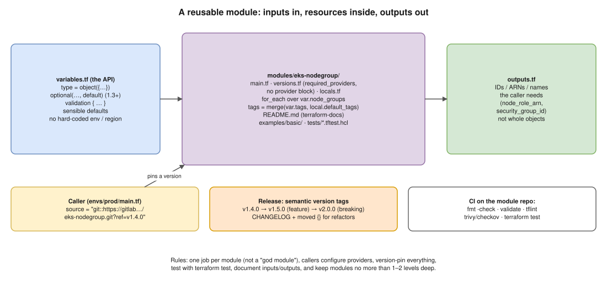

# 10 · Writing Reusable Modules ⭐



> **Say this first:** "A module is just a folder of `.tf` files with **inputs** (variables), **resources**, and **outputs**; I treat it like an API. To make it reusable I keep it focused on one job, give every input a type, a description, validation and sensible defaults, hard-code nothing environment-specific, output only the IDs callers need, and leave the provider configuration to the caller. Then I version it with semantic git tags, document it with terraform-docs, test it with `terraform test` and tflint in CI, and callers pin a version like `?ref=v1.4.0`, so a change to the module never reaches prod until someone bumps the tag."

## Standard layout

```text
terraform-aws-eks-nodegroup/
├── main.tf            # the resources
├── variables.tf       # inputs: type, description, default, validation
├── outputs.tf         # what callers can use
├── versions.tf        # required_version + required_providers (NO provider block)
├── locals.tf          # derived values, default tags
├── README.md          # generated inputs/outputs table (terraform-docs) + usage example
├── CHANGELOG.md
├── examples/
│   └── basic/main.tf  # a working caller; also used by tests
└── tests/
    └── defaults.tftest.hcl
```

## 1. Inputs: design them like an API *(illustrative)*

```hcl
variable "cluster_name" {
  description = "EKS cluster the node groups join."
  type        = string
}

variable "node_groups" {
  description = "Node groups to create, keyed by name."
  type = map(object({
    instance_types = list(string)
    min_size       = number
    max_size       = number
    capacity_type  = optional(string, "ON_DEMAND") # optional() with default: 1.3+
    labels         = optional(map(string), {})
    disk_size      = optional(number, 50)
  }))

  validation {
    condition     = alltrue([for ng in values(var.node_groups) : ng.min_size <= ng.max_size])
    error_message = "Each node group needs min_size <= max_size."
  }
  validation {
    condition     = alltrue([for ng in values(var.node_groups) : contains(["ON_DEMAND", "SPOT"], ng.capacity_type)])
    error_message = "capacity_type must be ON_DEMAND or SPOT."
  }
}

variable "tags" {
  description = "Extra tags added to every resource."
  type        = map(string)
  default     = {}
}
```

Rules:
- **Every variable has a `type` and a `description`.** Objects with `optional()` keep the interface small but flexible.
- **Defaults for the common case**; required only for what truly differs (names, IDs, sizes).
- **Validation** catches mistakes at plan time, with a clear message.
- **No hard-coded** account IDs, regions, environment names, CIDRs or AMI IDs.
- `sensitive = true` on secret inputs ([02](02-secrets.md)); `nullable = false` where null makes no sense.

## 2. Resources: one job, generic inside

```hcl
locals {
  default_tags = { "terraform-module" = "eks-nodegroup" }
}

resource "aws_eks_node_group" "this" {
  for_each        = var.node_groups # for_each, not count (see 03)
  cluster_name    = var.cluster_name
  node_group_name = each.key
  node_role_arn   = aws_iam_role.node.arn
  subnet_ids      = var.subnet_ids
  instance_types  = each.value.instance_types
  capacity_type   = each.value.capacity_type
  disk_size       = each.value.disk_size
  labels          = each.value.labels

  scaling_config {
    min_size     = each.value.min_size
    max_size     = each.value.max_size
    desired_size = each.value.min_size
  }

  tags = merge(local.default_tags, var.tags)

  lifecycle {
    ignore_changes = [scaling_config[0].desired_size] # autoscaler owns it (see 04)
  }
}
```

- **One responsibility per module** (VPC, EKS node groups, RDS…). Avoid a "god module" that builds a whole environment with 200 inputs; compose small modules in the env root instead ([06](06-multiple-environments.md)).
- Name the main resource **`this`** when there's one of it (common convention).
- Keep nesting shallow (root → module → maybe one sub-module).

## 3. Outputs: what callers need

```hcl
output "node_role_arn" {
  description = "IAM role ARN used by the nodes (add it to aws-auth / access entries)."
  value       = aws_iam_role.node.arn
}

output "node_group_names" {
  description = "Map of node group key => EKS node group name."
  value       = { for k, ng in aws_eks_node_group.this : k => ng.node_group_name }
}
```

Output IDs/ARNs/names, with descriptions. Avoid outputting whole resource objects (large, leaks internals, makes refactoring a breaking change).

## 4. Providers: the caller configures them

```hcl
# versions.tf (in the module)
terraform {
  required_version = ">= 1.5"
  required_providers {
    aws = {
      source  = "hashicorp/aws"
      version = ">= 5.0" # a minimum in modules; the ROOT pins the exact range + lock file
    }
  }
}
```

- **No `provider "aws" {}` block inside a reusable module**: it makes the module impossible to use with `for_each`/`count`/`depends_on` and ties it to one region/account.
- Multi-region / multi-account: the caller passes aliased providers:

```hcl
module "replica_bucket" {
  source    = "./modules/s3-bucket"
  providers = { aws = aws.dr_region }
}
```

## 5. Calling a module: sources and versions

```hcl
module "nodegroups" {
  source = "git::https://gitlab.com/acme/terraform-modules/eks-nodegroup.git?ref=v1.4.0"

  cluster_name = module.eks.cluster_name
  subnet_ids   = module.vpc.private_subnet_ids
  node_groups = {
    general = { instance_types = ["m6i.large"], min_size = 2, max_size = 6 }
  }
  tags = { Environment = "prod" }
}
```

| Source | Example | Versioning |
|---|---|---|
| Local path | `source = "../../modules/vpc"` | Same commit as the caller (monorepo) |
| Git | `git::https://gitlab.com/acme/mods/vpc.git?ref=v1.4.0` (or `//subdir?ref=`) | Git tag in `ref` |
| Public registry | `source = "terraform-aws-modules/eks/aws"` + `version = "~> 21.0"` | `version` argument |
| Private registry | GitLab Terraform module registry, HCP Terraform | `version` argument |

After changing a source or version: `terraform init -upgrade` (or `terraform get -update`).

**Don't reinvent**: for VPC/EKS, the community `terraform-aws-modules` are battle-tested; wrap them in a thin company module with your defaults if needed.

## 6. Version and release like software

- **Semantic versioning** with git tags: `v1.4.0 → v1.5.0` new optional input (backward compatible), `v1.4.1` bug fix, **`v2.0.0` breaking** (renamed variable, removed output, resource replaced).
- **CHANGELOG** with upgrade notes for breaking changes.
- **Refactor without destroying** using `moved` blocks inside the module (e.g., renaming `aws_iam_role.node` → `aws_iam_role.this`). Callers get the move automatically on upgrade (tested pattern in [03](03-count-vs-for-each.md)).
- Callers **pin** a version and upgrade deliberately (dev → staging → prod).

## 7. Test and lint in CI

**`terraform test`** (1.6+): `.tftest.hcl` files with `run` blocks and assertions. A tiny module tested for real 🧪:

```hcl
# modules/bucket_names/variables.tf
variable "env" {
  type = string
  validation {
    condition     = contains(["dev", "staging", "prod"], var.env)
    error_message = "env must be dev, staging or prod."
  }
}
```

```hcl
# modules/bucket_names/main.tf
resource "terraform_data" "name" {
  input = "acme-${var.env}-logs"
}
output "name" { value = terraform_data.name.output }
```

```hcl
# modules/bucket_names/tests/naming.tftest.hcl
variables {
  env = "dev"
}

run "name_has_env" {
  command = apply
  assert {
    condition     = output.name == "acme-dev-logs"
    error_message = "wrong bucket name"
  }
}

run "rejects_bad_env" {
  command = plan
  variables {
    env = "qa"
  }
  expect_failures = [var.env]
}
```

```bash
$ terraform test
tests/naming.tftest.hcl... in progress
  run "name_has_env"... pass
  run "rejects_bad_env"... pass
tests/naming.tftest.hcl... tearing down
tests/naming.tftest.hcl... pass

Success! 2 passed, 0 failed.
```

And the validation message a caller sees (tested 🧪):

```text
Error: Invalid value for variable

  on main.tf line 4, in module "logs":
   4:   env    = var.env
    ├────────────────
    │ var.env is "qa"

env must be dev, staging or prod.
```

- `command = plan` tests are free and fast; `command = apply` creates real resources (in a sandbox account) and destroys them at the end. **Mock providers** (`mock_provider "aws" {}`, 1.7+) let you test without AWS.
- (`expect_failures = [var.env]` only works when the test runs **in the module's own folder**, where `var.env` is that module's variable.)

Module CI pipeline:

```bash
terraform fmt -check -recursive
terraform init -backend=false && terraform validate
tflint --recursive                 # provider-aware lint (invalid instance types, deprecated args)
trivy config .                     # or checkov: security misconfigurations
terraform test
terraform-docs markdown table --output-file README.md .   # keep the README in sync
```

## Checklist: is this module reusable?

- [ ] One clear job; works in dev and prod with only input changes
- [ ] Every variable typed + described; validation on risky ones; sane defaults
- [ ] No hard-coded env/account/region; no provider block
- [ ] `for_each` with stable keys for collections
- [ ] Minimal, described outputs
- [ ] `versions.tf` with minimum versions
- [ ] README + example + tests; CI runs fmt/validate/tflint/trivy/test
- [ ] Semantic version tags; `moved` blocks for refactors; CHANGELOG

## Real-world example (adapt it to what you really did)

At work we had near-identical EKS node group code copy-pasted in three env folders, and they drifted apart (different disk sizes, missing labels). I pulled it into one `eks-nodegroup` module with a `node_groups` map input (`for_each`), `optional()` defaults, and an `ignore_changes` on `desired_size`. Used `moved` blocks so the existing node groups moved into the module **without being recreated** (the plan showed only moves), tagged it `v1.0.0`, and rolled it out dev → staging → prod by changing each env's `source` ref.

## Interview angle

**Q: Should a module contain a provider block?**
No. Declare `required_providers` with a minimum version; the root configures providers and passes aliases via `providers = {}`.

**Q: How do you stop a module change breaking prod?**
Callers pin `?ref=vX.Y.Z` (or `version`), semantic versioning, CHANGELOG, tests in the module's CI, and promotion dev → staging → prod.

**Q: You renamed a resource inside a module. How do you avoid destroying it for every caller?**
Add a `moved { from = ... to = ... }` block in the module; callers' plans show a move, not destroy/create.

**Q: How do you test modules?**
`terraform test` (plan-only and apply-in-sandbox runs, mock providers), plus fmt, validate, tflint and trivy/checkov in CI.
