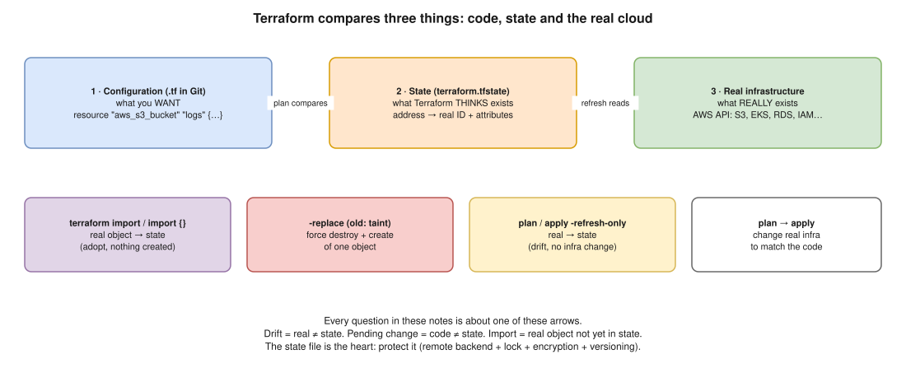

# 🏗️ Terraform Notes: Interview Edition

The 10 Terraform questions that come up most in DevOps / SRE interviews, answered in the same format as the [Helm](../helm-chart/README.md), [Docker](../docker/README.md) and [Kubernetes](../kubernetes/README.md) notes. Terraform is on your resume (One2N, Koko Networks, Perfios: AWS, EKS, GitLab CI), so expect at least one of these, usually with a "how did you do it at work?" follow-up.

The 🧪 outputs were **run for real** with **Terraform v1.13.4** on 11 Nov 2026, using the built-in `terraform_data` resource (no cloud account needed). Everything AWS-specific is marked *(illustrative)*: it's the real syntax, but it wasn't applied against an AWS account for these notes.

## How to use these notes

- Read one file at a time, then answer its **Interview angle** questions **out loud**.
- ⭐ = very likely interview topic · 🧪 = tested, real output · ⚠️ = deprecated command, say so in the interview
- **15 minutes before the interview:** read the "Say this first" box at the top of each file.
- **Real-world example** sections are **suggested stories** built from the tools on your resume (AWS, EKS, GitLab CI, S3 state). Only tell the parts that match what you really did, and swap in your own details.

## The one idea: code, state, real world



Terraform always compares **three** things:

1. **Configuration**: the `.tf` files in Git (what you **want**).
2. **State**: `terraform.tfstate` (what Terraform **thinks** exists: resource address → real ID + attributes).
3. **Real infrastructure**: what the AWS API says **really** exists.

Almost every interview question is about one of the arrows between them:

| Question | Which arrow |
|---|---|
| import vs taint | real → state (import) · force rebuild of one object (taint / `-replace`) |
| Drift detection | real ≠ state |
| refresh vs plan | refresh writes real → state · plan compares code → state |
| Remote backend | where the state lives and who can write it |
| Rollback | putting the **code** back, not the state |

## Contents

| # | File | Question |
|---|---|---|
| 01 ⭐ | [import vs taint](01-import-vs-taint.md) | What is the difference between `terraform import` and `terraform taint`? ⚠️ |
| 02 ⭐ | [Secrets](02-secrets.md) | How do you manage secrets in Terraform without hardcoding them? 🧪 |
| 03 ⭐ | [count vs for_each](03-count-vs-for-each.md) | What's the difference between `count` and `for_each`? Real-world use case. 🧪 |
| 04 ⭐ | [Drift detection](04-drift-detection.md) | How do you handle drift detection in Terraform? 🧪 |
| 05 ⭐ | [Remote backend](05-remote-backend.md) | What is a remote backend, and why is it important? |
| 06 ⭐ | [Multiple environments](06-multiple-environments.md) | How do you manage dev, staging and prod? |
| 07 | [local-exec vs remote-exec](07-local-exec-vs-remote-exec.md) | Difference between the two provisioners. |
| 08 ⭐ | [Rollback](08-rollback.md) | How do you safely roll back after a failed deployment? |
| 09 | [refresh vs plan](09-refresh-vs-plan.md) | Explain `terraform refresh` vs `terraform plan`. ⚠️ 🧪 |
| 10 ⭐ | [Reusable modules](10-reusable-modules.md) | How do you write reusable Terraform modules? 🧪 |

## Two deprecations to mention without being asked

| Old | New | Since |
|---|---|---|
| `terraform taint ADDR` | `terraform apply -replace="ADDR"` | v0.15.2 |
| `terraform refresh` | `terraform plan -refresh-only` then `terraform apply -refresh-only` | v0.15.4 |

Both old commands **still work** in 1.13 (tested 🧪), but saying "that's deprecated, today I'd use…" shows you use a current Terraform.

## Diagrams

The diagrams are in [diagrams/](diagrams/) as editable **`.drawio.svg`** files; open one in VS Code (Draw.io Integration) or [app.diagrams.net](https://app.diagrams.net) to edit it. They are generated once by [`tools/diagrams_terraform.py`](../../tools/diagrams_terraform.py), which skips files that already exist.

**To draw on a whiteboard:** the three worlds (above), count vs for_each (03) and the remote backend (05).

## Try it yourself (no AWS account) 🖥️

Every 🧪 here used `terraform_data`, a resource built into Terraform 1.4+, so `terraform init` downloads nothing:

```bash
mkdir tflab && cd tflab
cat > main.tf <<'HCL'
variable "names" {
  type    = list(string)
  default = ["alice", "bob", "carol"]
}
resource "terraform_data" "c" {
  count = length(var.names)
  input = var.names[count.index]
}
resource "terraform_data" "f" {
  for_each = toset(var.names)
  input    = each.value
}
HCL
terraform init && terraform apply -auto-approve
terraform plan -var 'names=["alice","carol"]'   # see 03: count shifts, for_each doesn't
```

## Related files

- [Kubernetes 21: Helm, Kustomize and GitOps](../kubernetes/21-helm-kustomize-gitops.md): how the EKS side is deployed after Terraform builds the cluster.
- [Helm 04: the drift scenario](../helm-chart/04-drift-scenario.md): the same "someone changed it by hand" question, for Helm.
